# Frozen release boundary review

**29/29 native integration checks pass** in mGBA on the frozen release3 ROM.
The checks complement the earned Forest critical-path, Cream boss, handoff,
and full music reviews; this is a focused integration proof, not a claim that
all game behavior has been exhaustively tested.

- ROM SHA256: `b348cf4d628aee1abb9b71d8885a9f04094332c5252490ff2dd8f8e7cd0bf1b8`
- Source commit: `0b9344d781e65e304d245bd9ae4aecdbc7056837`
- Harness SHA256: `95a962ed3d173f82992589529fdf564cc36a1b6ec932807e38ff0036b4f4766c`
- [Complete machine-readable report and traces](report.json)
- [Reusable harness](../../../tools/release_boundary_review.py)

## Entrances and returns

Actual loaded Sewer geometry gives a dry 396px route from the ordinary
`(200,270)` spawn to the Cream approach `(456,130)`, and a dry 220px route to
the Annex approach `(280,130)`. A 4px-grid BFS reads the native Room collision
and ROM metatile types, applies Bloom's 10×8 feet box, excludes water, pits and
harmful floor, and includes the arcade cabinet's collision. Moving NPCs are
not modeled in this static reachability proof.

After navigation-only positioning, real A presses enter Cream at its visible
entry stairs `(400,350)` and return to the matching Sewer arch `(456,130)`.
Real A enters the Annex; a real downward walk through its bottom opening
returns to its own Sewer arch `(280,130)`.

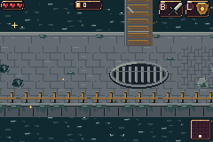
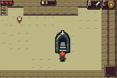
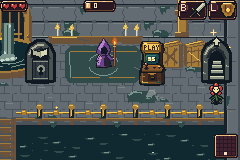
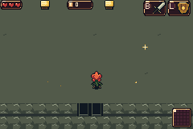
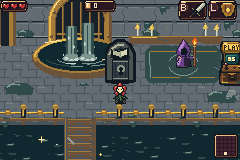

## Original three mandatory Forest trials

Each negative control starts a fresh run with full original and added legacy
inventory, but no earned Forest trial prizes or wins. The normal transition
request is used solely to load each actual generated critical-gate room.
Actual charged bomb release, Grail Lamp use, and directional cape jump all
activate their native mechanics. The cracked wall, web and cape cut each
remain blocked, with native trial-seal dialogue. Gate tiles, all world open
bits, trial prize bits and mystery flags remain unchanged.

This tests full-inventory access against unearned trials; it does not replace
the separate earned-reward positive control.

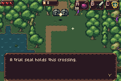
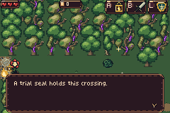
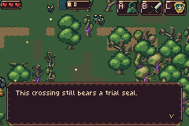

## Original music through menus

Real Start → original pause → Select Satchel → R atlas → A room zoom → Start
return preserves the original soundtrack. The sample count advances by about
16,458 samples per 30 physical frames during every screen, DMA1 and sample
timers remain enabled, and the original `gVBlankHook` is restored on return.
The old pause and Satchel's saved hooks both point to the original music
hook. The Annex Inn modal likewise keeps music running and preserves the
hook after real B dismissal. The DMA-offset diagnostic is recorded as a PCM
block base; it can correctly remain unchanged during these short spans.

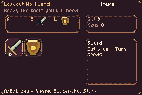
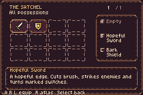
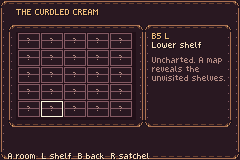
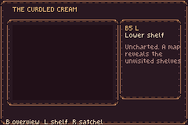
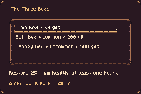

## Fixture boundaries and reproduction

All images are unmodified 240×160 framebuffers from real mGBA runs. There
are no framebuffer, audio, terrain, collision, enemy HP/state, gate, quest or
completion writes. Explicit fixtures are the deterministic title seed,
player position/facing/safe standing point, pending normal room transitions,
and the full-inventory negative control. Generic Actor HP is unused for the
player; `player_health` in the report reads the actual PlayerState health.
Each core has fresh private SRAM via a private ROM path.

```sh
source /workspace/setup/activate.sh
python3 tools/release_boundary_review.py \
  --bundle /workspace/setup/curdled-cream/release3 \
  --out /tmp/bartgame-release-boundary
```

The bundle must contain matching `bartgame.gba`, `bartgame.map` and
`source-commit.txt`. The harness never rebuilds or modifies the bundle.
