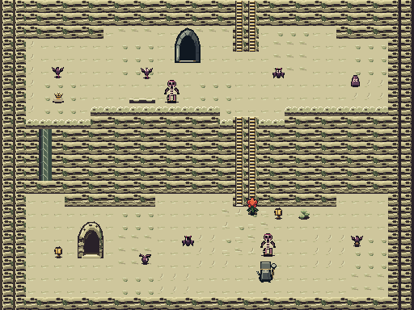
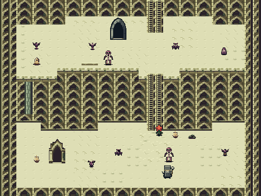
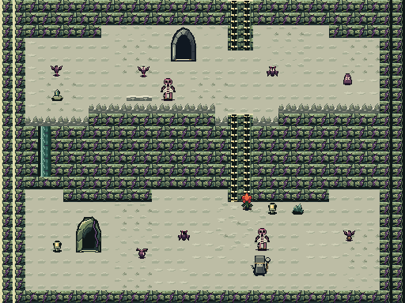
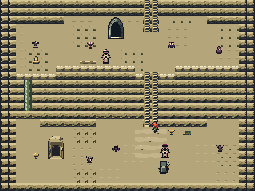
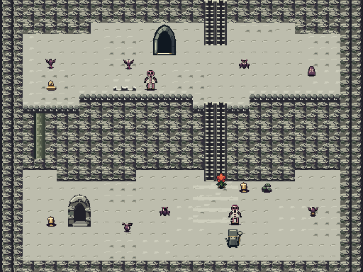

# Five new Curdled Cream art directions

Five complete **unselected environment alternatives**, authored at native GBA
sizes and rendered by the actual game in mGBA. They redraw all142 Cream
metatiles and their148 frames, plus the Cream-only return portal. Bloom, NPCs,
enemies, HUD, original music and the other regions keep their current art.

[Download all five playable ROMs](https://raw.githubusercontent.com/natertott/bartgame/cream-art-studies/downloads/cream-art-studies-4966dab4/five-cream-art-studies.zip) · [Individual ROMs/checksums](../downloads/cream-art-studies-4966dab4/README.md) · [Scope and art notes](../bartgame/docs/curdled-cream/ART_STUDIES.md)

The pictures below show the **same sour room18**, with identical content,
collision and routes. Each512×384 image is a literal mosaic of nine registered
240×160 mGBA camera frames: the scene is frozen and HUD hidden for that room
survey. These are labelled renderer views, not single GBA frames or live
playthrough screenshots. The **live-climb links** use separate fresh cores,
normal HUD and actual advancing simulation/input, with positive player health.
No high-resolution artwork is reduced into a game tile.

## 1. Curdstone Karst

Rounded ivory shelves, erosion cups and dark wet undersides. The most natural limestone/curd direction.

[Healthy room](images/01-curdstone-karst-healthy-room.png) · [Deep corruption](images/01-curdstone-karst-deep-room.png) · [Live climb](images/01-curdstone-karst-sour-climb.gif) · [Native live frame](images/01-curdstone-karst-sour-climbing.png) · [Complete source tile atlas](source/curdstone-karst/terrain-source.png) · [Playable ROM](https://raw.githubusercontent.com/natertott/bartgame/cream-art-studies/downloads/cream-art-studies-4966dab4/01-curdstone-karst-4966dab4.gba)

## 2. Brine Basilica

Ruined pointed bays and buttresses. The most architectural and ornate option; its repetition is deliberately more formal.

[Healthy room](images/02-brine-basilica-healthy-room.png) · [Deep corruption](images/02-brine-basilica-deep-room.png) · [Live climb](images/02-brine-basilica-sour-climb.gif) · [Native live frame](images/02-brine-basilica-sour-climbing.png) · [Complete source tile atlas](source/brine-basilica/terrain-source.png) · [Playable ROM](https://raw.githubusercontent.com/natertott/bartgame/cream-art-studies/downloads/cream-art-studies-4966dab4/02-brine-basilica-4966dab4.gba)

## 3. Moldglass Crags

Olive/teal mineral facets over dark cavities. Strong material contrast, with the busiest deep-purple fractures.

[Healthy room](images/03-moldglass-crags-healthy-room.png) · [Deep corruption](images/03-moldglass-crags-deep-room.png) · [Live climb](images/03-moldglass-crags-sour-climb.gif) · [Native live frame](images/03-moldglass-crags-sour-climbing.png) · [Complete source tile atlas](source/moldglass-crags/terrain-source.png) · [Playable ROM](https://raw.githubusercontent.com/natertott/bartgame/cream-art-studies/downloads/cream-art-studies-4966dab4/03-moldglass-crags-4966dab4.gba)

## 4. Gilt Quarry

Broad cut stone, deep shadow courses and brass fixtures. The clearest hierarchy between walking ground, cliff and climbing grips.

[Healthy room](images/04-gilt-quarry-healthy-room.png) · [Deep corruption](images/04-gilt-quarry-deep-room.png) · [Live climb](images/04-gilt-quarry-sour-climb.gif) · [Native live frame](images/04-gilt-quarry-sour-climbing.png) · [Complete source tile atlas](source/gilt-quarry/terrain-source.png) · [Playable ROM](https://raw.githubusercontent.com/natertott/bartgame/cream-art-studies/downloads/cream-art-studies-4966dab4/04-gilt-quarry-4966dab4.gba)

## 5. Black Rind Terraces

Unequal oyster-like shelves and wet rotten seams. The most organic and fungal option; its repeated fans remain visible.

[Healthy room](images/05-black-rind-terraces-healthy-room.png) · [Deep corruption](images/05-black-rind-terraces-deep-room.png) · [Live climb](images/05-black-rind-terraces-sour-climb.gif) · [Native live frame](images/05-black-rind-terraces-sour-climbing.png) · [Complete source tile atlas](source/black-rind-terraces/terrain-source.png) · [Playable ROM](https://raw.githubusercontent.com/natertott/bartgame/cream-art-studies/downloads/cream-art-studies-4966dab4/05-black-rind-terraces-4966dab4.gba)

## Readability changes shared by the studies

- Clear light-facing shelf lips, dark overhangs, recessed faces and cliff-foot
  shadows separate height levels.
- Regular pale/brass grips identify actual climbable strips. Irregular stone,
  facets and fungus never acquire decorative fake climbing marks.
- Raised blocked rims differ from open drop notches. Cave mouths and the
  return stairs have strong negative space and lit thresholds.
- Chests, switches, trial markers, supplies and magical wards use stronger
  silhouettes/value contrast than walking ground. Fractures, silk and thorns
  retain their tool meanings.
- Capability wards show luminous sigils, rather than falsely implying a small
  key. Opaque switches have complete stone plinths, and unlit lamps have dark
  interiors or extinguished wicks.
- Healthy, sour and deep states change structure as well as palette. Purple
  rot stays attached to cracks/growths while walking ground remains readable.

My strongest starting points are **1 for natural curdstone** and **4 for
navigation clarity**. All five still use repeated wall modules; the architectural
bays and fungal fans make that rhythm particularly obvious. If one is selected,
larger local variations and authored landmarks could interrupt those runs.
The shared blue-gray handoff entrances/actors are protected existing art, so
these are complete Cream terrain families rather than a redraw of every object
that can appear in a room.

## Native constraints and verification

Each study uses10 of12 available area BG banks and375–408 of1024 BG subtiles.
Indexed game pixels use16-color RGB555 banks and final-size16×16 cells,
32×48 cave compositions and32×32 chests. Room geometry and gameplay semantics
are unchanged; study-only placement pairs the complementary cliff halves so
full shelves/arches appear correctly.

Source `4966dab4132218b9d2692fbb62165a22c70f52c3`.
Normal `BART_CREAM=0` remains byte-for-byte identical to the published production
ROM (`0dd8554384b53e618140f8c61590fc7e6a7ff0888f296ece034a95f357b34fdd`).
Build a study with `make -C bartgame BART_CREAM=1` through `5`.

[Independent native asset audit](validation/native-audit.json):5983/5983 checks.
[Matched native capture comparison](validation/comparison.json):366/366 checks
across the control and five studies. Seed0xB4A7; healthy21, sour18, deep0.
The graph, feature coordinates, physical terrain types, solid grid, climb mask
and overlay occupancy match the production control. Real climbs retain exactly
135/119/151 input frames and128/112/144 climbing frames, with minimum health
32/30/30. No health, inventory, enemy, completion, terrain or video data is
assigned. Seed, ordinary load requests and hero navigation/facing are explicit
fixtures; this is an art/mechanic comparison, not an unassisted run.

The frozen survey uses the existing registered camera/clock hook; it does not
simulate movement or combat. Its crops are copied literally, and room/player
state is checked unchanged. Live footage has never enabled that hook.
[Capture methods](validation/CAPTURE_NOTES.md),
[independent critique](validation/INDEPENDENT_SOURCE_REVIEW.md),
[semantic checks](validation/semantic-checks.json) and
[per-file/build provenance](manifest.json) retain exact identities and limits.

These finite three-room samples do not establish every visual join in all
possible seeds. The prior region generation/playability proofs remain their own
qualification. No new default or shared nine-area palette is selected here.
