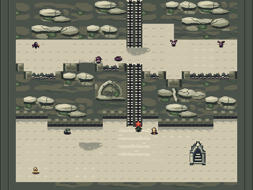
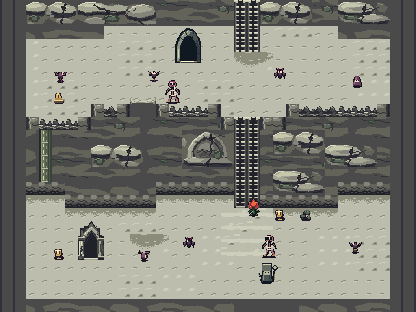
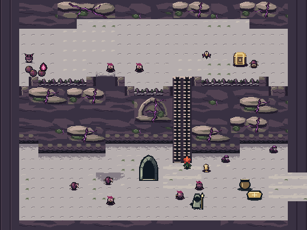
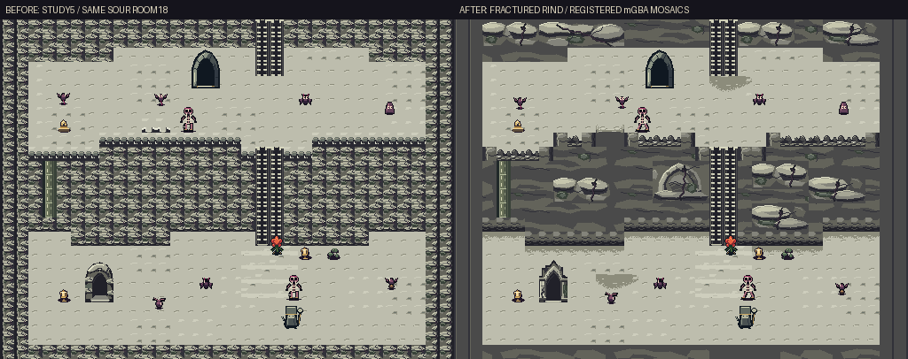
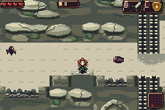

# Fractured Rind — Curdled Cream depth pass

A sixth study combining **2's contrast and arches**, **3/5's rock textures**,
and **5's exact palette**. Larger unequal rock formations sit over continuous
strata; dormant cracks widen into branching violet veins as corruption grows.
Raised blocked rims, open drop sills and actual landing shadows clarify height.

[Download ROM](https://raw.githubusercontent.com/natertott/bartgame/cream-art-studies/downloads/cream-depth-9747a925/fractured-rind-9747a925.gba) · [Download ZIP](https://raw.githubusercontent.com/natertott/bartgame/cream-art-studies/downloads/cream-depth-9747a925/fractured-rind-9747a925.zip) · [Build details](../bartgame/docs/curdled-cream/FRACTURED_RIND.md)

`BART_CREAM=6` selects this optional study. Production 0 and studies 1–5 remain
available; the default is unchanged. Bloom, enemies, NPCs, HUD and other
regions retain their current art.

## Generated rooms

**Registered renderer mosaics:** each 512×384 room assembles nine literal
240×160 mGBA camera frames with frozen simulation and hidden HUD. These show
the actual renderer, not a single GBA frame or live playthrough.

| Healthy | Sour | Deep corruption |
| --- | --- | --- |
|  |  |  |

The matched sour room compares study 5 on the left with study 6 on the right:

## Ordinary live movement

These clips use separate fresh mGBA cores, advancing simulation, normal HUD
and real button input. Local navigation/room-load fixtures select useful test
positions; health, inventory, gates, enemies, terrain and video are not
assigned. These are disclosed comparisons, not unassisted playthroughs.
The earned four-row proof uses the established progression harness, including
standing/height normalization at navigation waypoints; the isolated clips do
not assign action/height. [Capture fixtures and limits](validation/CAPTURE_NOTES.md)
record that distinction.

| Action | Live clip | Actual 240×160 frame |
| --- | --- | --- |
| Climb, healthy | [GIF](images/healthy-climb.gif) | [Frame](images/healthy-climbing.png) |
| Climb, sour | [GIF](images/sour-climb.gif) | [Frame](images/sour-climbing.png) |
| Climb, deep | [GIF](images/deep-climb.gif) | [Frame](images/deep-climbing.png) |
| Local ledge drop | [GIF](images/local-drop.gif) | [Takeoff](images/local-before.png) · [Landing](images/local-landed.png) |
| One-row drop | [GIF](images/one-row-drop.gif) | [Takeoff](images/one-row-before.png) · [Landing](images/one-row-landed.png) |
| Earned four-row drop | [GIF](images/four-row-drop.gif) | [Progression and landing proof](validation/earned-long.json) |

[Untouched takeoff and landing frames side by side](images/local-before-landed-pair.png).

Cliff-foot contact shade and the separate destination patch serve different
purposes. Landing patches come from the actual directed route's arrival,
including distant rooms. Compatible paths retain their pressed grain beneath
the shade; hazards, gates and objects keep their own drawings.

## Native construction and review

The generator measures usable solid wall after routes/content exist. Complete
32×32, 64×32, 96×32 and 64×48 paintings fit that space without clipping
features. A continuous 128×48 rock backing supplies the quieter gaps. Seeded,
staggered placement prevents identical panels touching, and keeps at least a
quarter of available midface free of foreground panel art. A sealed relief
arch differs from an actual open cave; neither adds a route or changes collision.

**Source art, not game captures:** [native wall atlas](source/native-source-atlas.png)
· [3× inspection](source/source-atlas-3x.png)
· [native backing](source/backing-source-native.png)
· [3× backing](source/backing-source-3x.png)
· [native edge/shadow kit](source/edge-source-native.png).
Game pixels are authored at final size in sixteen-color RGB555 banks. Only
inspection copies use nearest-neighbor enlargement.

The final rooms are calmer and more coherent than the dense repeated fans in
study 5. Broad planes now separate the bright panel groups instead of exposing
16px scallops or a regular repeated ivory seam. The finite panel kit still
reuses recognizable forms; pale overhangs can resemble small shelves, while
only the main terraces and marked routes are traversable. Violet stays local
to the rock rather than washing out the ground.

## Evidence and remaining limits

Source `9747a92526fe9162d93a1ed46b8a6b8292841bb4`; ROM SHA256
`2b8559c3cac89f483d3a34d48aa6eb5144a4fc2b3b7b265808b800672216a1b1`.
The study uses **861/1024 BG subtiles and 10/12 area banks**.

[Asset/geometry audit](validation/native-audit.json): **5221/5221 checks**,
including 3200 closed/open room builds across 64 seeds and exact existing
physical metadata. [Matched rooms/climbs](validation/matched-capture.json):
**61 checks**; [physical comparisons](validation/native-capture.json):
**38 checks**; [isolated drops](validation/isolated-drops.json): **26 checks**;
[earned four-row drop](validation/earned-long.json): **4 checks**. The
[independent visual review](validation/VISUAL_REVIEW.md) records their scopes.

**Loading tradeoff:** the tested one-row drop takes 70 physical frames versus
64 in the control: six extra VBlanks, about 0.10s, spent loading. Its 46 fall
simulation ticks are unchanged; the local fall retains 32 ticks and matched
climbs retain 135/119/151 input frames. No composition runs in the active frame
loop. Finite room/seed samples do not establish every possible join.

[Design notes](../bartgame/docs/curdled-cream/FRACTURED_RIND.md)
· [Actually viewed Mount Crenel reference](../bartgame/docs/curdled-cream/CRENEL_REFERENCE.md)
· [Previous five studies](../cream-art-review/README.md)
