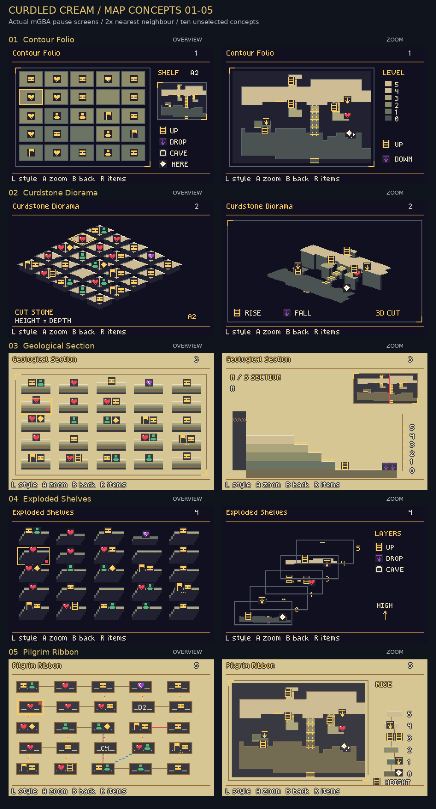
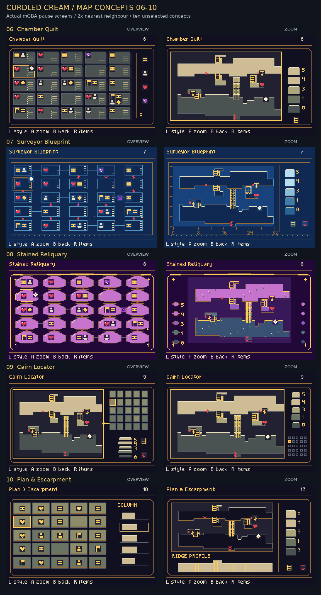
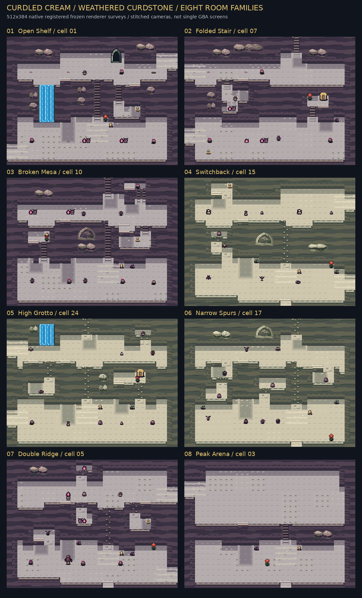
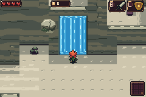

# The Curdled Cream: Weathered Heights

Weathered Curdstone now has continuous horizontal rock beds, carved stone climbs, projecting ledges, attached landing shadows and animated blue Whitewater Ribbons. The room generator builds eight terrain families with open shelves, narrow spurs, raised mesas, switchbacks and successive physical levels.

[Download the playable GBA ROM](../downloads/cream-weathered-heights-f4b917f7/bartgame-weathered-heights.gba) · [Download ZIP](../downloads/cream-weathered-heights-f4b917f7/weathered-heights.zip) · [Design notes](../bartgame/docs/art-reboot/CREAM_WEATHERED_HEIGHTS.md)

The ten map designs are review alternatives. All ten are implemented in this ROM and share the same actual terrain, feature locations and discovery state.

## Ten pause-map concepts

Left: regional overview. Right: room zoom. These are actual 240×160 mGBA pause screenshots, enlarged exactly 2× with labels outside the screenshots. The comparison visits all 25 rooms through ordinary room-load requests; the selected room is Double Ridge, cell5, seed0xb4a7, with actual floor heights 0, 1, 3, 4, 5. Separate [fresh-discovery captures](validation/maps-fresh) show the normal fog.

| # | Concept | Overview | Room zoom |
|---|---|---|---|
| 1 | Contour Folio | [Overview](images/maps/01-overview-3x.png) | [Room zoom](images/maps/01-zoom-3x.png) |
| 2 | Curdstone Diorama | [Overview](images/maps/02-overview-3x.png) | [Room zoom](images/maps/02-zoom-3x.png) |
| 3 | Geological Section | [Overview](images/maps/03-overview-3x.png) | [Room zoom](images/maps/03-zoom-3x.png) |
| 4 | Exploded Shelves | [Overview](images/maps/04-overview-3x.png) | [Room zoom](images/maps/04-zoom-3x.png) |
| 5 | Pilgrim Ribbon | [Overview](images/maps/05-overview-3x.png) | [Room zoom](images/maps/05-zoom-3x.png) |
| 6 | Chamber Quilt | [Overview](images/maps/06-overview-3x.png) | [Room zoom](images/maps/06-zoom-3x.png) |
| 7 | Surveyor Blueprint | [Overview](images/maps/07-overview-3x.png) | [Room zoom](images/maps/07-zoom-3x.png) |
| 8 | Stained Reliquary | [Overview](images/maps/08-overview-3x.png) | [Room zoom](images/maps/08-zoom-3x.png) |
| 9 | Cairn Locator | [Overview](images/maps/09-overview-3x.png) | [Room zoom](images/maps/09-zoom-3x.png) |
| 10 | Plan & Escarpment | [Overview](images/maps/10-overview-3x.png) | [Room zoom](images/maps/10-zoom-3x.png) |

Pause with **Start**, then press **R twice** from the main Items page to reach the Cream map. **L** cycles forward; **Select** cycles backward; **D-pad** selects a room; **A** zooms; **B** returns; **R** opens items; **Start** resumes play.

## Eight room families

These 512×384 surveys assemble literal crops from registered frozen mGBA renderer cameras. They show the complete generated room; ordinary GBA play uses a scrolling 240×160 viewport. [Native and enlarged room images](images/rooms) retain exact screenshot pixels.

Each climb and jump follows real physical terrain. New shelves retain reachable content and return routes, while the existing three-gift progression and summit boss remain protected. Carving style varies between rooms and stays consistent within a room.

## Movement and water

[Carved climb](validation/local-actions/climb/motion.gif) · [Local ledge jump](validation/local-actions/drop/motion.gif) · [Four-screen drop](validation/earned-long/earned-runtime/drop-4-rooms.gif)

The falls use four native moving phases. Widths 1, 2, 3 were captured in ordinary gameplay with seed 0, cells 6, 10, 24. The complete three-wide sheet is below; [phase evidence](validation/waterfalls/phase-summary.json) and [viewport notes](validation/waterfalls/VISUAL_REVIEW.md) document the tall 1/2-wide examples.

## Verification and scope

- [Actual-C geometry audit](validation/audit/geometry-audit.json):3,200 builds across 64 seeds; protected macro routes, reachable content, safe local links, pure previews and stable composition. No climb fallback or native overflow occurred.
- [Native source/ROM audit](validation/audit/native-audit.json):7,193 checks passed, including original art outside Cream and exact packed native drawings/tables. [Native budgets](validation/audit/native-budgets.json):861 static 8×8 characters plus 163 available blend characters, ten palette banks.
- [Actual pause-map report](validation/maps/report.json):240 checks, 20 distinct screenshots, identical underlying data and unchanged paused gameplay. [Fresh fog](validation/maps-fresh/report.json) and [Forest cache round trip](validation/forest-cache/report.json) passed. Charted redraw completion measured 9–29 hardware frames, initial 17.
- [Full earned progression](validation/earned/report.json):63 checks; all three trial gifts, real gates, Pacci/mount/sword boss defeat and fresh-run reset. [Four-screen drop](validation/earned-long/report.json):28 checks. All movement captures retained positive health.
- [Timing comparison](validation/performance/report.json):25 living room samples per build retained 1.000 gameplay updates per hardware frame. Room-load 95th percentile, including fades, increased 50→57 frames. This finite stationary sample covers the generated enemies in those rooms.
- [Production 0](validation/audit/control0.json) and [previous Weathered 10](validation/audit/control10.json) rebuild byte for byte. The normal workspace build is restored to profile 0; the download above explicitly enables profile 12.

Normal capture clips use disclosed seed, ordinary loader and hero-navigation fixtures. Trials, inventory rewards, gate openings and combat results come from actual inputs. Registered frozen room surveys use a separate documented camera helper. Their adjacent reports record source cameras, pixel equality, fixtures and state checks.

Known representation limits: a section shows one labelled cut; the ridge profile summarizes each column’s highest floor; the exploded view separates actual occupied levels. Dense event icons can still overlap at native size. The first reveal of uncached rooms through a Map item can require additional pure previews; the measured redraw timings above use 25 visited rooms.

Frozen source: [`f4b917f7964941d488c4d20fce073f3f58b950bc`](https://github.com/natertott/bartgame/commit/f4b917f7964941d488c4d20fce073f3f58b950bc). ROM SHA-256:`a2e98b9551213c5335e826c59642fea5c03a4998746a811d5a9d464a96e24f86`. The [manifest](manifest.json) hashes every published artifact.
