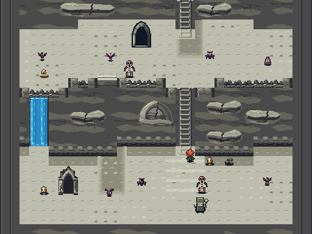
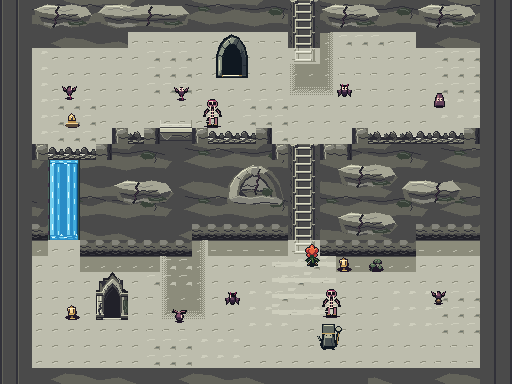
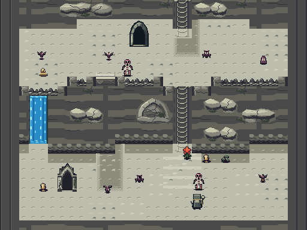
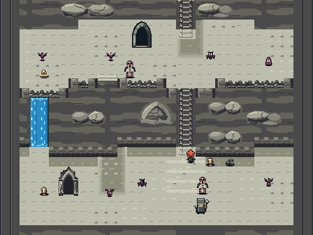
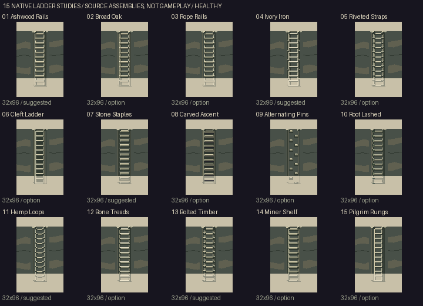

# Five Curdled Cream polish studies

Five refinements of Fractured Rind: finished rock silhouettes, continuous wall
backing, projecting drop lips, wall-connected shade, cleaner climbing fixtures
and brighter blue waterfalls. These are **review alternatives**, not a new
production selection. Each is authored directly at native GBA resolution.

[Download all five playable ROMs](https://raw.githubusercontent.com/natertott/bartgame/cream-art-studies/downloads/cream-polish-687e6c0e/all-five.zip) · [Individual ROMs and checksums](../downloads/cream-polish-687e6c0e/README.md)

Game/art source `687e6c0e999a8df70ef2f7db55f36b9200ddde30`.
Build with `make -C bartgame BART_CREAM=7` through `11`. Production 0 and the
previous studies remain available; Bloom, HUD and other regions keep their art.

## Five room treatments

The pictures below are **512×384 registered mGBA room mosaics**: nine
literal 240×160 camera crops, with frozen simulation and hidden HUD for the
whole-room survey. They are actual renderer output, not single GBA frames or
live playthroughs. Ordinary moving clips appear separately beneath each option.
The matched rooms use the same generated layout, content and camera framing;
combat poses need not represent an identical simulation instant.

### 1. Pearlstone Folds — profile 7

Long rounded mineral folds, shallow wet undercuts and restrained branching
fractures. Paired **01 Ashwood Rails** keep a quiet timber silhouette; the
**Azure Curtain** uses broad clear blue sheets and sparse moving highlights.

[Healthy](images/01-healthy-room.png) · [Deep](images/01-deep-room.png)
· [Playable ROM](https://raw.githubusercontent.com/natertott/bartgame/cream-art-studies/downloads/cream-polish-687e6c0e/01-pearlstone-folds.gba)
· [Live climb](images/01-climb.gif) · [Live local drop](images/01-local-drop.gif)
· Blue falls: [1 tile](images/01-water-width-1.gif), [2 tiles](images/01-water-width-2.gif), [3 tiles](images/01-water-width-3.gif)
· [Native audit](validation/01/native-audit.json) · [Capture/input report](validation/01/native-capture.json)

### 2. Faulted Chalk — profile 8

More angular bedding planes and longer stress seams. **04 Ivory Iron** uses
slender straight rails and crisp pale treads; **Whitewater Ribbons** separates
unequal bright ribbons within one continuous blue body.

[Healthy](images/02-healthy-room.png) · [Deep](images/02-deep-room.png)
· [Playable ROM](https://raw.githubusercontent.com/natertott/bartgame/cream-art-studies/downloads/cream-polish-687e6c0e/02-faulted-chalk.gba)
· [Live climb](images/02-climb.gif) · [Live local drop](images/02-local-drop.gif)
· Blue falls: [1 tile](images/02-water-width-1.gif), [2 tiles](images/02-water-width-2.gif), [3 tiles](images/02-water-width-3.gif)
· [Native audit](validation/02/native-audit.json) · [Capture/input report](validation/02/native-capture.json)

### 3. Ribbed Karst — profile 9

Unequal ribbed rock formations with sheltered recesses. **07 Stone Staples**
replaces timber rails with deliberate broad grips in the rock; **Glassfall**
keeps a quieter blue plane with a few long liquid highlights.

[Healthy](images/03-healthy-room.png) · [Deep](images/03-deep-room.png)
· [Playable ROM](https://raw.githubusercontent.com/natertott/bartgame/cream-art-studies/downloads/cream-polish-687e6c0e/03-ribbed-karst.gba)
· [Live climb](images/03-climb.gif) · [Live local drop](images/03-local-drop.gif)
· Blue falls: [1 tile](images/03-water-width-1.gif), [2 tiles](images/03-water-width-2.gif), [3 tiles](images/03-water-width-3.gif)
· [Native audit](validation/03/native-audit.json) · [Capture/input report](validation/03/native-capture.json)

### 4. Weathered Curdstone — profile 10

Controlled faceted mineral slabs, stepped undercuts and tapered fractures.
**11 Hemp Loops** gives the climb shallow hanging rope treads; **Split Silk**
adds unequal moving sheets joined by recessed blue channels.

[Healthy](images/04-healthy-room.png) · [Deep](images/04-deep-room.png)
· [Playable ROM](https://raw.githubusercontent.com/natertott/bartgame/cream-art-studies/downloads/cream-polish-687e6c0e/04-weathered-curdstone.gba)
· [Live climb](images/04-climb.gif) · [Live local drop](images/04-local-drop.gif)
· Blue falls: [1 tile](images/04-water-width-1.gif), [2 tiles](images/04-water-width-2.gif), [3 tiles](images/04-water-width-3.gif)
· [Native audit](validation/04/native-audit.json) · [Capture/input report](validation/04/native-capture.json)

### 5. Velvet Travertine — profile 11

Broader flowing erosion beds and softer mineral folds. **13 Bolted Timber**
adds readable metal cuffs to weathered staves; **Cerulean Cascade** combines
blue flow with grouped ivory/cyan turbulence.

[Healthy](images/05-healthy-room.png) · [Deep](images/05-deep-room.png)
· [Playable ROM](https://raw.githubusercontent.com/natertott/bartgame/cream-art-studies/downloads/cream-polish-687e6c0e/05-velvet-travertine.gba)
· [Live climb](images/05-climb.gif) · [Live local drop](images/05-local-drop.gif)
· Blue falls: [1 tile](images/05-water-width-1.gif), [2 tiles](images/05-water-width-2.gif), [3 tiles](images/05-water-width-3.gif)
· [Native audit](validation/05/native-audit.json) · [Capture/input report](validation/05/native-capture.json)

## Fifteen climbing-fixture iterations

These are **native source assemblies**, not screenshots. Each design is drawn
once across its full 32px width and split into distinct left/right halves.
This removes the old four-rail appearance caused by repeating a16px half.
Top sockets,8px tread cadence and floor-bank feet connect the fixture to the
actual wall and floor. The five choices used above are highlighted by name.

[Sour source sheet](source/ladders-sour.png) · [Deep source sheet](source/ladders-deep.png)
· [2× healthy inspection](source/ladders-healthy-2x.png)

| 1–5 | 6–10 | 11–15 |
| --- | --- | --- |
| **01 Ashwood Rails** | 06 Cleft Ladder | **11 Hemp Loops** |
| 02 Broad Oak | **07 Stone Staples** | 12 Bone Treads |
| 03 Rope Rails | 08 Carved Ascent | **13 Bolted Timber** |
| **04 Ivory Iron** | 09 Alternating Pins | 14 Miner Shelf |
| 05 Riveted Straps | 10 Root Lashed | 15 Pilgrim Rungs |

These construction choices share the same existing climbing mechanic. They
do not introduce extra climbable surfaces or a different traversal rule.

## Water, ledges and shadows

[Five blue-water source families and widths](source/waterfalls.png)
([3× inspection](source/waterfalls-3x.png)) are
**source art**. The moving1/2/3 tile clips above use ordinary advancing mGBA
simulation. A wide fall is one complete 16/32/48px drawing: wet rock contacts
stay at the outside edges, with uninterrupted water at internal cell joins.
Bright moving streaks run downward, with separate crown and foam contacts.

An actual drop has a low projecting sill and a distinct front face beneath
it. Permanent rims remain raised and obstructed. Shade connects the supported
landing back to the real wall base, keeps the existing floor/path grain and
has a broken feathered edge. The gameplay arrival helper remains the authority
for the destination, including arrivals in other rooms.

The wall paintings have explicit irregular silhouette masks. Their exterior
reveals the actual continuous backing rather than erasing it with a rectangular
fill. Internal rock shadows stay opaque. Important contours/cracks end inside
their complete native panel instead of being cut at an asset boundary.

## Evidence and limits

Profiles 7–11 use **852/879/866/894/892 static BG subtiles**, respectively,
with **10 area palette banks** and up to 128 reserved runtime-composition
characters within the 1024-tile limit. Independent audits pass **32,796 checks**
across 16,000 closed/open room builds. Actual RGB555 alpha unions pass in all 15
matched room views. Three real climbs per style retain 135/119/151 input frames;
all five have short-drop proofs, all 15 generated water-width clips visibly
animate, and profile 7 adds an earned four-room fall. Menu cache restoration is
also checked in profiles 7/11.

[Exact ROM hashes](../downloads/cream-polish-687e6c0e/README.md)
· [Default 0 and previous 6 byte-exact preservation](validation/preservation.json)
· [Visual review and finite evidence](../bartgame/docs/curdled-cream/POLISH_VISUAL_REVIEW.md)
· [Capture methods and fixture disclosure](validation/CAPTURE_NOTES.md)

**Loading tradeoff:** the measured one-row drops take 74 physical frames in
options1–4 and 75 in option5, versus 64 in the production control: about 0.17–0.18 seconds
extra loading. All retain 46 fall simulation ticks; local drops retain 32 ticks.
These cases do not establish active-frame performance in every room.

The registered room survey freezes its scene; ordinary clips use separate
fresh cores, normal HUD, real input and advancing simulation. Explicit seed,
hero navigation/facing and ordinary room-load requests select review cases.
These are instrumented comparisons, not unassisted playthroughs. The earned
four-room harness separately discloses standing/height navigation normalization;
its rewards, tools, gates and fall outcomes use real input. Ordinary waterfall
views use the settled normal camera; long crowns can lie partly above the
viewport/HUD while the full width and flowing body remain visible.

The five studies retain Bloom, enemies, NPCs, HUD, original score and other
regions. Repeated native forms remain a deliberate finite kit; the renderer
composes them at unequal scales rather than promising infinitely unique rock.

[Prior Fractured Rind review](../cream-depth-review/README.md)
· [Art direction](../bartgame/docs/art-reboot/ART_BIBLE.md)
· [Mount Crenel reference and source limits](../bartgame/docs/curdled-cream/CRENEL_REFERENCE.md)
