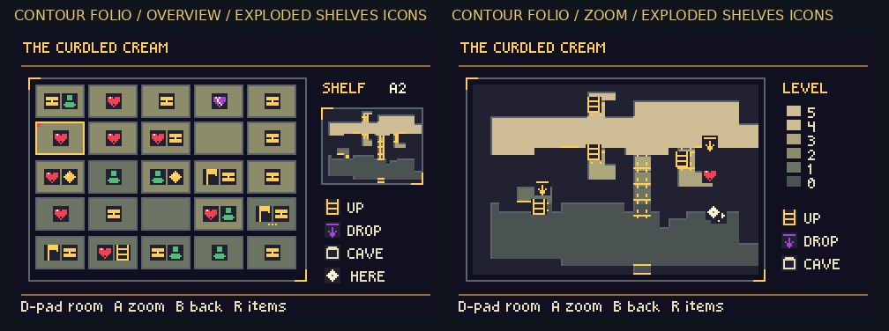

# Selected Cream pause map

**Contour Folio (#1) layout with Exploded Shelves (#4) icons.**

The overview keeps #1's grid and room inset, with #4's colored hearts, folk, boss, cave, chest and task markers. Rooms show up to two events and dots for additional content. The room zoom keeps #1's contours and height scale, with the shared colored markers and climb/drop/cave legend.

[Download ROM](../downloads/cream-selected-map-48a39a9a/bartgame-contour-folio.gba) · [Download ZIP](../downloads/cream-selected-map-48a39a9a/bartgame-contour-folio.zip)

[Overview at 3×](images/overview-3x.png) · [Room zoom at 3×](images/zoom-3x.png) · [Another room](images/neighbor-zoom-3x.png) · [Fresh discovery](validation/fresh/overview-3x.png)

These are actual 240×160 mGBA screenshots. The board adds labels outside the screenshots and scales pixels exactly 2×. The charted comparison uses seed 0xb4a7 and ordinary room-load/navigation fixtures; the fresh case retains normal fog. Capture details are in the [native report](validation/report.json).

Normal builds now enable the selected Weathered Heights terrain and this map (`BART_CREAM=12`). The map stays fixed to this selection. Pause with **Start**, then **R twice** from Items. **D-pad** selects; **A** zooms; **B** returns; **R** opens items; **Select** returns to the standard menu; **Start** resumes.

## Verification

- 191 native checks passed across charted/fresh maps and a real-input Forest→Cream-atlas→Forest cache round trip.
- 33 rendered 9px icon stamps match #4's original actual screenshot pixel for pixel, covering all seven overview event types, ten rooms with two events and an overflow case.
- Opening, browsing and zooming preserve terrain, physical topology, all actors, inventory and progress. Closing restores the native room graphics.
- Redraws complete in 9–17 hardware frames in this sample.
- Explicit historical builds 0 and 10 retain their exact ROM hashes; the normal build is restored to the selected 12. [Build preservation](validation/build/historical-preservation.json).

Source: `48a39a9a1c0dc3fe1a0eb4fa563219eab0d104f6`. ROM SHA-256: `98d1dce7d1fa78d64a537688d44872b78e9a012585584081820a23edb2f9842e`.

The [original ten concepts](../cream-heights-review/README.md) retain their historical captures and ROM. The current download above applies the adopted combination.
