# Curdled Cream and additive handoff restoration

[Download the ROM](https://raw.githubusercontent.com/natertott/bartgame/handoff-restoration-curdled-cream/downloads/curdled-cream-0b9344d7/bartgame-0b9344d7.gba) · [ZIP](https://raw.githubusercontent.com/natertott/bartgame/handoff-restoration-curdled-cream/downloads/curdled-cream-0b9344d7/bartgame-0b9344d7.zip) · [Checksums and frozen evidence](../downloads/curdled-cream-0b9344d7/README.md)

This normal standalone build adds The Curdled Cream, impact-thrown bombs and
the playable systems from the original-game handoff. Existing Forest/Drain
art, Bloom's selected Step-and-cut, original music, the three Forest trials,
appearance options, discovery cabinet and completed-run reset remain.

Source: `0b9344d781e65e304d245bd9ae4aecdbc7056837`.
ROM SHA256: `b348cf4d628aee1abb9b71d8885a9f04094332c5252490ff2dd8f8e7cd0bf1b8`.
The screenshots and clips below come from **this ROM in mGBA 0.10.5**.
To continue an earlier save, copy its `.sav` beside this ROM as
`bartgame-0b9344d7.sav` so mGBA associates it with the new filename.

## Where to go

The original Forest ladder remains. Two additional arches in the Drain's
northern wall lead to the **Challenge Annex** and **Curdled Cream**. Face an
arch and press A. The Cream's entry stairs return to its matching Drain arch;
the Annex's southern exit returns to its own arch.

Start opens the existing pause screen. **Select** opens the expanded Satchel;
A/B/L assign equipment, R opens the atlas, and Select returns to the old pause.
The original menu and appearance settings remain available. The Cream's map
has separate upper/lower shelf views, directed exits and room zoom.

Bombs now use **hold, then release**. A tap drops at Bloom's feet; half a second
throws 1½ tiles; one second reaches the maximum 2 tiles. They explode on ground or
wall impact. Remote Bombs are a separate optional tool with command detonation.

## Curdled Cream

The annotated Mount Crenel reference informed the movement grammar: climb up,
move laterally, commit to a drop, then find another climb or cave. Each seeded
5×5 region contains two terraces per room, upward routes, lateral connections,
short local drops, one-to-four-room descents and caves between distant shelves.
Three reward sites provide the tools for a randomly positioned top-row boss;
carried gear can satisfy those tool checks. The original Forest still requires
its three completed trials even when gear is inherited.
Every terminal branch has content. The graph is admitted only after its
capability-state solver proves completion and return safety; a separately
verified fixed layout supplies a bounded fallback.

The new artwork is authored at native tile/sprite sizes: pale curd and ochre
shelves, horizontally layered cliff faces, dark climb seams, clear downward
edges and purple infection near the summit. Existing art data is preserved.

| Cave and terraces | Summit fight |
| --- | --- |
| 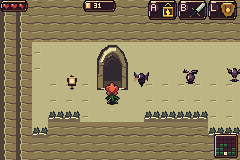 | 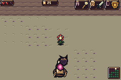 |

| A committed four-room descent | Actual earned boss victory route |
| --- | --- |
| 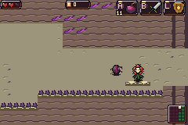 | 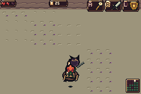 |

Full-room views are **512×384 mosaics of nine real 240×160 camera captures**,
with their overlapping source captures and camera provenance in the evidence
archive. They are not offline tilemap paintings. Actors may move between views.

| Lower elevation | Increasing infection | Summit arena |
| --- | --- | --- |
| 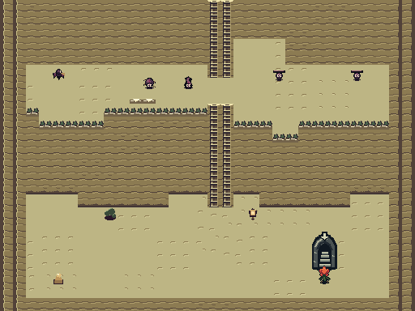 | 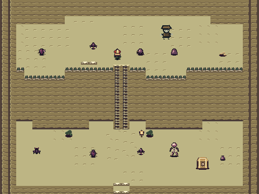 | 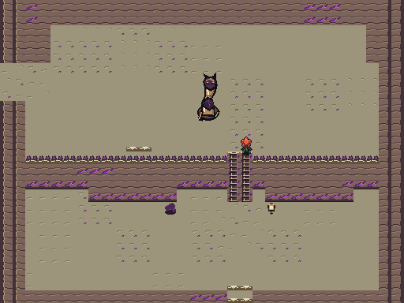 |

## Restored systems

The [complete requirement ledger](../docs/handoff-restoration/AUDIT.md) links
all handoff chapters, baseline gaps, implementation and qualification. Its
machine-readable counterpart retains exact source citations and enum values.
Playable requirements are distinguished from retired designs, raw internal
enemy forms, feasibility notes and the seven unspecified future regions.

- **Gear and movement:** Gust Jar, steerable boomerang, Pacci, Fire Rod, Light
  Arrows, Mitts, Boots, Flippers, Minish form, bottles, sword arts and Four Sword
  copies. New equipment and icons append to existing inventory/art IDs.
- **World interactions:** movable objects, keys/doors, levers and eye/light
  switches, Minish gaps, clone pressure plates, tool-specific surfaces,
  moving platforms, a minecart, parachute and a bridge with an upper deck and
  lower underpass. Four optional courts expose these verbs through real objects.
- **Quests and economy:** all seven quest forms, memory and cleanup games,
  1,528 solver-certified push boards, shops, three-pick drafts, an inn, matching
  kinstone fusers, food, bottled charms, equipment upgrades, an adaptive four-step
  contract and cross-run progression. These accompany the original Forest tasks.
- **Enemies:** 75 appended original visual forms adapt the curated handoff
  mechanics and extra boss setups, alongside the existing nine. Counters include
  suction, flipping, shield rebounds, elemental armor, exposed tails, capture
  escape and raised weak points. Unsafe raw child/script forms are represented
  by their actual multipart encounter, rather than exposed as bare spawns.
- **Discovery and saves:** 139 visible item rows and 84 enemy rows in the cabinet,
  native previews and counter notes, extended gear/region saves and redundant
  checksums. Earlier published saves remain readable; won runs stay retired.

| Expanded Satchel | Two-level atlas | Room detail |
| --- | --- | --- |
| 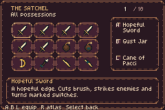 | 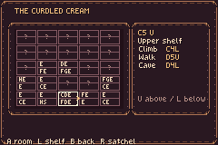 | 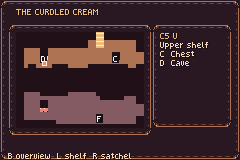 |

The atlas can switch to the lower shelf without changing the selected room:

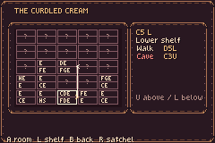
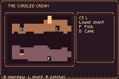

| New enemy encounter | Mechanism court | Mirror Shield interaction |
| --- | --- | --- |
| 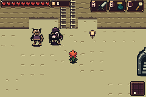 | 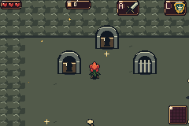 | 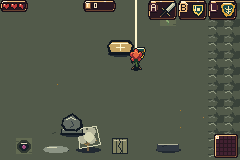 |

| Cart | Parachute | Over / under bridge |
| --- | --- | --- |
| 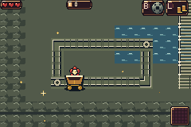 | 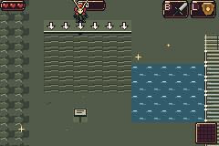 | 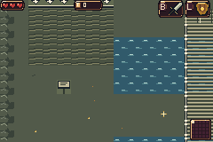 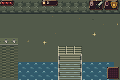 |

## What was verified

Native tests use the normal ROM. The earned Cream run uses positioning/facing
fixtures for navigation, then real inputs for all three trials, rewards,
equipment choices, gates, cave travel and the boss. It does **not** assign
inventory, player health, enemy health/state, completion, terrain or pixels.
Other isolated gear/enemy tests explicitly provide loadouts, health, positions or
developer roster requests; their reports disclose those fixtures. All published
native reports bind the exact ROM hash above. Host checks are labelled separately.

| Native mGBA qualification | Result |
| --- | --- |
| Complete Cream route / art review | 59/59 and 65/65 |
| Three-room and four-room descent runs | 28/28 each |
| New gear / objects / forms / mechanisms | 95/95 |
| Cart, parachute, both bridge levels, fusion and cold Continue | 32/32 |
| Cabinet previews, mappings and return state | 227/227 |
| New enemy mechanics, counters and stress cases | 267/267 |
| Expanded menu and regional maps | 27/27 |
| Services / seven quests / adaptive contract / save-meta | 14/14, 28/28, 22/22, 19/19 |
| Sewer access, original gate protection and menu/audio boundaries | 29/29 |
| Original Forest trials through Heart victory | 21/21 |
| Victory reset and earlier save compatibility | 53/53 |
| Original music and PCM continuity | 69/69 |
| Cross-system damage and modal interruption probes | 8/8 |

The actual C generator passed 100,000 deterministic mazes. An independent state
solver checked 1,000 samples with every inherited tool mask and the explicit
fallback. Generated required routes span 18–52 crossings and 9–22 distinct rooms.
The actual C room builder then produced **2,500,000 rooms**: all 9.9 million route
triggers and 9.9 million destination approaches passed, with zero geometry failures.
These are host proofs of graph/geometry, not millions of emulator playthroughs.
A separate independent Python generator also matches the actual C output
byte for byte on 1,000 seeds and six forced fallback cases, including PRNG and
all 1,392 bytes of each record. [Equivalence report](qualification/independent-generator-twin.json).

The old-art comparison passes **2,232 checks**: all 40 existing sprite sheets and
2,133 metatile IDs retain their pixels, palettes, geometry and animation data.
Every one of the 2,540 newly authored enemy frames independently matches the
pixels decoded from the released ROM.

The matched 146-scenario performance survey passes 127 assertions. It records
25,906 updates in 25,920 eligible video frames; the 14 omissions are isolated
single frames, not sustained crowd slowdown. Separate new-roster runs record
13,320/13,320 updates and six 600-frame crowd loads record 3,600/3,600. Peak tested
world sprite allocation is 744/876 tiles and 58/128 OAM entries. These describe
the sampled workloads; the raw traces are retained for further diagnosis.

[Readable qualification summary](qualification/native-summary.json) ·
[Native evidence ZIP](https://raw.githubusercontent.com/natertott/bartgame/handoff-restoration-curdled-cream/downloads/curdled-cream-0b9344d7/native-evidence.zip) ·
[Integration boundary notes](../bartgame/docs/handoff-restoration/release-boundary/README.md) ·
[Item/mechanism evidence](../bartgame/docs/handoff-restoration/evidence/items-objects/README.md)
