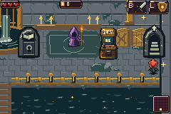
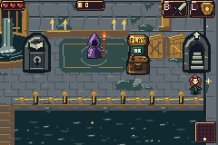
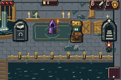

# Drain entrance repair and Annex provenance correction

[Download repaired ROM](https://raw.githubusercontent.com/natertott/bartgame/handoff-restoration-curdled-cream/downloads/curdled-cream-door-2bc08eca/bartgame-2bc08eca.gba) · [ZIP and checksums](../../downloads/curdled-cream-door-2bc08eca/README.md)

The published entrance had a real bug. Its A interaction was centered at
world y130, twenty pixels below the drawn arch's foot. Walking north from the
Drain spawn could take Bloom to y106 or y72, where pressing A did nothing.
The earlier test positioned Bloom at y130; it missed this ordinary approach.

Both new arches now use their drawing's anchor for interaction. Walking north
across the sill enters automatically. A works throughout the visible arch and
its approach, including when Bloom faces away after shield strafing. The
return point stays below the sill so standing still cannot re-enter. The
optional Entitlement lock still explains its condition, with one message per
upward hold rather than repeated messages. In ordinary mode Cream is open.

The following are untouched 240×160 frames sampled from actual mGBA runs of
the repaired normal ROM. Tests walk from the initial Drain spawn using real
inputs; they do not position Bloom or assign game state, inventory, camera,
terrain or pixels. The optional mode is enabled through the actual Trophy UI.
Only the deterministic title seed and fresh private SRAM are test fixtures.

| Walk into the Cream staircase | A inside its visible arch |
| --- | --- |
|  |  |

Source: `2bc08ecad81e0acbf52933cf6d69c3ad2e2414ce`.
ROM SHA256: `e8df68ad63350948894742cad7e4f4085600857f26ec55aaa545b0697cd9954e`.

- [22/22 natural-input entrance checks](entrance-report.json).
- [29/29 boundary checks](boundary-report.json), including original gate and audio controls.
- [59/59 earned Cream route checks](route-report.json), through the actual summit win.
- [2,593/2,593 art-preservation checks](art-preservation.json) against the previous release: all 126 sheets and 2,322 metatile IDs remain.
- [Reusable natural-input test](../../bartgame/tools/sewer_entrance_review.py).

## What the Challenge Annex is

**The Annex was our implementation invention.** Its name, separate area,
challenge-selection desk and mechanism courts were not specified by the
handoff. It exposes the restored shops, quests, puzzles, enemy encounters and
traversal systems through an extra hub.

The underlying features have handoff sources. The placement does not match
the intended design: [chapter 06](../../docs/newgame/06_CURRENT_GAME_DESIGN.md)
puts events on generated-area room nodes and quests in regional content.
Most added quest/event/mechanism families currently live in Annex rooms.
That regional deployment remains unfinished; working Annex mechanics are
not equivalent to completing it. The earlier completion claim was too broad.

[Corrected deployment notes](../../bartgame/docs/handoff-restoration/EVENTS.md)
and the [corrected audit](../../docs/handoff-restoration/AUDIT.md) record those
gaps without discarding the valid mechanical test evidence. This repair fixes
the entrances; it does not claim to finish regional integration.
