# BARTGAME tile specification

Every background tile the game draws in the wood, its mystery rooms and the Drain: what each one is, where it goes, what it must join, and how to deliver it. Written so an artist or an art-generating model can redraw the set without reading the code. The pictures show the tiles in the game now, which this delivery replaces. Use them for size, layout and joins, not for style.

117 entries, 328 tiles: 232 in the wood, 27 in the mystery rooms, 69 in the Drain. The pictures are in `tile_spec/`, one per entry (the current art at 3x, frames as rows), with room views in `tile_spec/rooms/`.

## 1. How the screen is built

- **Tiles.** The world is built of 16x16 tiles. The screen shows 15 by 10 of them (240x160 pixels). The Bloom is 31 pixels tall, about two tiles; most monsters are one tile.
- **View.** Top-down with a three-quarter tilt, as in The Minish Cap. Floors are seen from above. Walls, trunks, rocks and props show their front face. Light comes from the upper left; shadows fall down and to the right.
- **Two layers.** Ground tiles are drawn under the sprites and must be opaque in every pixel. Overlay tiles are drawn over the sprites, so the Bloom walks behind a tree's crown; they are transparent outside the drawing.
- **Solid.** Collision is decided per 8x8 quarter. "Solid" blocks the whole tile. "Bottom half" blocks only the lower 8 rows, so the Bloom can stand behind the top half. "Top half" is the reverse.
- **Joins.** Most tiles repeat. "Tiles in every direction" means any arrangement of copies must read as one surface, with no seam at the 16-pixel grid and no feature that repeats visibly. Tiles listed together as variants must also tile with each other.
- **Animation.** Frames play in a loop. "Each shown 20/60 s" means a frame holds for 20 of the game's 60 frames a second. Every copy of a tile animates in step.

## 2. Hard rules (Game Boy Advance)

- **Colour.** 4 bits a pixel: each palette group has 15 colours plus transparent. All 256 pixels of one tile come from one group. Where a tile shows two materials (a shore with grass and sand, a trunk with grass and bark), both must be in its group.
- **Palette budget.** The wood may use up to 6 groups, the mystery rooms 2 of their own (they also see the wood's 6), the Drain 4. That is 12 of the 16 background palettes; the HUD, the pause menu and the text keep the other 4. Suggested groups are listed below; regroup freely within each area's count.
- **Piece budget.** Each area holds at most 1,023 distinct 8x8 pieces. A 16x16 tile is four pieces; a piece repeated exactly, or mirrored, is stored once. This list is 232 tiles for the wood (928 pieces), 27 for the mystery rooms and 69 for the Drain, so there is room for some reuse but not for many more variants. Animation frames beyond the first do not count.
- **Pixels.** Exact sizes. No anti-aliasing, no partial transparency, no gradients finer than the palette. Every pixel is a palette colour or fully transparent.
- **Style.** After the four BARTGAME style boards: "grime and glamour". Three tones per material plus a highlight; a dark outline on objects that stand up from the ground (rocks, props, trunks), none on flat ground textures. Detail should be rich but quiet: the ground is a backdrop for the sprites, so keep its contrast lower than theirs, and keep bright specks for things the player should notice.

### Palette groups

| Group | Area | What goes in it |
|---|---|---|
| `wood_ground` | The wood | grass in all its variants, flowers, tall grass, bones, the trail, mossy flagstones, the meadow, clover and fairy ring, the trail edges, shores and verges, and the grass round tree trunks and roots (so a trunk tile needs its bark colours here too) |
| `wood_leaf` | The wood | the canopy walls and their faces and crowns, tree crowns, bushes, stumps, logs, thorns, the lantern post |
| `wood_water` | The wood | water, its banks, nicks and lilies, rafts, falls and foam, and the bridges |
| `wood_stone` | The wood | rocks, boulders, cliffs, pillars, the ruined wall, the statue, pits, the gates, chests, censers, the stairs, the mystery mouths |
| `wood_blight` | The wood | everything of the blight: its grounds, trail, pools, crystals, dead trees, walls, the sick canopy, the blighted tree, the mist |
| `wood_spare` | The wood | free: give it to whatever needs more colours (the great trees, the flowers, the sparkles) |
| `myst_cave` | The mystery rooms | the cave and the objects every mystery room shares (plates, pots, the chest, the spring) |
| `myst_wood` | The mystery rooms | the hollow and the thicket |
| `drain_stone` | The Drain | floors and their marks, walls, wall tops, pipes, the hole, the arch, rubble, the banks |
| `drain_water` | The Drain | water, scum, bubbles, glints, lilies, the waterfall, the grate, the ladder |
| `drain_props` | The Drain | the stall, the rug, barrels, crates, skull, pot, gold, candles, banners, the lantern, the torch |
| `drain_spare` | The Drain | free: glows, fungus and glints, or whatever needs more colours |

## 3. Delivery

- One PNG per entry, named with the entry's key (for example `grass.png`), in a folder named for its palette group (for example `wood_ground/grass.png`).
- Variants and families: the tiles side by side in the order listed, no gaps. A family of fifteen is 240 pixels wide.
- Pieces bigger than a tile: the whole picture at its full size, which the importer cuts into tiles.
- Animation: each frame is a further row below the first, the same layout again. The file size given on each entry includes the frames.
- Transparency: overlay entries, and the crown rows of a tree, use a real alpha channel or pure magenta `#FF00FF` for transparent. Ground entries have none.
- Optional and welcome: one mock-up screen per area (240x160) laid from the delivered tiles, so the joins can be checked together.

## 4. The wood

Rooms are 32x24 tiles, laid out by the game, so any tile can meet any of its listed neighbours. The wood has three moods: the living rooms (green), the sick rooms (stained grass, the canopy going violet) and the blighted rooms (purple to the walls), with the arena of the Blight Heart deepest of all. The edge tiles are used in the living rooms only.

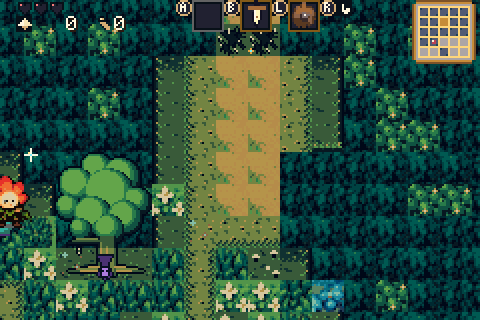 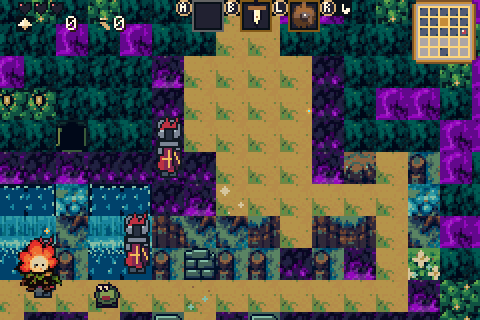 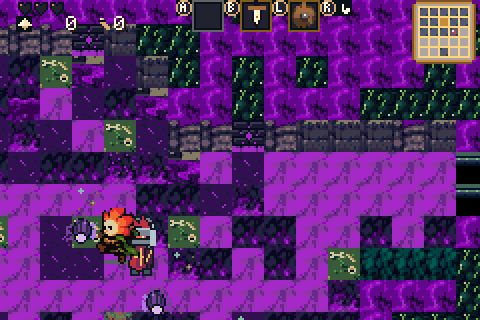 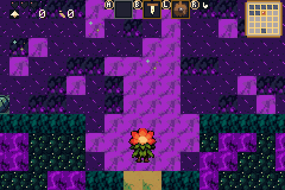

### Ground of the living wood

Most of every living room. Mostly plain, so the sprites read against it.

| Entry | Key and file | Size | Layer | Frames | Solid | What it is | Joins |
|---|---|---|---|---|---|---|---|
|  **Grass** | `wood_ground/grass.png` 48x16 | 3 tiles, 16x16 each | ground | still | walkable | Short dark-olive grass: a few darker blade clusters, a few lit tips. Three variants laid at random. | Each tiles with itself and with the other two in every direction. No single tuft, flower or stone that repeats visibly when 300 of them are laid together. |
| 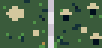 **Grass, blight stain** | `wood_ground/grass_stain.png` 32x16 | 2 tiles, 16x16 each | ground | still | walkable | Grass with the blight creeping in: a small violet bruise and a thin crack of magenta light. An accent, about one tile in eight. | Edges match plain grass. |
|  **Flowers** | `wood_ground/flowers.png` 32x16 | 2 tiles, 16x16 each | ground | still | walkable | Grass with a few small flowers: white star flowers; blue bells. Scattered, and under the gold sparkle of a hidden hoard. | Edges match plain grass; keep the flowers inside the tile. |
| 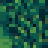 **Tall grass** | `wood_ground/tall_grass.png` 16x16 | 16x16 | ground | still | walkable | A clump of taller, brighter blades on grass. The Bloom walks over it. | Edges match plain grass. |
|  **Bones** | `wood_ground/bones.png` 16x16 | 16x16 | ground | still | walkable | Grass with old bones half sunk in it: a skull, a rib. An accent in the boneyards and beside dead trees. | Edges match plain grass. |
| 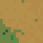 **Trail** | `wood_ground/trail.png` 16x16 | 16x16 | ground | still | walkable | Packed earth, warm brown with small pebbles: the lanes in from the doors, the ways between clearings, the open door gaps. | Tiles with itself in every direction. The grass meets it through the trail edges below. |
|  **Mossy flagstone** | `wood_ground/flagstone.png` 16x16 | 16x16 | ground | still | walkable | An old flat flagstone sunk in moss and grass. The ruins' floor, the spot where the relic lies, the shrine's step once used. | Edges are grass, so it sits on grass on any side. |
| 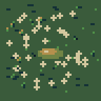 **Meadow** | `wood_ground/meadow.png` 48x48 | 48x48 (3 by 3 tiles) | ground | still | walkable | A flower meadow painted whole: taller grass and flowers in a 48x48 patch. | Its outer edge fades into plain grass on all four sides. |
| 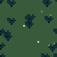 **Clover patch** | `wood_ground/clover.png` 32x32 | 32x32 (2 by 2 tiles) | ground | still | walkable | A patch of clover, 32x32. | Its outer edge fades into plain grass on all four sides. |
| 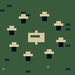 **Fairy ring** | `wood_ground/fairy_ring.png` 32x32 | 32x32 (2 by 2 tiles) | ground | still | walkable | A ring of small pale mushrooms on grass, 32x32. Laid in living and blighted rooms alike. | Its outer edge fades into plain grass on all four sides. |

### Edges of the living wood

No boundary in a living room is a hard line. Each of these is the grass or trail tile with an edge on the marked sides, in fifteen combinations. Read the labels as "the neighbour on that side is water", "is the canopy" or "is grass". Corners where two marked sides meet join round, not square.

| Entry | Key and file | Size | Layer | Frames | Solid | What it is | Joins |
|---|---|---|---|---|---|---|---|
| 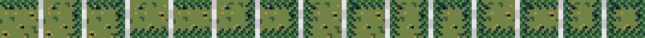 **Trail edges** | `wood_ground/trail_edge.png` 240x16 | 15 tiles, 16x16 each | ground | still | walkable | The trail with ragged grass creeping over its edge on the marked sides, and a little shadow under the tufts. | The unmarked sides are plain trail. The grass side must meet plain grass. Order: N, E, N+E, S, N+S, E+S, N+E+S, W, N+W, E+W, N+E+W, S+W, N+S+W, E+S+W, N+E+S+W. |
| 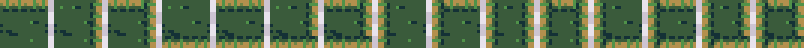 **Shores** | `wood_ground/shore.png` 240x16 | 15 tiles, 16x16 each | ground | still | walkable | Grass beside water on the marked sides: a dark soil lip, a strip of sand or mud, reeds dipping in. | The unmarked sides are plain grass. The water tile beside it draws the bank's other half, so the two must meet. Order: N, E, N+E, S, N+S, E+S, N+E+S, W, N+W, E+W, N+E+W, S+W, N+S+W, E+S+W, N+E+S+W. |
| 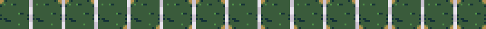 **Shore nicks** | `wood_ground/shore_corner.png` 240x16 | 15 tiles, 16x16 each | ground | still | walkable | Grass touching water only at the marked corners: a small curved nick of shore in that corner. | Everything but the marked corners is plain grass. Order: NW, NE, NW+NE, SE, NW+SE, NE+SE, NW+NE+SE, SW, NW+SW, NE+SW, NW+NE+SW, SE+SW, NW+SE+SW, NE+SE+SW, all four. |
| 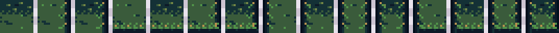 **Verges** | `wood_ground/verge.png` 240x16 | 15 tiles, 16x16 each | ground | still | walkable | Grass beside the canopy wall on the marked sides. A wall to the north casts shadow and drops leaves; walls east or west push undergrowth and roots in; a wall to the south has ferns at its foot. A cliff above counts as a wall to the north. | The unmarked sides are plain grass. The wall side must meet the canopy's face, its crown or its plain mass. Order: N, E, N+E, S, N+S, E+S, N+E+S, W, N+W, E+W, N+E+W, S+W, N+S+W, E+S+W, N+E+S+W. |

### Water

Ponds, rivers and lakes. Water is drawn under the sprites; the Bloom swims or sinks in it. Every water tile has two frames that alternate every 20 frames, so ripples drift.

| Entry | Key and file | Size | Layer | Frames | Solid | What it is | Joins |
|---|---|---|---|---|---|---|---|
|  **Open water** | `wood_water/water.png` 16x32 | 16x16 | ground | 2 frames, each shown 20/60 s | walkable | Dark teal-blue depth with slow light ripples. | Tiles in every direction in both frames. |
| 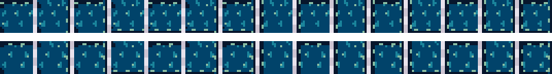 **Water banks** | `wood_water/water_bank.png` 240x32 | 15 tiles, 16x16 each | ground | 2 frames, each shown 20/60 s | walkable | Water with a bank on the marked sides: the lip where ground meets it, a line of foam along it. Ground means grass, the canopy or a cliff. | The unmarked sides are open water. Each bank meets the shore tile beside it. Order: N, E, N+E, S, N+S, E+S, N+E+S, W, N+W, E+W, N+E+W, S+W, N+S+W, E+S+W, N+E+S+W. |
| 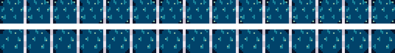 **Water nicks** | `wood_water/water_nick.png` 240x32 | 15 tiles, 16x16 each | ground | 2 frames, each shown 20/60 s | walkable | Open water with ground touching only at the marked corners: a small rounded bit of bank in that corner. | Everything but the marked corners is open water. Order: NW, NE, NW+NE, SE, NW+SE, NE+SE, NW+NE+SE, SW, NW+SW, NE+SW, NW+NE+SW, SE+SW, NW+SE+SW, NE+SE+SW, all four. |
| 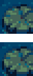 **Lily** | `wood_water/lily.png` 16x32 | 16x16 | ground | 2 frames, each shown 20/60 s | walkable | Open water with a lily pad and a small white flower. | One in five open water tiles. |
| 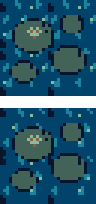 **Lily raft** | `wood_water/lily_raft.png` 32x64 | 32x32 (2 by 2 tiles) | ground | 2 frames, each shown 20/60 s | walkable | A great raft of lily pads on open water, 32x32. Still water underfoot. | Its edge is open water on all sides. |
|  **Waterfall** | `wood_water/waterfall.png` 16x48 | 16x16 | ground | 3 frames, each shown 6/60 s | walkable | Water pouring off a cliff or out of the canopy: lit streaks falling, foam at the lip. A fall is two tiles wide and one or two tall. | Tiles left-right and up-down. The three frames scroll the water down a third of a tile each, so it loops. |
|  **Foam** | `wood_water/foam.png` 16x32 | 16x16 | ground | 2 frames, each shown 10/60 s | walkable | The churn where a fall lands: white foam boiling on water, under each tile of a fall. | Tiles left-right; its bottom edge meets open water. |

### The canopy

The wood's walls: the border of every room and the masses between its clearings. Solid.

| Entry | Key and file | Size | Layer | Frames | Solid | What it is | Joins |
|---|---|---|---|---|---|---|---|
| 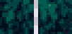 **Canopy** | `wood_leaf/canopy.png` 32x16 | 2 tiles, 16x16 each | ground | still | solid | A dense mass of leaves, blue-black in the depths to lit green on the tops, round clumps lit from the upper left. Two variants laid at random. | Each tiles with itself and the other in every direction, with no visible seams or grid. Large areas of it fill the screen, so it must not look like wallpaper. |
| 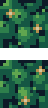 **Canopy, glint** | `wood_leaf/canopy_glint.png` 16x32 | 16x16 | ground | 2 frames, each shown 28/60 s | solid | Canopy with two leaves that catch the light and wink. One in seven canopy tiles. | Matches canopy on every edge. |
|  **Canopy, lantern** | `wood_leaf/canopy_lantern.png` 16x32 | 16x16 | ground | 2 frames, each shown 10/60 s | solid | Canopy with a small amber lantern hung in the leaves above a way; its glow flickers. | Matches canopy on every edge. |
| 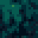 **Canopy face** | `wood_leaf/canopy_face.png` 16x16 | 16x16 | ground | still | solid | The wall's lower edge where ground or water lies below: the canopy above, trunks, roots and deep shadow at its foot. | Repeats left-right. Its top meets canopy; its bottom meets grass, the trail or water. |
| 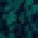 **Canopy crown** | `wood_leaf/canopy_crown.png` 16x16 | 16x16 | ground | still | solid | The wall's upper edge where ground lies above it: the lit, rounded tops of the leaf mass. | Repeats left-right. Its bottom meets canopy; its top meets grass or the trail. |
|  **Canopy, sick** | `wood_blight/canopy_sick.png` 16x16 | 16x16 | ground | still | solid | Canopy gone sick: leaves dulled toward grey-violet, veins of violet, magenta tips. Mixed into the sick rooms' canopy and filling the blighted rooms' walls. | Tiles with itself and with canopy in every direction. |
|  **Canopy, sick, lit** | `wood_blight/canopy_sick_lit.png` 16x32 | 16x16 | ground | 2 frames, each shown 18/60 s | solid | Sick canopy with veins of light in the leaves that pulse. | Matches sick canopy on every edge. |

### Trees

A tree's crown is on the overlay, drawn over the Bloom so she walks behind it, and is transparent outside the leaves. Its trunk tiles are ground, grass included, with only their bottom half solid.

| Entry | Key and file | Size | Layer | Frames | Solid | What it is | Joins |
|---|---|---|---|---|---|---|---|
| 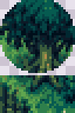 **Oak** | `wood_leaf/tree.png` 32x48 | 32x48 (2 by 3 tiles) | crown on the overlay, trunk on the ground | still | trunk row: bottom half | A free-standing oak, 32x48: a round crown of lit leaf clumps on the top two rows, the trunk and its roots on grass on the bottom row. | Crown tiles: overlay, transparent round the crown. Trunk tiles: ground, the grass round the trunk matching plain grass. |
| 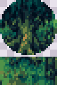 **Oak with a lantern** | `wood_leaf/tree_lantern.png` 32x48 | 32x48 (2 by 3 tiles) | crown on the overlay, trunk on the ground | still | trunk row: bottom half | The oak of another shape, an amber lantern hung in its crown. One tree in three. | As the oak. |
| 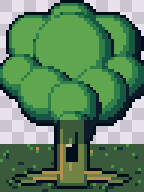 **Great tree** | `wood_leaf/great_tree.png` 48x64 | 48x64 (3 by 4 tiles) | crown on the overlay, trunk on the ground | still | middle root: bottom half | A great tree, 48x64: a crown 48x48 on the top three rows, a thick trunk with a dark hollow in the middle of the bottom row, roots spreading over three tiles of grass. | Crown: overlay, transparent outside the leaves; it may overhang the canopy behind. Roots: ground on grass. |
| 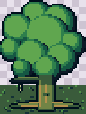 **Great tree, lopsided** | `wood_leaf/great_tree_2.png` 48x64 | 48x64 (3 by 4 tiles) | crown on the overlay, trunk on the ground | still | middle root: bottom half | A second great tree: lopsided, a lantern on its low branch, a knot in the trunk. | As the great tree. |
| 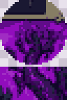 **Blighted tree** | `wood_blight/blight_tree.png` 32x48 | 32x48 (2 by 3 tiles) | crown on the overlay, trunk on the ground | still | trunk row: bottom half | The blighted rooms' tree, 32x48: a black twisted trunk, bare branches clawing up, magenta veins of light, glow at the tips. | Branches: overlay, transparent between them. Trunk tiles: ground on blight ground. |

### On the grass

Things that stand on a living room's floor. Each is drawn on its own patch of grass that matches plain grass at the tile's edges.

| Entry | Key and file | Size | Layer | Frames | Solid | What it is | Joins |
|---|---|---|---|---|---|---|---|
| 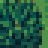 **Bush** | `wood_leaf/bush.png` 16x16 | 16x16 | ground | still | solid | A round leafy bush with a few berries. Lifted with R and carried, or cut with the sword. | Must match the carried bush in the sprite spec (sheet lift). |
| 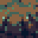 **Small stone** | `wood_stone/stone_small.png` 16x16 | 16x16 | ground | still | solid | A small mossy stone, light enough to lift. | Must match the carried stone in the sprite spec. |
|  **Boulder** | `wood_stone/boulder.png` 16x16 | 16x16 | ground | still | solid | A dark, cracked, mossy boulder. Only the gauntlet lifts it. | Must match the carried boulder in the sprite spec. |
|  **Rocks** | `wood_stone/rocks.png` 48x16 | 3 tiles, 16x16 each | ground | still | solid | Three fixed rocks: a mossy stone sunk in the soil, tufts over its foot; a flat stone buried to its shoulders, grass over its edge; two stones stacked, moss between, lichen on the top one. | They must read as fixed, unlike the small stone. |
| 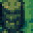 **Stump** | `wood_leaf/stump.png` 16x16 | 16x16 | ground | still | solid | A cut stump: rings on the top, bark down the sides. |  |
| 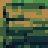 **Log** | `wood_leaf/log.png` 16x16 | 16x16 | ground | still | solid | A short fallen log, the rings of its cut end showing. |  |
| 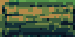 **Hollow log** | `wood_leaf/hollow_log.png` 32x16 | 32x16 (2 by 1 tiles) | ground | still | solid | A hollow log two tiles long: rings at one end, a dark hollow at the other, moss along its back. |  |
|  **Great boulder** | `wood_stone/great_boulder.png` 32x32 | 32x32 (2 by 2 tiles) | ground | still | solid | A great boulder, 32x32: moss on its crown, lichen, a sapling rooted in a crack. |  |
| 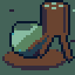 **Rock in the roots** | `wood_stone/tree_rock.png` 32x32 | 32x32 (2 by 2 tiles) | ground | still | solid | A stone wedged in the roots of a stump, 32x32; roots of soil-brown wrap the stone. |  |
| 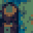 **Pillar** | `wood_stone/pillar.png` 16x16 | 16x16 | ground | still | solid | A broken stone pillar of the old ruins. | Two pillars often stand with a ruined wall between them, or four in a square. |
|  **Ruined wall** | `wood_stone/ruin_wall.png` 16x16 | 16x16 | ground | still | solid | A stretch of ruined wall, mossy blocks, set between two pillars. | Its left and right edges meet a pillar. |
|  **Shrine statue** | `wood_stone/statue.png` 16x16 | 16x16 | ground | still | bottom half | A stone statue of a seated hare with a glowing gem: the shrine's keeper. A flower tile and a sparkle lie at its feet. |  |
|  **Lantern post** | `wood_leaf/lantern_post.png` 16x32 | 16x16 | ground | 2 frames, each shown 10/60 s | bottom half | A wooden post with an amber lantern hanging from it; the glow flickers. |  |
| 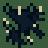 **Thorns** | `wood_leaf/thorns.png` 16x16 | 16x16 | ground | still | solid | A bramble of dark vines with magenta barbs, on grass. Cut with the sword. Laid in hedges of three, and as a gate across a door gap. | Repeats left-right and up-down, so a hedge reads as one bramble. |

### Cliffs, crossings and pits

| Entry | Key and file | Size | Layer | Frames | Solid | What it is | Joins |
|---|---|---|---|---|---|---|---|
|  **Cliff** | `wood_stone/cliff.png` 48x16 | 3 tiles, 16x16 each | ground | still | solid (a one-way drop to the south) | A cliff the Bloom can jump down going south: a grassy brow on top, a face of mossy stone blocks, a foot of soil. Delivered as its west end, its middle, its east end. | The middle repeats left-right; the ends round off. The ground above and below is grass. |
| 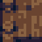 **Bridge** | `wood_water/bridge.png` 16x16 | 16x16 | ground | still | walkable | A plank bridge over water running east-west, rails along its top and bottom edges. | Repeats left-right; its ends meet the trail or grass. |
|  **Bridge, north-south** | `wood_water/bridge_ns.png` 16x16 | 16x16 | ground | still | walkable | The same planks running north-south, rails down the sides. | Repeats up-down. |
|  **Chasm** | `wood_stone/pit.png` 16x16 | 16x16 | ground | still | a fall | A dark drop with a stone lip on its near edge, filling a door gap: the Petal Cloak leaps it. | Repeats left-right. |

### Gates and set pieces

A room's doors are two-tile gaps in its border of canopy. A gate fills the gap: the same tile placed twice, side by side in a north or south wall, one above the other in an east or west wall. Draw each to read as a whole gate either way.

| Entry | Key and file | Size | Layer | Frames | Solid | What it is | Joins |
|---|---|---|---|---|---|---|---|
| 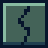 **Cracked wall** | `wood_stone/crack.png` 16x16 | 16x16 | ground | still | solid | A cracked stone wall plugging the gap. A bomb opens it. | Its sides meet the canopy. |
|  **Web** | `wood_stone/web.png` 16x16 | 16x16 | ground | still | solid | A thick cobweb strung across the gap, on dark stone. The lamp burns it away to trail. | Its sides meet the canopy. |
| 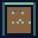 **Locked door** | `wood_stone/door_locked.png` 16x16 | 16x16 | ground | still | solid | A heavy door in a stone frame with a lock. A key opens it. | Its sides meet the canopy. |
| 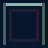 **Open door** | `wood_stone/door_open.png` 16x16 | 16x16 | ground | still | walkable | The stone frame opened: the trail running through it. What a bombed wall and an unlocked door become. | Its sides meet the canopy; the trail runs in and out. |
|  **Stairs down** | `wood_stone/stairs.png` 16x16 | 16x16 | ground | still | walkable | A stone arch with steps going down into the dark: the way back to the Drain. | Its sides meet the canopy. |
|  **Chest** | `wood_stone/chest.png` 32x16 | 2 tiles, 16x16 each | ground | still | solid | A treasure chest on grass, then the same chest opened and empty. | The open chest replaces the closed one in place. |
| 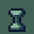 **Censer** | `wood_stone/censer.png` 16x16 | 16x16 | ground | still | bottom half | A stone censer on a short pillar, cold. The lamp lights it. |  |
|  **Censer, lit** | `wood_stone/censer_lit.png` 16x32 | 16x16 | ground | 2 frames, each shown 6/60 s | bottom half | The censer lit, a flame flickering in its bowl. | Replaces the cold censer in place, so the stone must match it. |
|  **Mystery mouths** | `wood_stone/mouths.png` 48x16 | 3 tiles, 16x16 each | ground | still | the way in | The ways into the mystery rooms, set into a canopy face: a mouth in mossy rock; an opening in a great trunk; a dark tunnel through brambles. | Each stands in a row of canopy faces: its top and sides meet the face, its bottom meets the grass. |

### The blight

The wood sickens toward its heart. The sick rooms are stained grass under a canopy going violet; the blighted rooms are purple to the walls; the arena, where the Blight Heart waits, is the deepest.

| Entry | Key and file | Size | Layer | Frames | Solid | What it is | Joins |
|---|---|---|---|---|---|---|---|
|  **Blighted grass** | `wood_blight/blight_ground.png` 32x16 | 2 tiles, 16x16 each | ground | still | walkable | The sick rooms' grass: stained violet and dulled, split by a few faint cracks. Two variants laid at random. | Each tiles with itself and the other in every direction. |
|  **Blighted grass, lit** | `wood_blight/blight_ground_lit.png` 16x32 | 16x16 | ground | 2 frames, each shown 12/60 s | walkable | The same with a crack of light that pulses. | Matches blighted grass on every edge. |
| 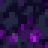 **Blight floor** | `wood_blight/blight_floor.png` 16x16 | 16x16 | ground | still | walkable | The blighted rooms' floor: purple through and through, a texture of rot. | Tiles in every direction and with the pitted floor. |
|  **Blight floor, pitted** | `wood_blight/blight_floor_pits.png` 16x32 | 16x16 | ground | 2 frames, each shown 20/60 s | walkable | Dark purple, pits of black, a few short seams of light that pulse. | Matches the blight floor on every edge. |
|  **Blight vein** | `wood_blight/blight_vein.png` 16x32 | 16x16 | ground | 2 frames, each shown 12/60 s | walkable | The blighted rooms' trail: a vein of glowing magenta through the purple, the lanes in from the doors. | Tiles in every direction; it meets blight floors without an edge tile. |
| 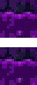 **Blight pool** | `wood_blight/blight_pool.png` 16x32 | 16x16 | ground | 2 frames, each shown 16/60 s | walkable, hurts | A pool of glowing blight that burns to stand in. | Its edges meet blight floors. |
|  **Blight crystals** | `wood_blight/crystal.png` 16x16 | 16x16 | ground | still | solid | A cluster of violet crystals grown out of the ground, glowing at the tips. |  |
| 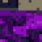 **Dead tree** | `wood_blight/dead_tree.png` 16x16 | 16x16 | ground | still | bottom half | A small dead tree, black and twisted, on blight ground. |  |
| 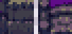 **Blight wall** | `wood_blight/blight_wall.png` 32x16 | 2 tiles, 16x16 each | ground | still | solid | The blighted rooms' wall face where ground lies below: old stone blocks, violet light climbing them from the ground. Two variants. | Repeats left-right with either variant. Its top meets sick canopy; its bottom meets blight floors. |
|  **Blight wall, crystal** | `wood_blight/blight_wall_lit.png` 16x32 | 16x16 | ground | 2 frames, each shown 16/60 s | solid | The wall face with a crystal set in it, glowing. | Matches the blight wall on every edge. |

### On the overlay

Drawn over the ground and over the sprites, transparent outside the drawing. Keep them small and sparse.

| Entry | Key and file | Size | Layer | Frames | Solid | What it is | Joins |
|---|---|---|---|---|---|---|---|
| 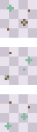 **Gold sparkle** | `wood_spare/sparkle.png` 16x48 | 16x16 | overlay (over the sprites) | 3 frames, each shown 14/60 s | walkable | A gold glint that winks: marks a hidden hoard, the relic and the shrine, and lies on the floor here and there. |  |
| 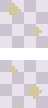 **White stars** | `wood_spare/sparkle_white.png` 16x32 | 16x16 | overlay (over the sprites) | 2 frames, each shown 16/60 s | walkable | Two small white four-point stars that wink, over the living rooms' floors. |  |
| 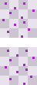 **Blight mist** | `wood_blight/mist.png` 16x32 | 16x16 | overlay (over the sprites) | 2 frames, each shown 16/60 s | walkable | Sparse violet motes of mist drifting over the blighted rooms. |  |

## 5. The mystery rooms

Small rooms behind the mouths in the wood's walls, one of three styles. They share the wood's censers, boulders, gold sparkle and grass.

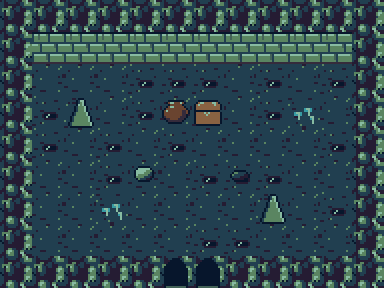 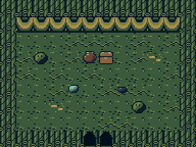 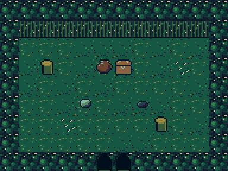

### The three rooms

Behind each mouth in the wood: a damp cave, the hollow of a tree, a thicket of brush. A room is 12x9, 18x12 or 24x16 tiles: a wall border one tile thick, two tiles at the top (the wall mass, then its face), the floor inside, the way out in the middle of the bottom wall. Each style is the same seven drawings, delivered as one strip in this order: wall mass, wall face, floor, floor variant, solid thing, glowing thing, way out.

| Entry | Key and file | Size | Layer | Frames | Solid | What it is | Joins |
|---|---|---|---|---|---|---|---|
|  **Cave** | `myst_cave/cave.png` 112x16 | 7 tiles, 16x16 each | ground | still | mass, face, stalagmite: solid | Lumps of wet rock for the mass; a face of blocks dripping moss; a stone floor with puddles that catch the light (the variant one tile in four); a stalagmite; pale glowing fungus; the way out, a gap in the rock with daylight beyond. | Mass tiles in every direction. The face repeats left-right, its top meeting the mass. Floors tile with each other. The way out is used twice side by side. |
|  **Hollow** | `myst_wood/hollow.png` 112x16 | 7 tiles, 16x16 each | ground | still | mass, face, knot: solid | Bark grain for the mass; the rings of the heartwood as the face; a floor of wood chips and root; a knot; a shelf of amber fungus; the way out. | As the cave. |
|  **Thicket** | `myst_wood/thicket.png` 112x16 | 7 tiles, 16x16 each | ground | still | mass, face, stump: solid | A bramble mass barbed with magenta; a face of stems and leaves; turf under leaf litter; a stump; berries that glow; the way out. | As the cave. The censers, boulders and grass of the wood also stand here. |

### Things in every room

Drawn on the overlay over any style's floor, transparent round the drawing. One drawing serves all three styles.

| Entry | Key and file | Size | Layer | Frames | Solid | What it is | Joins |
|---|---|---|---|---|---|---|---|
|  **Stone plate** | `myst_cave/plate.png` 32x16 | 2 tiles, 16x16 each | overlay (over the sprites) | still | walkable | A round stone plate set in the floor, raised; then pressed down and lit. | Keep it low and flat: the Bloom stands on it. |
|  **Pot** | `myst_cave/pot.png` 16x16 | 16x16 | overlay (over the sprites) | still | walkable | A clay pot, lifted or smashed; one in six holds a prize. | Must match the carried pot in the sprite spec. |
|  **Chest** | `myst_cave/room_chest.png` 32x16 | 2 tiles, 16x16 each | overlay (over the sprites) | still | walkable | A chest, closed and then open. |  |
|  **Fairy spring** | `myst_cave/spring.png` 16x32 | 16x16 | overlay (over the sprites) | 2 frames, each shown 12/60 s | walkable | A small spring of glowing water in a stone ring that fills the hearts. |  |

## 6. The Drain

One hand-laid hall, 30x18 tiles, the hub under the wood: the Peddler's stall, the Gatekeeper's rug, a channel of water with a grate across it, the great drain, two pools in the lower corners, a waterfall pouring from the back wall beside the hole up to the wood.

 

### The floor

The hall's flagstones. Every floor tile tiles with every other in any arrangement.

| Entry | Key and file | Size | Layer | Frames | Solid | What it is | Joins |
|---|---|---|---|---|---|---|---|
|  **Flagstones** | `drain_stone/d_floor.png` 48x16 | 3 tiles, 16x16 each | ground | still | walkable | Wet worn flagstones of greenish stone, dark joints between them: two cuts of slab, and a third with moss in the joints. |  |
|  **Grime** | `drain_stone/d_grime.png` 32x16 | 2 tiles, 16x16 each | ground | still | walkable | Slabs with a dark stain of grime spread over them. |  |
|  **Cracked slabs** | `drain_stone/d_crack.png` 32x16 | 2 tiles, 16x16 each | ground | still | walkable | Slabs split by a crack. |  |
|  **Mossy slabs** | `drain_stone/d_moss.png` 32x16 | 2 tiles, 16x16 each | ground | still | walkable | Slabs with moss growing over them. |  |
|  **Puddle** | `drain_stone/d_puddle.png` 16x32 | 16x16 | ground | 2 frames, each shown 24/60 s | walkable | A shallow puddle on the slabs with a slow ripple. |  |
|  **Bones** | `drain_stone/d_bones.png` 16x16 | 16x16 | ground | still | walkable | Bones on the slabs: a rib, a long bone, a jaw. |  |
|  **Mushrooms** | `drain_stone/d_shroom.png` 16x32 | 16x16 | ground | 2 frames, each shown 16/60 s | walkable | A cluster of small glowing mushrooms in a joint, the glow pulsing. |  |
|  **Drip** | `drain_stone/d_drip.png` 16x64 | 16x16 | ground | 4 frames, each shown 9/60 s | walkable | A wet spot where water drips from the vault: rings spread and fade. |  |

### The walls

The back wall across the top of the hall is three rows: the wall's top course seen from above, then two rows of brick face. The bottom row of the hall is one row of brick face. All of it is solid.

| Entry | Key and file | Size | Layer | Frames | Solid | What it is | Joins |
|---|---|---|---|---|---|---|---|
|  **Wall top** | `drain_stone/d_wall_top.png` 32x16 | 2 tiles, 16x16 each | ground | still | solid | The top of the wall seen from above: heavy capstones; and with moss over them. | Repeats left-right; its bottom meets the brick face. |
|  **Brick face** | `drain_stone/d_wall.png` 16x16 | 16x16 | ground | still | solid | Old wet bricks, the hall's wall face. | Tiles left-right and up-down (the face is two rows tall). Every marked wall below matches it on every edge. |
|  **Bricks, marked** | `drain_stone/d_wall_marks.png` 112x16 | 7 tiles, 16x16 each | ground | still | solid | The brick face with: green slime running down; a crack; moss; a hanging chain; scratched tally marks; a skull set in the bricks; a rust stain. | Each matches the plain face on every edge. |
|  **Bricks, dripping** | `drain_stone/d_wall_drip.png` 16x64 | 16x16 | ground | 4 frames, each shown 7/60 s | solid | A wet streak down the bricks, a drop sliding down it and falling. |  |
|  **Bricks, cobweb** | `drain_stone/d_wall_web.png` 32x16 | 2 tiles, 16x16 each | ground | still | solid | A cobweb in the upper left corner; the same in the upper right. |  |
|  **Bricks, fungus** | `drain_spare/d_wall_fungus.png` 16x32 | 16x16 | ground | 2 frames, each shown 14/60 s | solid | Glowing fungus growing from the joints, the glow pulsing. |  |
|  **Barred window** | `drain_stone/d_wall_window.png` 16x32 | 16x16 | ground | 2 frames, each shown 22/60 s | solid | A small barred window in the bricks with a faint light beyond that wavers. |  |
|  **Pipes** | `drain_stone/d_pipes.png` 32x16 | 2 tiles, 16x16 each | ground | still | solid | A rusted pipe mouth in the wall; a copper pipe running along the wall. | The run repeats left-right. |
|  **Banners** | `drain_props/d_banners.png` 32x16 | 2 tiles, 16x16 each | ground | still | solid | Banners hung on the bricks, teal and rust-red, a gold sigil on each. |  |
|  **Lantern** | `drain_props/d_lantern.png` 16x32 | 16x16 | ground | 2 frames, each shown 10/60 s | solid | A lantern hung on the bricks, its glow flickering. |  |
|  **Wall torch** | `drain_props/d_torch.png` 16x32 | 16x16 | ground | 2 frames, each shown 6/60 s | solid | A torch burning in an iron sconce on the bricks. |  |
|  **The drain hole** | `drain_stone/d_hole.png` 16x16 | 16x16 | ground | still | the way out | A dark round opening in the back wall: the way up to the wood. |  |
|  **Waterfall** | `drain_water/d_waterfall.png` 16x32 | 16x16 | ground | 2 frames, each shown 4/60 s | solid | Water pouring out of the back wall into a basin, three tiles wide and two tall. | Tiles left-right and up-down; the frames scroll the water down so it loops fast. |
|  **Arch** | `drain_stone/d_arch.png` 16x16 | 16x16 | ground | still | top half | A dark low arch in the bottom wall. | Its sides meet the brick face. |

### The channel and the pools

A channel of dark water crosses the hall, and two pools lie in its lower corners. The water carries no bank of its own: the floor tiles beside it draw the lip.

| Entry | Key and file | Size | Layer | Frames | Solid | What it is | Joins |
|---|---|---|---|---|---|---|---|
|  **Water** | `drain_water/d_water.png` 16x32 | 16x16 | ground | 2 frames, each shown 20/60 s | walkable | Dark teal sewer water with slow ripples. | Tiles in every direction in both frames. |
|  **Water, marked** | `drain_water/d_water_marks.png` 48x32 | 3 tiles, 16x16 each | ground | 2 frames, each shown 20/60 s | walkable | The water with: a skin of green scum; a glint of light; a lily pad. | Each matches plain water on every edge. The glint runs at 16, the others at 20. |
|  **Bubbles** | `drain_water/d_bubble.png` 16x64 | 16x16 | ground | 4 frames, each shown 8/60 s | walkable | A bubble rising and popping. |  |
|  **Bank, water below** | `drain_stone/d_bank_above.png` 32x16 | 2 tiles, 16x16 each | ground | still | walkable | Flagstones with the stone lip of the channel along their bottom edge; and with moss over the lip. | Repeats left-right; its bottom meets water. |
|  **Bank, water above** | `drain_stone/d_bank_below.png` 32x16 | 2 tiles, 16x16 each | ground | still | walkable | Flagstones with the lip along their top edge; and with moss. | Repeats left-right; its top meets water. |
|  **Grate** | `drain_water/d_grate.png` 16x16 | 16x16 | ground | still | walkable | An iron grate over the channel, bars both ways, black water beneath: the way across. | Tiles in every direction (it is two wide and four tall). |
|  **Ladder down** | `drain_water/d_ladder.png` 16x16 | 16x16 | ground | still | walkable | A ladder going down over the bank into a pool. | It stands in a row of bank tiles. |

### The stall, the rug and the clutter

The Peddler keeps a stall under a red awning on the left; the Gatekeeper stands on a glowing rug on the right.

| Entry | Key and file | Size | Layer | Frames | Solid | What it is | Joins |
|---|---|---|---|---|---|---|---|
|  **The great drain** | `drain_stone/d_drain.png` 32x32 | 32x32 (2 by 2 tiles) | ground | still | walkable | A great round drain in the floor, 32x32: an iron ring, bars, darkness below. | Its outer edge is flagstone. |
|  **Rug** | `drain_props/d_rug.png` 32x32 | 32x32 (2 by 2 tiles) | ground | still | walkable | The Gatekeeper's rug, 32x32: violet with a gold border and a faint glow. | Its outer edge is flagstone. |
|  **Awning** | `drain_props/d_awning.png` 32x16 | 32x16 (2 by 1 tiles) | ground | still | solid | The stall's red awning, 32x16, scalloped hem, seen from above. | Laid twice side by side, so its ends meet. |
|  **Counter** | `drain_props/d_counter.png` 16x16 | 16x16 | ground | still | solid | The Peddler's counter: planks on a stone base, coins on it. | Repeats left-right (four long). |
|  **Clutter** | `drain_props/d_props.png` 80x16 | 5 tiles, 16x16 each | ground | still | see what it is | Each on flagstones: a barrel; a crate; a skull; a little heap of gold coins; a heap of fallen stones. | Barrel, crate and rubble are solid; skull and gold are walked over. |
|  **Pot** | `drain_props/d_pot.png` 16x16 | 16x16 | ground | still | solid | A clay pot on flagstones, lifted or smashed. | Must match the carried pot in the sprite spec. |
|  **Candles** | `drain_props/d_candles.png` 16x32 | 16x16 | ground | 2 frames, each shown 7/60 s | solid | A cluster of candles on the floor, flames flickering, wax pooled. |  |

### On the overlay

Glints that wink over the water, the walls and the rug only, so nothing on the open floor looks like a thing to pick up.

| Entry | Key and file | Size | Layer | Frames | Solid | What it is | Joins |
|---|---|---|---|---|---|---|---|
|  **Glints** | `drain_spare/d_glints.png` 48x48 | 3 tiles, 16x16 each | overlay (over the sprites) | 3 frames, each shown 12/60 s | walkable | Three small glints of light, each a different shape and speed. | Transparent but for the glint. Rates 12, 14 and 18. |

## 7. Sprites seen here

Specified in `BARTGAME_ART_SPEC.md`, not part of this delivery.

- **The wood:** the Bloom; beetles, bats, slimes, spitters, knights and the Blight Heart; the folk; pickups, effects, arrows and thrown loads; the mouth in the ground.
- **The Drain:** the Bloom; the Peddler and the Gatekeeper; pickups and effects.

## 8. Additions that would lift the quality

Not drawn by the game today, so not required. Each needs a small change in the game to use.

- **Gates by orientation.** Each gate (cracked wall, web, locked and open door, stairs) as two halves, one pair for north and south walls and one for east and west walls, so a door in a side wall can be drawn from the side.
- **The blighted crown.** A canopy crown in the blight's colours. The blighted rooms use the green crown today wherever ground lies above a wall.
- **Edges in the blight.** Blight floors meeting the blight vein, water and the walls get no edge tiles today, so their joins are hard lines. The same fifteen-tile families as the living wood's trail edges, shores and verges would end that.
- **Pool banks in the Drain.** Banks with the water to the left and to the right, and the four outer corners, so the pools and the basin under the waterfall get a lip on every side.
- **A fairy ring on blight.** The fairy ring with blight floor round it, for the blighted rooms.

## 9. Checklist for a delivery

1. Every entry present, named by its key, in its group's folder, at the file size given.
2. At most 15 colours per palette group, and no more groups per area than the budget.
3. Ground tiles opaque in every pixel; overlay tiles transparent outside the drawing.
4. Every repeating tile tested in a 4x4 block of itself, and every variant set in a random mix.
5. Every edge family checked against its neighbours: a shore against water banks, a verge against the canopy, a trail edge against grass.
6. Animation frames that differ only where they should, and loop without a jump.
7. Lifted things (the bush, the small stone, the boulder, the pots) matching their carried sprites.
