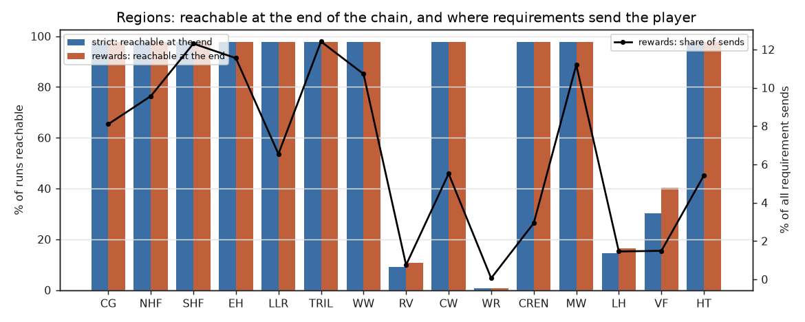
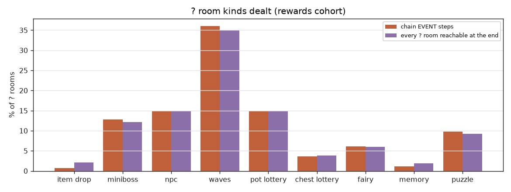
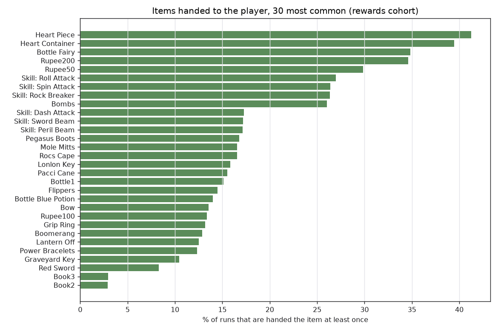
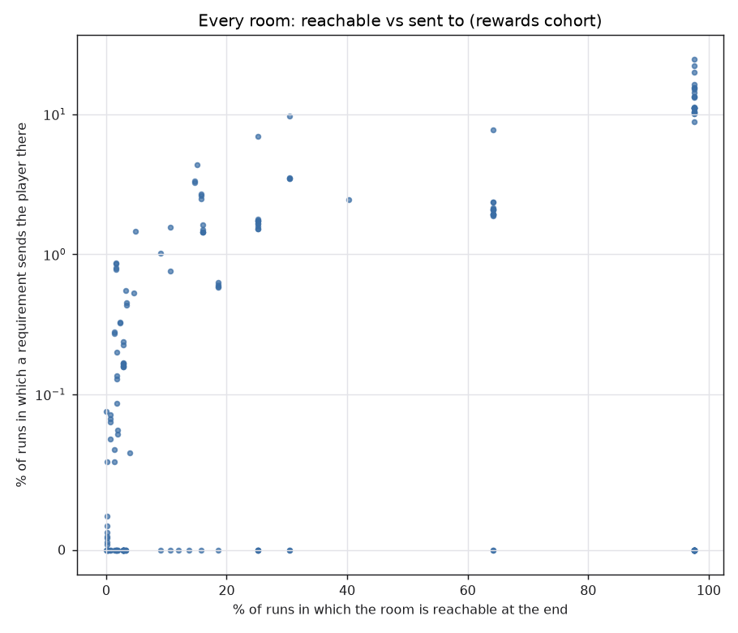

# QUICKSTART simulation study

Generated by `tools/quickstart/sim_study.py` from 500,000 strict and 500,000 rewards runs. Every number below is regenerated by running the tool; nothing is typed in by hand.

**Cohorts.** `strict` holds the three hub picks plus the chain's own ITEM steps: the placer's floor. `rewards` also collects every step's prize (a region clear's draw, a ? room's seeded prize), which can pay key items and grow the reach. Items are reported for `rewards`.

**Exact vs modelled.** The chain, the reach flood, the finale, the ? room kinds and their prizes are re-implemented from the C and replayed from the seed (checked against the ROM: `sim_validate.py`, `site_roll_validate.py`). The drop region, the hub offers, the quest host and a region clear's item come from the live RNG in the game and from a seeded Python RNG here.

## 1. Rooms: visited and reachable

The model knows 182 rooms (every surveyed destination and every region pool row). A room is VISITED when a requirement sends the player there (a chain step or the finale); the drop room is counted separately.

| | strict | rewards |
|---|---|---|
| rooms reachable in at least one run | 142 | 176 |
| rooms reachable in every run | 0 | 0 |
| rooms never reachable | 40 | 6 |
| rooms visited in at least one run | 90 | 116 |
| rooms never visited | 92 | 66 |
| reachable sometimes but never visited | 53 | 61 |
| median rooms reachable at the end of a run | 45 | 60 |
| median distinct rooms a run sends the player to (drop included) | 6 | 6 |

### Most visited rooms (rewards)

| room | runs visiting | reachable at end |
|---|---|---|
| HYRULE_TOWN/HYRULE_TOWN_MAIN | 24.6% | 97.6% |
| CAVES/CAVES_TRILBY_HIGHLANDS | 22.1% | 97.6% |
| HYRULE_FIELD/HYRULE_FIELD_NORTH_HYRULE_FIELD | 19.9% | 97.6% |
| HOUSE_INTERIORS_4/HOUSE_INTERIORS_4_RANCH_HOUSE_WEST | 16.4% | 97.6% |
| HYRULE_FIELD/HYRULE_FIELD_TRILBY_HIGHLANDS | 15.5% | 97.6% |
| HYRULE_FIELD/HYRULE_FIELD_EASTERN_HILLS_NORTH | 15.5% | 97.6% |
| HYRULE_FIELD/HYRULE_FIELD_SOUTH_HYRULE_FIELD | 15.1% | 97.6% |
| CASTLE_GARDEN/CASTLE_GARDEN_MAIN | 14.3% | 97.6% |
| DOJOS/DOJOS_GRIMBLADE | 13.4% | 97.6% |
| MINISH_HOUSE_INTERIORS/MINISH_HOUSE_INTERIORS_HYRULE_FIELD_SOUTHWEST | 13.3% | 97.6% |
| MINISH_HOUSE_INTERIORS/MINISH_HOUSE_INTERIORS_HYRULE_FIELD_EXIT | 13.2% | 97.6% |
| MINISH_WOODS/MINISH_WOODS_MAIN | 11.2% | 97.6% |
| HOUSE_INTERIORS_2/HOUSE_INTERIORS_2_LINKS_HOUSE_ENTRANCE | 11.1% | 97.6% |
| HOUSE_INTERIORS_2/HOUSE_INTERIORS_2_LINKS_HOUSE_SMITH | 11.1% | 97.6% |
| HOUSE_INTERIORS_2/HOUSE_INTERIORS_2_LINKS_HOUSE_BEDROOM | 11.1% | 97.6% |

### Least visited rooms that are ever visited (rewards)

| room | runs visiting | reachable at end |
|---|---|---|
| MINISH_CAVES/MINISH_CAVES_LAKE_HYLIA_NORTH | <0.01% | 0.13% |
| MINISH_CAVES/MINISH_CAVES_MINISH_WOODS_NORTH_1 | <0.01% | 0.13% |
| CASTOR_CAVES/CASTOR_CAVES_WIND_RUINS | <0.01% | 0.14% |
| MINISH_PATHS/MINISH_PATHS_LON_LON_RANCH | <0.01% | 0.19% |
| VEIL_FALLS_CAVES/VEIL_FALLS_CAVES_HALLWAY_BLOCK_PUZZLE | 0.01% | 0.13% |
| DOJOS/DOJOS_GRAYBLADE | 0.02% | 0.08% |
| MINISH_CRACKS/MINISH_CRACKS_LON_LON_RANCH_NORTH | 0.02% | 0.12% |
| CAVES/CAVES_LON_LON_RANCH | 0.06% | 0.14% |
| MINISH_HOUSE_INTERIORS/MINISH_HOUSE_INTERIORS_LIBRARI | 0.06% | 1.4% |
| LAKE_HYLIA/LAKE_HYLIA_MAIN | 0.06% | 3.9% |
| CAVES/CAVES_LON_LON_RANCH_WALLET | 0.06% | 1.4% |
| MINISH_CRACKS/MINISH_CRACKS_RUINS_ENTRANCE | 0.07% | 0.71% |
| MINISH_CAVES/MINISH_CAVES_SOUTHEAST_WATER_1 | 0.07% | 1.9% |
| DOJOS/DOJOS_TO_SCARBLADE | 0.08% | 1.9% |
| DOJOS/DOJOS_TO_SPLITBLADE | 0.08% | 0.69% |

### Reachable but never visited (61, rewards)

These rooms are inside the reach of some runs but host nothing a requirement can name: no ? room site, and not a region pool row.

| room | regions | reachable at end |
|---|---|---|
| MINISH_VILLAGE/MINISH_VILLAGE_MAIN | MW | 97.6% |
| MINISH_VILLAGE/MINISH_VILLAGE_SIDE_HOUSE_AREA | MW | 97.6% |
| MINISH_PATHS/MINISH_PATHS_MINISH_VILLAGE | MW | 97.6% |
| MINISH_HOUSE_INTERIORS/MINISH_HOUSE_INTERIORS_GENTARI_MAIN | MW | 97.6% |
| MINISH_HOUSE_INTERIORS/MINISH_HOUSE_INTERIORS_GENTARI_EXIT | MW | 97.6% |
| MINISH_HOUSE_INTERIORS/MINISH_HOUSE_INTERIORS_FESTARI | MW | 97.6% |
| MINISH_HOUSE_INTERIORS/MINISH_HOUSE_INTERIORS_RED | MW | 97.6% |
| MINISH_HOUSE_INTERIORS/MINISH_HOUSE_INTERIORS_GREEN | MW | 97.6% |
| MINISH_HOUSE_INTERIORS/MINISH_HOUSE_INTERIORS_BLUE | MW | 97.6% |
| MINISH_HOUSE_INTERIORS/MINISH_HOUSE_INTERIORS_SHOE_MINISH | MW | 97.6% |
| MINISH_HOUSE_INTERIORS/MINISH_HOUSE_INTERIORS_POT_MINISH | MW | 97.6% |
| DOJOS/DOJOS_TO_GRIMBLADE | CG | 97.6% |
| CRENEL_CAVES/CRENEL_CAVES_BOMB_BUSINESS_SCRUB | CREN | 97.6% |
| MINISH_CRACKS/MINISH_CRACKS_MINISH_WOODS_SOUTH | MW | 97.6% |
| HYRULE_CASTLE_CELLAR/HYRULE_CASTLE_CELLAR_0 | CG | 97.6% |
| DEEPWOOD_SHRINE_ENTRY/DEEPWOOD_SHRINE_ENTRY_MAIN | MW | 97.6% |
| TREE_INTERIORS/TREE_INTERIORS_MINISH_WOODS_BUSINESS_SCRUB | MW | 64.2% |
| CAVES/CAVES_KINSTONE_BUSINESS_SCRUB | MW | 64.2% |
| CASTOR_CAVES/CASTOR_CAVES_NORTH | CW | 30.4% |
| CASTOR_DARKNUT/CASTOR_DARKNUT_HALL | CW | 30.4% |
| CRENEL_CAVES/CRENEL_CAVES_HELMASAUR_HALLWAY | CREN | 25.2% |
| CRENEL_CAVES/CRENEL_CAVES_LADDER_TO_SPRING_WATER | CREN | 25.2% |
| CAVES/CAVES_TO_GRAVEYARD | NHF | 25.2% |
| CAVES/CAVES_BOTTLE_BUSINESS_SCRUB | TRIL | 25.2% |
| MINISH_CRACKS/MINISH_CRACKS_CASTOR_WILDS_NEXT_TO_BOW | CW | 18.6% |
| DIG_CAVES/DIG_CAVES_TRILBY_HIGHLANDS | TRIL | 15.7% |
| MINISH_HOUSE_INTERIORS/MINISH_HOUSE_INTERIORS_SIDE_AREA | MW | 13.7% |
| MT_CRENEL/MT_CRENEL_CENTER | CREN | 12.0% |
| ROYAL_VALLEY/ROYAL_VALLEY_FOREST_MAZE | RV | 10.6% |
| DOJOS/DOJOS_GREATBLADE | NHF | 9.1% |
| CASTOR_WILDS_DIG_CAVE/CASTOR_WILDS_DIG_CAVE_0 | CW | 3.3% |
| HYLIA_DIG_CAVES/HYLIA_DIG_CAVES_0 | LH | 3.2% |
| TREE_INTERIORS/TREE_INTERIORS_WAVEBLADE | LH | 3.2% |
| DIG_CAVES/DIG_CAVES_EASTERN_HILLS | EH | 3.1% |
| MT_CRENEL/MT_CRENEL_TOP | CREN | 2.8% |
| MT_CRENEL/MT_CRENEL_WALL_CLIMB | CREN | 2.8% |
| MT_CRENEL/MT_CRENEL_CAVERN_OF_FLAMES_ENTRANCE | CREN | 2.8% |
| MELARIS_MINE/MELARIS_MINE_MAIN | CREN | 2.8% |
| CRENEL_MINISH_PATHS/CRENEL_MINISH_PATHS_RAIN | CREN | 2.8% |
| CRENEL_MINISH_PATHS/CRENEL_MINISH_PATHS_MELARI | CREN | 2.8% |
| MINISH_HOUSE_INTERIORS/MINISH_HOUSE_INTERIORS_MELARI_MINES_SOUTHEAST | CREN | 2.8% |
| MINISH_HOUSE_INTERIORS/MINISH_HOUSE_INTERIORS_MELARI_MINES_EAST | CREN | 2.8% |
| CRENEL_CAVES/CRENEL_CAVES_PILLAR_CAVE | CREN | 2.8% |
| CRENEL_CAVES/CRENEL_CAVES_BRIDGE_SWITCH | CREN | 2.8% |
| CAVE_OF_FLAMES/CAVE_OF_FLAMES_ENTRANCE | CREN | 2.8% |
| DOJOS/DOJOS_SCARBLADE | CW | 1.9% |
| MINISH_CAVES/MINISH_CAVES_2 | CW | 1.9% |
| MINISH_PATHS/MINISH_PATHS_LAKE_HYLIA | LH | 1.8% |
| LAKE_HYLIA/LAKE_HYLIA_BEANSTALK | LH | 1.6% |
| HYLIA_DIG_CAVES/HYLIA_DIG_CAVES_1 | LH | 1.6% |
| VEIL_FALLS_TOP/VEIL_FALLS_TOP_0 | VF | 1.6% |
| MINISH_CAVES/MINISH_CAVES_LAKE_HYLIA_LIBRARI | LH | 1.4% |
| MINISH_CRACKS/MINISH_CRACKS_RUINS_TEKTITE | WR | 0.71% |
| MINISH_CAVES/MINISH_CAVES_RUINS | WR | 0.71% |
| CRENEL_MINISH_PATHS/CRENEL_MINISH_PATHS_BEAN | CREN | 0.24% |
| MINISH_CAVES/MINISH_CAVES_BEAN_PESTO | CREN | 0.24% |
| TEMPLE_OF_DROPLETS/TEMPLE_OF_DROPLETS_ENTRANCE | LH | 0.22% |
| CRENEL_DIG_CAVE/CRENEL_DIG_CAVE_0 | CREN | 0.18% |
| MINISH_CRACKS/MINISH_CRACKS_LAKE_HYLIA_EAST | LH | 0.13% |
| VEIL_FALLS_DIG_CAVE/VEIL_FALLS_DIG_CAVE_0 | VF | 0.10% |
| VEIL_FALLS_CAVES/VEIL_FALLS_CAVES_HALLWAY_HEART_PIECE | VF | <0.01% |

### Never reachable (6, rewards)

BEANSTALKS/BEANSTALKS_EASTERN_HILLS, GORON_CAVE/GORON_CAVE_MAIN, GORON_CAVE/GORON_CAVE_STAIRS, RUINS/RUINS_BELOW_FORTRESS_ENTRANCE, RUINS/RUINS_FORTRESS_ENTRANCE, TREE_INTERIORS/TREE_INTERIORS_WITCH_HUT

### By drop region

Where a run starts decides how much of the world it can ever see. A run is an ISLAND when, after all four requirements, it still cannot reach a single room outside the region it was dropped in.

| drop region | runs dropped there | median rooms reachable at the end | island runs |
|---|---|---|---|
| EH (Eastern Hills) | 10.8% | 60 | 0 |
| WW (Western Wood) | 10.6% | 60 | 0 |
| RV (Royal Valley) | 8.1% | 63 | 0 |
| HT (Hyrule Town) | 8.0% | 60 | 0 |
| SHF (South Hyrule Field) | 8.0% | 60 | 0 |
| TRIL (Trilby Highlands) | 8.0% | 60 | 0 |
| CG (Hyrule Castle Garden) | 8.0% | 60 | 0 |
| NHF (North Hyrule Field) | 8.0% | 60 | 0 |
| MW (Minish Woods) | 8.0% | 60 | 0 |
| LLR (Lon Lon Ranch) | 7.9% | 60 | 0 |
| CREN (Mount Crenel) | 7.9% | 60 | 0 |
| VF (Veil Falls) | 3.9% | 6 | 61.6% |
| CW (Castor Wilds) | 1.4% | 69 | 0 |
| WR (Wind Ruins) | 0.71% | 73 | 0 |
| LH (Lake Hylia) | 0.69% | 66 | 0 |

## 2. Win-condition chains

A chain is four requirements and a finale. The shape below is the four kinds in order, then the finale's carrier (`WAVE`, `BOSS` or `QUEST` in the element region).

265 distinct ordered shapes in the rewards cohort, 81 if order is ignored.

| | most common (rewards) | runs | | least common (rewards) | runs |
|---|---|---|---|---|---|
| 1 | `EVENT-EVENT-EVENT-EVENT > BOSS` | 6.7% | | `ITEM-BOSS-WAVE-WAVE > QUEST` | <0.01% |
| 2 | `EVENT-EVENT-EVENT-EVENT > WAVE` | 5.4% | | `QUEST-ITEM-WAVE-WAVE > WAVE` | <0.01% |
| 3 | `EVENT-EVENT-EVENT-EVENT > QUEST` | 3.0% | | `EVENT-EVENT-EVENT-ITEM > BOSS` | <0.01% |
| 4 | `EVENT-WAVE-EVENT-EVENT > BOSS` | 2.2% | | `ITEM-BOSS-EVENT-WAVE > QUEST` | <0.01% |
| 5 | `EVENT-EVENT-EVENT-WAVE > BOSS` | 2.2% | | `ITEM-EVENT-EVENT-QUEST > WAVE` | <0.01% |
| 6 | `ITEM-EVENT-EVENT-EVENT > WAVE` | 2.2% | | `ITEM-WAVE-BOSS-WAVE > QUEST` | <0.01% |
| 7 | `EVENT-EVENT-WAVE-EVENT > BOSS` | 2.2% | | `ITEM-WAVE-WAVE-BOSS > QUEST` | <0.01% |
| 8 | `WAVE-EVENT-EVENT-EVENT > BOSS` | 2.1% | | `QUEST-ITEM-WAVE-BOSS > WAVE` | <0.01% |
| 9 | `EVENT-ITEM-EVENT-EVENT > BOSS` | 2.1% | | `QUEST-ITEM-EVENT-WAVE > BOSS` | <0.01% |
| 10 | `ITEM-EVENT-EVENT-EVENT > BOSS` | 2.1% | | `QUEST-ITEM-WAVE-WAVE > BOSS` | <0.01% |
| 11 | `EVENT-EVENT-EVENT-WAVE > WAVE` | 1.8% | | `EVENT-EVENT-EVENT-ITEM > QUEST` | <0.01% |
| 12 | `EVENT-ITEM-EVENT-EVENT > WAVE` | 1.8% | | `ITEM-BOSS-ITEM-EVENT > QUEST` | <0.01% |

Ignoring order:

| kinds (any order) > finale | strict | rewards |
|---|---|---|
| `EVENT+EVENT+EVENT+WAVE > BOSS` | 9.0% | 8.8% |
| `EVENT+EVENT+EVENT+WAVE > WAVE` | 7.2% | 7.1% |
| `EVENT+EVENT+EVENT+EVENT > BOSS` | 6.7% | 6.7% |
| `EVENT+EVENT+EVENT+ITEM > BOSS` | 5.9% | 5.9% |
| `EVENT+EVENT+EVENT+ITEM > WAVE` | 5.6% | 5.6% |
| `EVENT+EVENT+EVENT+EVENT > WAVE` | 5.3% | 5.4% |
| `EVENT+EVENT+WAVE+WAVE > BOSS` | 4.5% | 4.4% |
| `EVENT+EVENT+EVENT+WAVE > QUEST` | 4.4% | 4.3% |
| `EVENT+EVENT+ITEM+WAVE > WAVE` | 4.1% | 4.2% |
| `EVENT+EVENT+ITEM+WAVE > BOSS` | 4.0% | 4.1% |
| `EVENT+EVENT+WAVE+WAVE > WAVE` | 4.0% | 3.9% |
| `BOSS+EVENT+EVENT+WAVE > WAVE` | 3.9% | 3.8% |
| `BOSS+EVENT+EVENT+EVENT > WAVE` | 3.3% | 3.4% |
| `EVENT+EVENT+EVENT+ITEM > QUEST` | 3.2% | 3.3% |
| `EVENT+EVENT+EVENT+EVENT > QUEST` | 3.1% | 3.0% |

Step kind by position (rewards):

| step | ITEM | EVENT | WAVE | BOSS | QUEST |
|---|---|---|---|---|---|
| 1 | 15.4% | 56.5% | 21.0% | 7.0% | 0.15% |
| 2 | 13.7% | 63.5% | 18.2% | 4.6% | 0.01% |
| 3 | 13.4% | 64.1% | 18.6% | 3.9% | <0.01% |
| 4 | 1.3% | 73.6% | 21.4% | 3.6% | <0.01% |

| finale carrier | strict | rewards |
|---|---|---|
| WAVE | 42.7% | 42.8% |
| BOSS | 32.6% | 32.5% |
| QUEST | 24.7% | 24.7% |
| fell back to the drop row | 4.0% | 4.0% |

### Requirements dealt in a room outside reach

A WAVE, BOSS or QUEST step and the finale are placed by the pool row's reach NODE (`QuickStartReachPoolOk`), not by the room test an EVENT uses. A row whose room the survey prices above its node can be dealt while the room itself is out of reach.

Runs with such a requirement: strict 0.06%, rewards 0.06%.

| requirement room | strict | rewards |
|---|---|---|
| FINALE RUINS/RUINS_BELOW_FORTRESS_ENTRANCE | 0.04% | 0.05% |
| RUINS/RUINS_BELOW_FORTRESS_ENTRANCE | 0.02% | 0.02% |

## 3. Where requirements must be met

Overworld means a region room (a field screen); interior means a cave, house, dojo or other pocket room.

| requirement | overworld | interior |
|---|---|---|
| EVENT | 0 | 100.0% |
| WAVE | 100.0% | 0 |
| BOSS | 100.0% | 0 |
| QUEST | 100.0% | 0 |
| FINALE WAVE | 100.0% | 0 |
| FINALE BOSS | 100.0% | 0 |
| FINALE QUEST | 100.0% | 0 |

By region, share of each requirement kind (rewards):

| region | EVENT | WAVE | BOSS | QUEST | finale | all sends |
|---|---|---|---|---|---|---|
| TRIL (Trilby Highlands) | 15.9% | 7.1% | 10.2% | 0 | 8.1% | 12.4% |
| SHF (South Hyrule Field) | 15.8% | 7.1% | 10.2% | 0 | 7.7% | 12.3% |
| EH (Eastern Hills) | 6.4% | 22.2% | 10.7% | 0 | 16.6% | 11.5% |
| MW (Minish Woods) | 15.4% | 7.1% | 10.1% | 0 | 3.8% | 11.2% |
| WW (Western Wood) | 6.8% | 22.5% | 0 | 0 | 13.6% | 10.7% |
| NHF (North Hyrule Field) | 9.2% | 8.1% | 11.5% | 0 | 11.4% | 9.6% |
| CG (Hyrule Castle Garden) | 8.7% | 8.0% | 11.3% | 0 | 6.0% | 8.1% |
| LLR (Lon Lon Ranch) | 8.1% | 0 | 11.5% | 0 | 6.7% | 6.5% |
| CW (Castor Wilds) | 6.0% | 8.4% | 0 | 0 | 3.2% | 5.5% |
| HT (Hyrule Town) | 0 | 8.8% | 12.1% | 0 | 15.5% | 5.4% |
| CREN (Mount Crenel) | 2.5% | 0 | 12.2% | 0 | 4.7% | 2.9% |
| VF (Veil Falls) | 1.6% | 0 | 0 | 100.0% | 2.4% | 1.5% |
| LH (Lake Hylia) | 2.5% | 0 | 0.08% | 0 | 0.05% | 1.5% |
| RV (Royal Valley) | 1.0% | 0.65% | 0 | 0 | 0.25% | 0.75% |
| WR (Wind Ruins) | 0.03% | 0.09% | 0 | 0 | 0.10% | 0.06% |

Finale carrier by element region (rewards):

| region | WAVE | BOSS | QUEST |
|---|---|---|---|
| CG | 2.3% | 2.1% | 1.6% |
| NHF | 4.7% | 5.1% | 1.6% |
| SHF | 3.3% | 2.8% | 1.6% |
| EH | 8.3% | 3.4% | 4.9% |
| LLR | 0 | 5.1% | 1.6% |
| TRIL | 3.4% | 3.1% | 1.6% |
| WW | 8.7% | 0 | 4.9% |
| RV | 0.08% | 0 | 0.17% |
| CW | 1.6% | 0 | 1.6% |
| WR | 0.08% | 0 | 0.02% |
| CREN | 0 | 3.1% | 1.6% |
| MW | 1.1% | 1.1% | 1.6% |
| LH | 0 | 0.01% | 0.03% |
| VF | 2.4% | 0 | 0.03% |
| HT | 7.0% | 6.9% | 1.6% |

Rooms hosting EVENT steps, most and least often (rewards):

| most | share | | least | share |
|---|---|---|---|---|
| CAVES/CAVES_TRILBY_HIGHLANDS | 8.6% | | MINISH_CAVES/MINISH_CAVES_LAKE_HYLIA_NORTH | <0.01% |
| HOUSE_INTERIORS_4/HOUSE_INTERIORS_4_RANCH_HOUSE_WEST | 6.4% | | MINISH_CAVES/MINISH_CAVES_MINISH_WOODS_NORTH_1 | <0.01% |
| DOJOS/DOJOS_GRIMBLADE | 5.2% | | CASTOR_CAVES/CASTOR_CAVES_WIND_RUINS | <0.01% |
| MINISH_HOUSE_INTERIORS/MINISH_HOUSE_INTERIORS_HYRULE_FIELD_SOUTHWEST | 5.2% | | MINISH_PATHS/MINISH_PATHS_LON_LON_RANCH | <0.01% |
| MINISH_HOUSE_INTERIORS/MINISH_HOUSE_INTERIORS_HYRULE_FIELD_EXIT | 5.1% | | VEIL_FALLS_CAVES/VEIL_FALLS_CAVES_HALLWAY_BLOCK_PUZZLE | <0.01% |
| HOUSE_INTERIORS_2/HOUSE_INTERIORS_2_LINKS_HOUSE_ENTRANCE | 4.3% | | DOJOS/DOJOS_GRAYBLADE | <0.01% |
| HOUSE_INTERIORS_2/HOUSE_INTERIORS_2_LINKS_HOUSE_SMITH | 4.3% | | MINISH_CRACKS/MINISH_CRACKS_LON_LON_RANCH_NORTH | <0.01% |
| HOUSE_INTERIORS_2/HOUSE_INTERIORS_2_LINKS_HOUSE_BEDROOM | 4.3% | | CAVES/CAVES_LON_LON_RANCH | 0.02% |
| TREE_INTERIORS/TREE_INTERIORS_PERCYS_TREEHOUSE | 4.3% | | MINISH_HOUSE_INTERIORS/MINISH_HOUSE_INTERIORS_LIBRARI | 0.02% |
| MINISH_CAVES/MINISH_CAVES_MINISH_WOODS_SOUTHWEST | 4.3% | | CAVES/CAVES_LON_LON_RANCH_WALLET | 0.03% |
| MINISH_HOUSE_INTERIORS/MINISH_HOUSE_INTERIORS_BARREL_MINISH | 4.3% | | MINISH_CRACKS/MINISH_CRACKS_RUINS_ENTRANCE | 0.03% |
| MINISH_HOUSE_INTERIORS/MINISH_HOUSE_INTERIORS_MINISH_WOODS_BOMB | 4.3% | | MINISH_CAVES/MINISH_CAVES_SOUTHEAST_WATER_1 | 0.03% |

108 ? room sites are live (not retired, no fusion gate). 8 were never dealt as an EVENT step in the rewards cohort: 18 GORON_CAVE_MAIN, 83 TREE_INTERIORS_WITCH_HUT, 84 DEEPWOOD_SHRINE_ENTRANCE, 86 BEANSTALKS_EASTERN_HILLS, 92 CRENEL_CAVES_FAIRY_FOUNTAIN, 94 CRENEL_CAVES_CHUCHU_POT_CHEST, 95 CRENEL_CAVES_SPINY_CHU_PUZZLE, 96 CRENEL_CAVES_WATER_HEART_PIECE.

## 4. Items handed to the player (rewards)

Counted: the three hub picks, every chain ITEM step, and every step prize (a WAVE or BOSS step's region clear, an EVENT step's ? room prize). Not counted: enemy drops, pots, fusions, side quests, ? rooms the chain does not name, and the finale's element. A pending ITEM step is paid by the next prize in the game; here the ITEM step is counted as its own delivery and the next prize as drawn.

Median items per run: 7. Median key items per run: 2.

| most common | runs | | least common (ever handed) | runs |
|---|---|---|---|---|
| Heart Piece | 41.2% | | Light Arrow | 0.03% |
| Heart Container | 39.4% | | Blue Sword | 0.04% |
| Bottle Fairy | 34.8% | | Skill: Fast Split | 0.04% |
| Rupee200 | 34.6% | | Skill: Great Spin | 0.04% |
| Rupee50 | 29.9% | | Skill: Fast Spin | 0.05% |
| Skill: Roll Attack | 27.0% | | Skill: Down Thrust | 0.05% |
| Skill: Spin Attack | 26.4% | | Remote Bombs | 0.08% |
| Skill: Rock Breaker | 26.4% | | Skill: Long Spin | 0.13% |
| Bombs | 26.0% | | Gold Flow | 0.13% |
| Skill: Dash Attack | 17.3% | | Gold Left | 0.15% |
| Skill: Sword Beam | 17.2% | | Gold Middle | 0.21% |
| Skill: Peril Beam | 17.1% | | Gold Right | 0.24% |
| Pegasus Boots | 16.8% | | Green Sword | 0.48% |
| Mole Mitts | 16.6% | | Fire Rod | 0.51% |
| Rocs Cape | 16.6% | | Arrow Butterfly | 0.59% |
| Lonlon Key | 15.8% | | Large Quiver | 0.70% |
| Pacci Cane | 15.5% | | Brioche | 0.86% |
| Bottle1 | 15.1% | | Orb Green | 0.86% |
| Flippers | 14.5% | | Mirror Shield | 0.99% |
| Bottle Blue Potion | 14.0% | | Croissant | 1.0% |

Items in the tier table never handed over by the counted sources (0): none. (The Ocarina and the Smith's Sword are handed over at boot, so no draw offers them.)

By source:

| source | deliveries | top items |
|---|---|---|
| BOSS prize | 72,821 | Bottle1 7.8%, Rupee50 7.7%, Heart Piece 6.9%, Bottle Blue Potion 6.8%, Bow 6.2%, Boomerang 6.0% |
| EVENT prize | 1,006,315 | Heart Piece 21.4%, Rupee50 13.2%, Rupee100 6.5%, Bottle1 4.4%, Heart Container 4.4%, Bottle Blue Potion 4.2% |
| WAVE prize | 395,663 | Rupee50 7.8%, Bottle1 7.7%, Bottle Blue Potion 6.8%, Heart Piece 6.8%, Bow 6.0%, Boomerang 5.9% |
| chain ITEM step | 218,990 | Lonlon Key 15.2%, Bombs 12.6%, Pacci Cane 12.6%, Pegasus Boots 12.5%, Mole Mitts 12.4%, Rocs Cape 11.6% |
| hub pick | 1,500,000 | Bottle Fairy 11.1%, Heart Container 11.1%, Rupee200 11.1%, Skill: Dash Attack 5.6%, Skill: Roll Attack 5.6%, Skill: Spin Attack 5.6% |

## 5. ? room events

What the chain's EVENT steps deal, and what every ? room a run can reach at its end would deal (the rooms an exploring player meets).

| kind | chain EVENT steps | reachable ? rooms |
|---|---|---|
| WAVES | 36.0% | 34.9% |
| NPC | 14.9% | 15.0% |
| POT_LOTTERY | 14.9% | 15.0% |
| MINIBOSS | 12.8% | 12.1% |
| PUZZLE | 9.8% | 9.2% |
| FAIRY | 6.1% | 6.0% |
| CHEST_LOTTERY | 3.6% | 3.8% |
| MEMORY | 1.1% | 1.9% |
| ITEM_DROP | 0.75% | 2.1% |

Finer labels (chain EVENT steps):

| label | share |
|---|---|
| WAVES | 27.0% |
| POT_LOTTERY | 14.9% |
| MINIBOSS | 12.8% |
| WAVES (stripped kit) | 9.0% |
| NPC (friendly) | 7.5% |
| NPC (evil) | 7.4% |
| FAIRY | 6.1% |
| CHEST_LOTTERY | 3.6% |
| PUZZLE variant 0 | 3.3% |
| PUZZLE variant 1 | 3.2% |
| PUZZLE variant 2 | 3.2% |
| MEMORY lesson | 0.93% |
| ITEM_DROP | 0.75% |
| MEMORY recital | 0.21% |

The survive-the-clock variant of WAVES is chosen per visit from the live stream (one visit in three) and is folded into WAVES here.

## 6. Rooms the overworld leads to that the build does not use

`tools/quickstart/room_census.py` walks every door, link, Minish hole and scroll seam out of every region room, asks the ROM's own containment at every policed door, and diffs the result against what the build incorporates (a survey destination, a ? room site, a pool row).

254 rooms hang off a region. 148 are incorporated. 53 can be entered but are unused; 53 are shut by containment.

Surveyed (reachable in the chain's model) but hosting no ? room site, so no requirement can send the player there:

| room | region | reached via | runs reachable (rewards) |
|---|---|---|---|
| CASTOR_CAVES/CASTOR_CAVES_NORTH | CW | CASTOR_WILDS_MAIN door (584,50) | 30.4% |
| CASTOR_DARKNUT/CASTOR_DARKNUT_HALL | CW | CASTOR_CAVES_DARKNUT door (104,24) | 30.4% |
| CAVES/CAVES_BOTTLE_BUSINESS_SCRUB | TRIL | CAVES_TRILBY_HIGHLANDS seam east edge | 25.2% |
| CAVES/CAVES_KINSTONE_BUSINESS_SCRUB | MW | TREE_INTERIORS_MINISH_WOODS_BUSINESS_SCRUB door (120,72) | 64.2% |
| CAVES/CAVES_TO_GRAVEYARD | NHF | HYRULE_FIELD_NORTH_HYRULE_FIELD door (264,312) | 25.2% |
| CRENEL_CAVES/CRENEL_CAVES_BOMB_BUSINESS_SCRUB | CREN | MT_CRENEL_ENTRANCE door (184,408) | 97.6% |
| CRENEL_CAVES/CRENEL_CAVES_BRIDGE_SWITCH | CREN | MT_CRENEL_CAVERN_OF_FLAMES_ENTRANCE door (568,184) | 2.8% |
| CRENEL_CAVES/CRENEL_CAVES_HELMASAUR_HALLWAY | CREN | MT_CRENEL_ENTRANCE door (408,216) | 25.2% |
| CRENEL_CAVES/CRENEL_CAVES_LADDER_TO_SPRING_WATER | CREN | MT_CRENEL_ENTRANCE door (728,392) | 25.2% |
| CRENEL_CAVES/CRENEL_CAVES_PILLAR_CAVE | CREN | MT_CRENEL_CAVERN_OF_FLAMES_ENTRANCE door (472,184) | 2.8% |
| CRENEL_MINISH_PATHS/CRENEL_MINISH_PATHS_BEAN | CREN | MT_CRENEL_ENTRANCE minish hole | 0.24% |
| CRENEL_MINISH_PATHS/CRENEL_MINISH_PATHS_MELARI | CREN | MT_CRENEL_CAVERN_OF_FLAMES_ENTRANCE minish hole | 2.8% |
| DEEPWOOD_SHRINE_ENTRY/DEEPWOOD_SHRINE_ENTRY_MAIN | MW | MINISH_WOODS_MAIN minish hole | 97.6% |
| DIG_CAVES/DIG_CAVES_TRILBY_HIGHLANDS | TRIL | HYRULE_FIELD_TRILBY_HIGHLANDS door (136,148) | 15.7% |
| DOJOS/DOJOS_GREATBLADE | NHF | DOJOS_TO_GREATBLADE seam north edge | 9.1% |
| DOJOS/DOJOS_SCARBLADE | CW | DOJOS_TO_SCARBLADE seam north edge | 1.9% |
| DOJOS/DOJOS_TO_GRIMBLADE | CG | CASTLE_GARDEN_MAIN door (936,388) | 97.6% |
| HYRULE_CASTLE_CELLAR/HYRULE_CASTLE_CELLAR_0 | CG | CASTLE_GARDEN_MAIN door (104,116) | 97.6% |
| MELARIS_MINE/MELARIS_MINE_MAIN | CREN | MT_CRENEL_CAVERN_OF_FLAMES_ENTRANCE minish hole | 2.8% |
| MINISH_CAVES/MINISH_CAVES_2 | CW | MINISH_CAVES_SOUTHEAST_WATER_1 seam north edge | 1.9% |
| MINISH_CAVES/MINISH_CAVES_BEAN_PESTO | CREN | MT_CRENEL_ENTRANCE door (456,24) | 0.24% |
| MINISH_CAVES/MINISH_CAVES_LAKE_HYLIA_LIBRARI | LH | LAKE_HYLIA_MAIN minish hole | 1.4% |
| MINISH_CAVES/MINISH_CAVES_RUINS | WR | RUINS_LADDER_TO_TEKTITES door (56,8) | 0.71% |
| MINISH_CRACKS/MINISH_CRACKS_LAKE_HYLIA_EAST | LH | LAKE_HYLIA_MAIN minish hole | 0.13% |
| MINISH_HOUSE_INTERIORS/MINISH_HOUSE_INTERIORS_BLUE | MW | MINISH_VILLAGE_MAIN door (424,520) | 97.6% |
| MINISH_HOUSE_INTERIORS/MINISH_HOUSE_INTERIORS_FESTARI | MW | MINISH_WOODS_MAIN minish hole | 97.6% |
| MINISH_HOUSE_INTERIORS/MINISH_HOUSE_INTERIORS_GENTARI_EXIT | MW | MINISH_VILLAGE_MAIN door (56,112) | 97.6% |
| MINISH_HOUSE_INTERIORS/MINISH_HOUSE_INTERIORS_GENTARI_MAIN | MW | MINISH_VILLAGE_MAIN door (120,136) | 97.6% |
| MINISH_HOUSE_INTERIORS/MINISH_HOUSE_INTERIORS_GREEN | MW | MINISH_VILLAGE_MAIN door (360,472) | 97.6% |
| MINISH_HOUSE_INTERIORS/MINISH_HOUSE_INTERIORS_MELARI_MINES_EAST | CREN | MELARIS_MINE_MAIN door (640,284) | 2.8% |
| MINISH_HOUSE_INTERIORS/MINISH_HOUSE_INTERIORS_MELARI_MINES_SOUTHEAST | CREN | MELARIS_MINE_MAIN door (552,544) | 2.8% |
| MINISH_HOUSE_INTERIORS/MINISH_HOUSE_INTERIORS_POT_MINISH | MW | MINISH_VILLAGE_MAIN door (72,584) | 97.6% |
| MINISH_HOUSE_INTERIORS/MINISH_HOUSE_INTERIORS_RED | MW | MINISH_VILLAGE_MAIN door (296,552) | 97.6% |
| MINISH_HOUSE_INTERIORS/MINISH_HOUSE_INTERIORS_SHOE_MINISH | MW | MINISH_VILLAGE_MAIN door (488,728) | 97.6% |
| MINISH_HOUSE_INTERIORS/MINISH_HOUSE_INTERIORS_SIDE_AREA | MW | MINISH_VILLAGE_SIDE_HOUSE_AREA door (312,104) | 13.7% |
| MINISH_PATHS/MINISH_PATHS_LAKE_HYLIA | LH | LAKE_HYLIA_MAIN minish hole | 1.8% |
| MINISH_PATHS/MINISH_PATHS_MINISH_VILLAGE | MW | MINISH_WOODS_MAIN minish hole | 97.6% |
| MINISH_VILLAGE/MINISH_VILLAGE_MAIN | MW | MINISH_WOODS_MAIN minish hole | 97.6% |
| MINISH_VILLAGE/MINISH_VILLAGE_SIDE_HOUSE_AREA | MW | MINISH_VILLAGE_MAIN seam east edge | 97.6% |
| ROYAL_VALLEY/ROYAL_VALLEY_FOREST_MAZE | RV | ROYAL_VALLEY_MAIN door (120,652) | 10.6% |
| TREE_INTERIORS/TREE_INTERIORS_MINISH_WOODS_BUSINESS_SCRUB | MW | MINISH_WOODS_MAIN door (528,456) | 64.2% |
| TREE_INTERIORS/TREE_INTERIORS_WAVEBLADE | LH | LAKE_HYLIA_MAIN door (256,696) | 3.2% |
| VEIL_FALLS_CAVES/VEIL_FALLS_CAVES_HALLWAY_HEART_PIECE | VF | VEIL_FALLS_MAIN door (56,40) | <0.01% |

A ? room site with no survey row (the chain cannot price it, so never names it):

- CRENEL_CAVES/CRENEL_CAVES_CHUCHU_POT_CHEST (CREN)
- CRENEL_CAVES/CRENEL_CAVES_FAIRY_FOUNTAIN (CREN)
- CRENEL_CAVES/CRENEL_CAVES_SPINY_CHU_PUZZLE (CREN)
- CRENEL_CAVES/CRENEL_CAVES_WATER_HEART_PIECE (CREN)
- DEEPWOOD_SHRINE/DEEPWOOD_SHRINE_ENTRANCE (MW)

Enterable, not surveyed, no site (by owning region):

| region | rooms |
|---|---|
| CREN | CAVE_OF_FLAMES_AFTER_CANE, CAVE_OF_FLAMES_BEFORE_GLEEROK, CAVE_OF_FLAMES_BOB_OMB_WALL, CAVE_OF_FLAMES_BOSSKEY_PATH1, CAVE_OF_FLAMES_BOSSKEY_PATH2, CAVE_OF_FLAMES_BOSS_DOOR, CAVE_OF_FLAMES_CART_TO_SPINY_CHU, CAVE_OF_FLAMES_CART_WEST, CAVE_OF_FLAMES_COMPASS, CAVE_OF_FLAMES_HELMASAUR_FIGHT, CAVE_OF_FLAMES_MAIN_CART, CAVE_OF_FLAMES_MINISH_LAVA_ROOM, CAVE_OF_FLAMES_MINISH_SPIKES, CAVE_OF_FLAMES_NORTH_ENTRANCE, CAVE_OF_FLAMES_ROLLOBITE_LAVA_ROOM, CAVE_OF_FLAMES_SPINY_CHU, CAVE_OF_FLAMES_TOMPAS_DOOM, CRENEL_CAVES_RUPEE_FAIRY_FOUINTAIN, MINISH_CRACKS_MT_CRENEL |
| EH+MW+WR | BEANSTALKS_7, BEANSTALKS_8, BEANSTALKS_9, BEANSTALKS_CRENEL_CLIMB, BEANSTALKS_EASTERN_HILLS_CLIMB, BEANSTALKS_LAKE_HYLIA_CLIMB, BEANSTALKS_RUINS_CLIMB |
| LLR | CAVES_LON_LON_RANCH_SECRET |
| MW | DEEPWOOD_SHRINE_16, DEEPWOOD_SHRINE_BARREL, DEEPWOOD_SHRINE_BLUE_PORTAL, DEEPWOOD_SHRINE_BOSS_DOOR, DEEPWOOD_SHRINE_BOSS_KEY, DEEPWOOD_SHRINE_BUTTON, DEEPWOOD_SHRINE_COMPASS, DEEPWOOD_SHRINE_DOUBLE_STATUE, DEEPWOOD_SHRINE_INSIDE_BARREL, DEEPWOOD_SHRINE_LEVER, DEEPWOOD_SHRINE_LILY_PAD_EAST, DEEPWOOD_SHRINE_LILY_PAD_WEST, DEEPWOOD_SHRINE_MADDERPILLAR, DEEPWOOD_SHRINE_MAP, DEEPWOOD_SHRINE_MULLDOZER, DEEPWOOD_SHRINE_PILLARS, DEEPWOOD_SHRINE_POT_BRIDGE, DEEPWOOD_SHRINE_STAIRS_TO_B1, DEEPWOOD_SHRINE_TORCHES, MINISH_CAVES_6 |
| RV | ROYAL_CRYPT_0, ROYAL_CRYPT_ENTRANCE, ROYAL_CRYPT_GIBDO, ROYAL_CRYPT_KEY_BLOCK, ROYAL_CRYPT_MUSHROOM_PIT, ROYAL_CRYPT_WATER_ROPE |

Shut by containment (a policed door into them is cancelled), unused:

| room | region | door |
|---|---|---|
| BEANSTALKS_WESTERN_WOODS_CLIMB | WW | HYRULE_FIELD_WESTERN_WOODS_SOUTH minish hole |
| CAVES_HYRULE_TOWN_WATERFALL | HT | HYRULE_TOWN_MAIN door (240,392) |
| HOUSE_INTERIORS_1_16 | HT | HOUSE_INTERIORS_1_1f seam north edge |
| HOUSE_INTERIORS_1_1f | HT | HOUSE_INTERIORS_1_SCHOOL_WEST seam south edge |
| HOUSE_INTERIORS_1_INN_1F | HT | HYRULE_TOWN_MAIN door (904,600) |
| HOUSE_INTERIORS_1_INN_EAST_2F | HT | HYRULE_TOWN_MAIN door (936,536) |
| HOUSE_INTERIORS_1_INN_EAST_ROOM | HT | HOUSE_INTERIORS_1_INN_1F door (248,24) |
| HOUSE_INTERIORS_1_INN_MIDDLE_ROOM | HT | HOUSE_INTERIORS_1_INN_1F door (184,24) |
| HOUSE_INTERIORS_1_INN_MINISH_HEART_PIECE | HT | HYRULE_TOWN_MAIN minish hole |
| HOUSE_INTERIORS_1_INN_WEST_2F | HT | HYRULE_TOWN_MAIN door (872,440) |
| HOUSE_INTERIORS_1_INN_WEST_ROOM | HT | HOUSE_INTERIORS_1_INN_1F door (120,24) |
| HOUSE_INTERIORS_1_LIBRARY_1F | HT | HYRULE_TOWN_MAIN door (360,168) |
| HOUSE_INTERIORS_1_LIBRARY_2F | HT | HYRULE_TOWN_MAIN door (312,72) |
| HOUSE_INTERIORS_1_MAYOR | HT | HYRULE_TOWN_MAIN door (712,312) |
| HOUSE_INTERIORS_1_POST_OFFICE | HT | HYRULE_TOWN_MAIN door (72,168) |
| HOUSE_INTERIORS_1_SCHOOL_EAST | HT | HYRULE_TOWN_MAIN door (808,104) |
| HOUSE_INTERIORS_1_SCHOOL_WEST | HT | HYRULE_TOWN_MAIN door (712,152) |
| HOUSE_INTERIORS_2_CUCCO | HT | HYRULE_TOWN_MAIN door (952,856) |
| HOUSE_INTERIORS_2_DR_LEFT | HT | HYRULE_TOWN_MAIN door (56,584) |
| HOUSE_INTERIORS_2_EAST_ORACLE | HT | HYRULE_TOWN_MAIN door (696,864) |
| HOUSE_INTERIORS_2_JULIETTA | HT | HYRULE_TOWN_MAIN door (840,760) |
| HOUSE_INTERIORS_2_ROMIO | HT | HYRULE_TOWN_MAIN door (744,752) |
| HOUSE_INTERIORS_2_STRANGER | HT | HYRULE_TOWN_MAIN door (152,360) |
| HOUSE_INTERIORS_2_WEST_ORACLE | HT | HYRULE_TOWN_MAIN door (64,440) |
| HOUSE_INTERIORS_3_BAKERY | HT | HYRULE_TOWN_MAIN door (632,496) |
| HOUSE_INTERIORS_3_BORLOV_ENTRANCE | HT | HYRULE_TOWN_MAIN door (664,600) |
| HOUSE_INTERIORS_3_CAFE | HT | HYRULE_TOWN_MAIN door (408,744) |
| HOUSE_INTERIORS_3_CARLOV | HT | TREE_INTERIORS_STAIRS_TO_CARLOV door (120,72) |
| HOUSE_INTERIORS_3_FIGURINE_HOUSE | HT | HYRULE_TOWN_MAIN door (376,656) |
| HOUSE_INTERIORS_3_REM_SHOE_SHOP | HT | HYRULE_TOWN_MAIN door (376,528) |
| HOUSE_INTERIORS_3_SIMON | HT | HYRULE_TOWN_MAIN door (376,592) |
| HOUSE_INTERIORS_3_STOCKWELL_SHOP | HT | HYRULE_TOWN_MAIN door (600,744) |
| HOUSE_INTERIORS_4_CARPENTER | HT | HYRULE_TOWN_MAIN door (144,712) |
| HOUSE_INTERIORS_4_SWIFTBLADE | HT | HYRULE_TOWN_MAIN door (312,904) |
| HYRULE_CASTLE_0 | CG | CASTLE_GARDEN_MAIN door (504,40) |
| HYRULE_CASTLE_1 | CG | HYRULE_CASTLE_3 door (104,24) |
| HYRULE_CASTLE_2 | CG | HYRULE_CASTLE_CELLAR_1 seam north edge |
| HYRULE_CASTLE_3 | CG | HYRULE_CASTLE_0 door (72,216) |
| HYRULE_CASTLE_4 | CG | HYRULE_CASTLE_2 seam east edge |
| HYRULE_CASTLE_CELLAR_1 | CG | HYRULE_CASTLE_0 seam north edge |
| HYRULE_DIG_CAVES_TOWN | HT | HYRULE_TOWN_UNDERGROUND_0 door (72,248) |
| HYRULE_TOWN_MINISH_CAVES_0 | HT | HYRULE_TOWN_MAIN minish hole |
| HYRULE_TOWN_UNDERGROUND_0 | HT | HYRULE_TOWN_MAIN door (824,308) |
| HYRULE_TOWN_UNDERGROUND_1 | HT | HYRULE_TOWN_UNDERGROUND_0 door (312,568) |
| MINISH_HOUSE_INTERIORS_HYRULE_TOWN | HT | HYRULE_TOWN_MAIN door (56,424) |
| MINISH_PATHS_SCHOOLYARD | HT | HYRULE_TOWN_MAIN minish hole |
| MINISH_RAFTERS_CAFE | HT | HYRULE_TOWN_MAIN minish hole |
| MINISH_RAFTERS_STOCKWELL | HT | HYRULE_TOWN_MAIN minish hole |
| SANCTUARY_HALL | CG | SANCTUARY_ENTRANCE_MAIN door (136,56) |
| SANCTUARY_MAIN | CG | SANCTUARY_HALL seam north edge |
| SANCTUARY_STAINED_GLASS | CG | SANCTUARY_MAIN door (232,40) |
| SANCTUARY_ENTRANCE_MAIN | CG | HYRULE_CASTLE_3 door (280,456) |
| TREE_INTERIORS_STAIRS_TO_CARLOV | HT | HYRULE_TOWN_MAIN door (80,888) |

