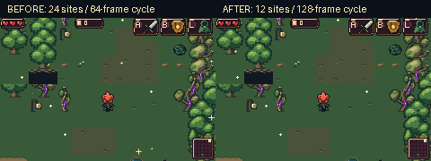
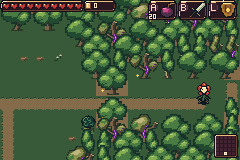
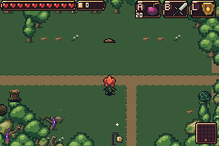
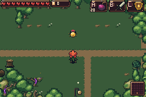
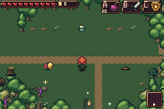
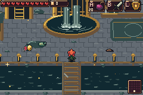
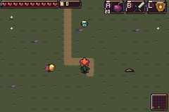

# Quieter glitter and new enemy prototypes

Glitter now appears **50% less on average** and blinks **half as often**. This
includes sparse rooms: a single eligible sparkle contributes half its former
visible time. Ambient cycles grow64→128 video frames; decorative gold borders
advance every16 frames instead of8. Button feedback and the minimap's blinking
current-room marker retain their functional timings.

Both panes are actual native240×160 mGBA views of the same generated room.
Labels sit above the images. The512-frame comparison uses exact decoded RGB
pixels and frame durations. Ordinary Drain/forest/cave views average12→6
visible glints; the sparse deep-forest view averages0.5→0.25.

## Enemy proposal report

The [full report](../bartgame/docs/enemy-prototypes/PROPOSALS.md) proposes
**16 enemy families**, grounded in the original Zelda Fan Game handoff's
**71 curated enemy/form entries**. It explains movement, attack timing,
health, damage, vulnerability, tool interactions and room requirements.
The [source audit](../bartgame/docs/enemy-prototypes/SOURCE_AUDIT.md) identifies
original behavior, deliberate adaptations and missing tool dependencies.

Three are playable now in a separate mechanic lab. **Names, artwork and tuning
are provisional.** The other thirteen are proposals awaiting implementation.
The normal game's five selected enemy families and broken purple Heart remain
in its procedural roster.

| Prototype / source | Attack and counter | HP / contact damage |
| --- | --- | --- |
| **Gilt Leech / Rope** | Compresses for30 updates, then commits to a straight1.625px/update charge. Sidestep and punish its36-update recovery. | 4 / 2 |
| **Root Maw / red Leever** | A visible mound announces24 updates of emergence. Attack during its180-update exposed phase or24-update retreat; buried phases reject damage. | 6 / 2 |
| **Reliquary Snout / Helmasaur** | A bright brass front blocks hits. After a60-update brace it rushes at3px/update with locked facing; strike a side/rear during recovery. | 4 / 2 |

One player heart is8 HP; ordinary sword/arrow hits deal2 enemy HP. These
prototypes are sword-solvable. The candle currently burns terrain, **not
enemies**; the report does not invent fire damage or a missing Gust Jar.
Knockback, menus and dialogue pause the relevant AI timers.

## Actual mGBA recordings

These are native gameplay samples from the optional lab, not source-pose
animations or repainted mockups. [Validation methods](../bartgame/docs/enemy-prototypes/VALIDATION.md)
explain navigation, equipment, healing and coordinate-only positioning fixtures.
The lab replaces ordinary actors to isolate each fight, while retaining the
real generated terrain, real player attacks and live enemy state machines.
Enemy HP, AI state, facing, flags and timers were never assigned by the harness.

| Gilt Leech: warning, charge, wall stop | Root Maw: emergence and pursuit | Reliquary Snout: front block, rear hit |
| --- | --- | --- |
|  |  |  |

| Mixed healthy forest | Mixed sewer | Mixed deep forest |
| --- | --- | --- |
|  |  |  |

[Leech filmstrip](gilt-leech-filmstrip.png) ·
[Maw filmstrip](root-maw-filmstrip.png) ·
[Snout filmstrip](reliquary-snout-filmstrip.png) ·
[Native authored pose sheet](source-poses.png).
The pose sheet is source art, with native and nearest-neighbor inspection
copies; it is **not** an emulator render.

## Downloads and controls

- [Normal game ROM](../downloads/glitter-enemies-ef63b92/bartgame-quieter-glitter-ef63b92.gba): quieter glitter, existing production roster.
- [Separate enemy-lab ROM](../downloads/glitter-enemies-ef63b92/enemy-lab-ef63b92.gba): three experiments and mixed encounter.
- [Both ROMs as a ZIP](../downloads/glitter-enemies-ef63b92/bartgame-and-enemy-lab.zip).
- [Complete native recordings, traces and frozen build bundles](../downloads/glitter-enemies-ef63b92/native-evidence.zip).
- [SHA256 checksums](../downloads/glitter-enemies-ef63b92/SHA256SUMS.txt).

Open the lab ROM in mGBA, start **New Game**, and dismiss the introduction.
**Select** cycles Leech → Maw → Snout → mixed. Initially **B** is sword,
**L** is shield and **A** is blightseeds. **Start** opens inventory; equip tools
with A/B/L, R changes pages and Start closes it. Switching cases resets actors
and grants ten hearts, twenty blightseeds, fifty arrows and current tools.
Tool use can still change supported terrain; selecting a case does not
regenerate the room.

Lab run-save loading, writing and erasure are disabled. It cannot import a
normal run or persist its granted progression. Appearance preferences retain
their separate settings record. The normal build uses `BART_ENEMY_LAB=0`;
the optional lab uses `1`. Neither build is instrumented for profiling.

## Qualification and limits

Both ROMs build from game source
[`ef63b92e`](https://github.com/natertott/bartgame/commit/ef63b92e3608805c60fddd2fbbb0b6c930e3033b).
The evidence archive includes exact ROM/ELF/map/header bundles, input hashes,
the matching capture tools and every native sample. The final capture tool's
later camera-settling improvements affect fixtures only; they do not change
the frozen game ROM. The workspace's ordinary make target remains the normal
production build.

| Check | Result / evidence |
| --- | --- |
| Fresh actual glitter capture | [187/187](validation/glitter-after.json); [baseline331/331](validation/glitter-before.json) |
| Paired density/cadence | [27/27](validation/glitter-comparison.json), four512-frame contexts |
| Actual-C density checks | [656 cases](validation/glitter-host.json), including192 odd-count views;4,265,136 assertions |
| Native glitter art/palettes | [4/4 unchanged](validation/glitter-assets.json) |
| Decoded native assets and lab save isolation | [300/300](validation/asset-save-audit.json); existing terrain, sprites, palettes and IDs preserved |
| Fresh actual lab mechanics | [110/110](validation/lab-summary.json),14 scenarios,2,952 video frames;742 PNG samples and14 exact GIFs |
| Normal HUD / forest / saves | [290/290](validation/normal-hud.json), [80/80](validation/normal-forest.json), [6/6](validation/normal-save.txt) |
| Normal sustained enemy loads | [30 scenarios](validation/normal-stress.json),5,400/5,400 updates,4–24 actual enemies |
| Mixed lab native cadence | Healthy, sewer and deep samples hold one update per eligible video frame; peak world OBJ allocation776 tiles, below reserved HUD boundary876 |

The HUD/forest/save/stress checks use the byte-identical final normal candidate;
glitter, lab and asset/save-isolation checks also run fresh on the frozen
bundles. These are finite controlled samples, not an unassisted full playthrough
or a guarantee for arbitrary future enemy counts. Fixture setup can take several
video frames and is excluded from steady combat timing. The Maw's conservative
straight dry-route check can defer emergence in cramped rooms. Moving onto its
announced mound can still be punished when emergence completes. Helmet removal
and fire counters are deferred, as are production spawning and final art polish.
