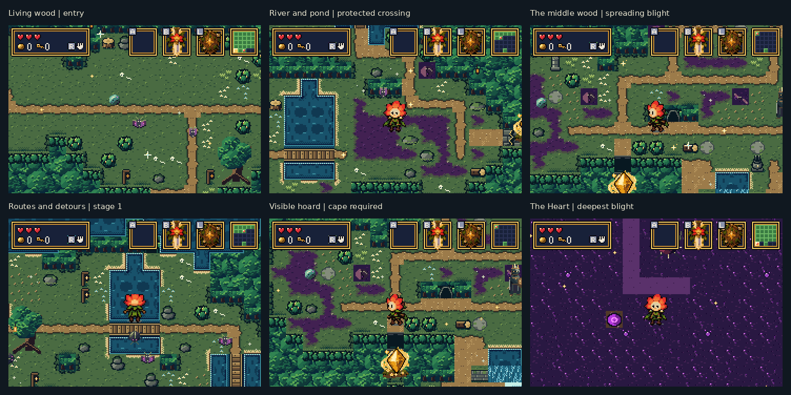
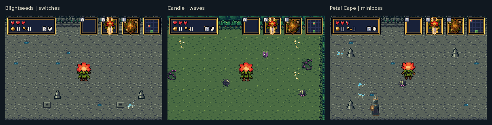
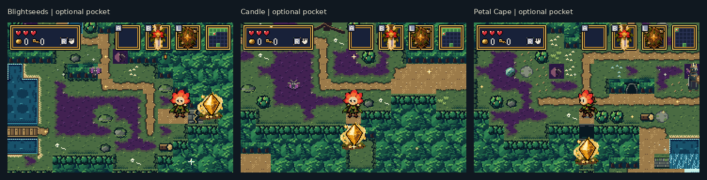

# Forest engine and artwork rework — real mGBA review

## Latest: blended surfaces and clean item icons

[Open the matched before/after and in-game item gallery](polish/README.md).
This pass separates prop art from its floor, blends diagonal blight edges,
and simplifies all active item-icon frames. The engine-rework images below
are retained as the earlier comparison, before this surface/icon pass.

The maze now has three earned progression trials, tunable route lengths,
required detours, optional item-gated glades, and more coherent terrain.
The images below are from the actual built ROM running in mGBA 0.10.5.
Debug navigation and healing frame the generated rooms for inspection;
the terrain, enemies, animation, and UI are rendered by the game. The sheets
only enlarge native 240×160 frames 2× and add captions outside them.

## The new forest

## Earn the three rewards

Floor plates grant **Blightseeds**, a wave trial grants the **candle**, and a
guardian grants the **Petal Cape**. Each task is reachable before its item is
needed. There is no free field chest for a required item. Required trials
allow retreat; an earned but unclaimed reward survives revisiting.

## Come back with the right item

These optional glades show their hoards before the player has the required
item. Bombs open the cracked neck, the candle burns the web, and the cape
crosses a two-tile chasm. Openings and collected loot persist. Trails can
point toward these detours, while a real exit's dirt lane may be overgrown.

## Three actual runs

The balanced profile targets **24–32 required room crossings**, at least two
reward detours and at least four optional cells. Crossings include the
necessary returns from branches; combat and travel inside rooms add time.

| Seed | Required crossings | Optional rooms | Repeated crossings | Graph | Native frames |
| --- | ---: | ---: | ---: | --- | --- |
| `0xB4A7` | 26 | 4 | 6 | [Maze](generation/seed-b4a7/maze.svg) | [25 rooms and trials](generation/seed-b4a7/) |
| `0xDEADBEEF` | 26 | 6 | 8 | [Maze](generation/seed-deadbeef/maze.svg) | [25 rooms and trials](generation/seed-deadbeef/) |
| `6` | 30 | 4 | 10 | [Maze](generation/seed-6/maze.svg) | [25 rooms and trials](generation/seed-6/) |

Each seed folder includes `generation.json` with the ROM SHA256, required
route legs, room stages and task locations. The SVGs are review diagrams of
the generated maze, separate from the game screenshots.

## Validation

- Host: **19,999 solvability seeds** and **15,000 pacing cases** passed.
- Real ROM: **625/625 rooms across 25 seeds** passed required traversal,
  bridge-bank and correct-item pocket checks. This includes 926 crossing
  lanes, 75 required task mouths and 338 optional pockets, with no
  wrong-item pocket bypasses.
- Required trials **54/54**; critical path and Heart **21/21 on two seeds**;
  pocket actions/persistence **18/18**; optional mysteries **28/28**;
  mechanics **22/22**; quests **12/12**; relic revisits **8/8**;
  legacy-save migration **6/6**.
- Representative normal rooms and the Heart sustained **180 game updates
  per 180 video frames** in mGBA.
- Forest art uses **852/1024 subtiles and 11/12 material palettes**. The
  Drain's artwork is retained.

[Validation JSON](generation/validation.json) · [Test logs and room report](generation/validation/) ·
[Generation and tuning guide](../bartgame/docs/FOREST_GENERATION.md) ·
[Artwork implementation notes](../bartgame/docs/FOREST_ART.md)

## Previous artwork-only revision

The [earlier forest sheet](forest-mgba.png), [mystery sheet](mysteries-mgba.png)
and [original native captures](captures/) are retained for comparison. Their
old-layout invariance results apply to that artwork-only revision; the
current engine intentionally generates new layouts.

Compiled ROMs, local ZIP bundles and save fixtures are excluded from Git.
