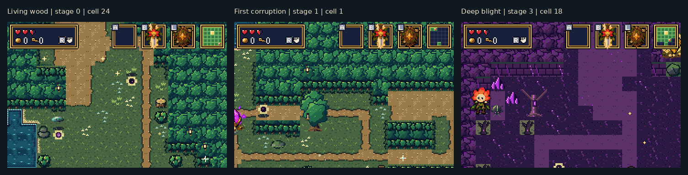
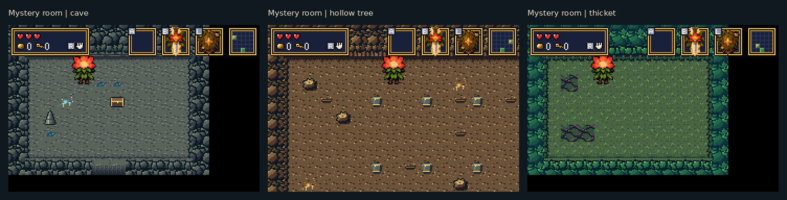

# Forest artwork — actual mGBA captures

These screenshots come from the built BARTGAME ROM running in mGBA 0.10.5,
seed `0xB4A7`. Debug room navigation selects the game's generated rooms;
the terrain and actors are rendered by the game. The sheets below enlarge
frames 2× using nearest-neighbour sampling, with captions outside the frames.

## Forest progression

## Mystery rooms

[Native 240×160 screenshots](captures/) · [Capture metadata and ROM digest](captures/capture.json) · [Validation results](validation.json)

All 25 room collision/spawn contracts matched the original build for this
seed. The Drain control frame matched pixel for pixel. Mechanics passed
22/22, mystery rooms 28/28, and critical path/boss 18/18 on two seeds.

See [the art implementation notes](../bartgame/docs/FOREST_ART.md) for build
and capture instructions. Compiled ROMs and local ZIP bundles are excluded
from this commit.
