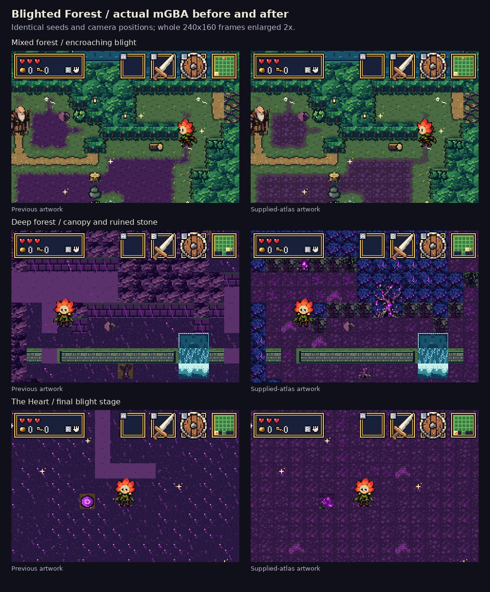
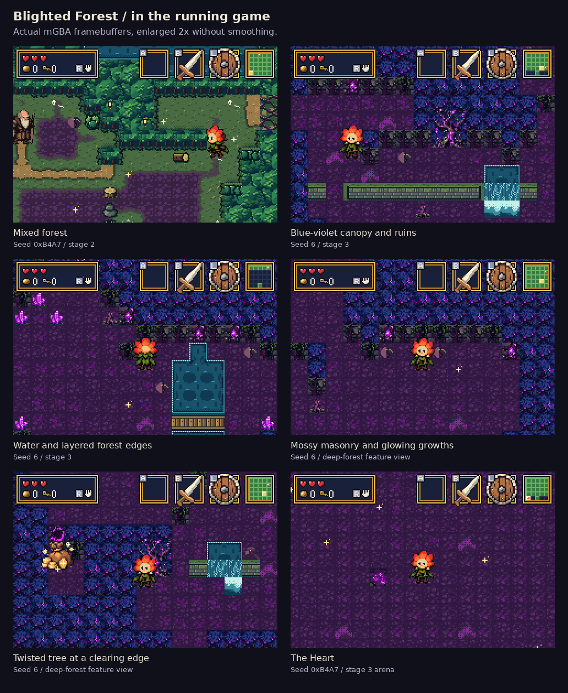
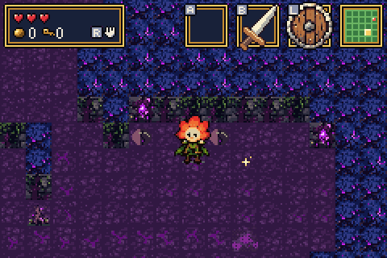
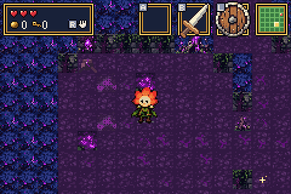
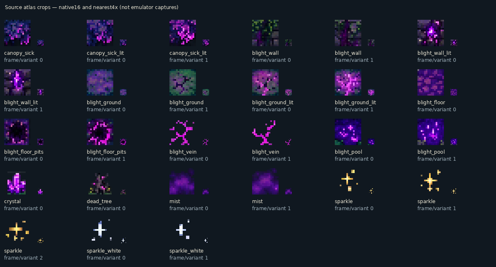

# Blighted Forest atlas pass — actual mGBA runs

The new artwork follows the supplied atlas: blue-violet canopy with pink
growths, mossy stone with luminous fissures, purple earth, crystals,
twisted trees, glowing pools and drifting mist. Ground and trail detail is
quieter so bright growths remain distinct. Grass-to-blight borders use a
wider irregular fringe, and transparent props reveal the floor beneath.

[Download the playable ROM](../../downloads/README.md) ·
[Validation](validation.json) · [Implementation notes](../../bartgame/docs/BLIGHT_REFERENCE.md)

## Before and after

These are actual mGBA 0.10.5 framebuffers from identical seeds and standing
positions, enlarged 2× without smoothing. The native frames are unmodified
240×160 PNGs. Captions are outside the game image.

## In the running forest

The larger twisted trees now appear along existing solid clearing edges
in deep rooms where the wall geometry allows. The 5×5 maze, required
items, barriers, rewards, collision and spawn positions are retained.
Walkable cracks, real holes and harmful pools keep their separate roles.

## Actual animation

The clips sample 96 real video frames at every other frame and enlarge
2× without smoothing. GIF palettes may be reduced; the PNGs retain the
original framebuffer colours.

## Captures and controls

- [New seed 0xB4A7: all 25 rooms and feature views](after/seed-b4a7/)
- [New seed 6: all 25 rooms and feature views](after/seed-6/)
- [Previous seed 0xB4A7](before/seed-b4a7/) · [Previous seed 6](before/seed-6/)
- [Capture and file-hash manifest](gallery.json)

The fixture navigates real generated rooms, heals Bloom, clears enemies
and ambient firefly actors, and settles the camera. It synchronizes the
animation clock, then runs 64 frames before each screenshot. Terrain,
objects, sparkle, mist and tile animation are rendered by the game.

Ordinary healthy terrain and the Drain controls match exactly. Seed 6's
early room 7 already contains one **blight pool**; that existing hazard
also receives the new artwork. Its control report explicitly records the
16×16 change and verifies every surrounding pixel remains identical.

## Verification

- **3,540/3,540 scope checks:** retained normal forest, Drain and mystery
  tiles, all their animation frames, all 29 sprite sheets, item palettes
  and the title bitmap match the previous ROM. All original tile contracts
  and appended cosmetic contracts are checked separately from artwork.
- **75/75 generated rooms:** physical layouts and spawn records unchanged.
- **2,538/2,538 surface checks:** transparent props, substrates, layering,
  lifting and chest rendering pass.
- **21/21 critical-path checks:** all three rewards, barriers, Heart and
  Grail remain completable. Optional mysteries pass **28/28**.
- Normal, deep and Heart views each sustain **180 updates / 180 video frames**.
- Forest materials fit **993/1024 subtiles and 12/12 palettes**.

## Reference samples

This last sheet shows **source-asset samples**, not a game screenshot.
The game reduces them to 16-colour material palettes and RGB555, adjusts
their contrast and blends them into the generated forest.

[Supplied screenshot](../../bartgame/art/ref/blight-reference.jpg) ·
[Higher-resolution original of the same atlas](../../bartgame/art/ref/tile_art/blight.webp) ·
[Source import metadata](import.json)

Built from source [`cdb99b8`](https://github.com/natertott/bartgame/commit/cdb99b8ff213cd4328083b750acb9513237704b1).
All new captures and reports identify ROM SHA256
`d3b9049cdcc48f43aa6415838d28fa8f2efc15cdeb6341b2660dbe244b95bd76`.
