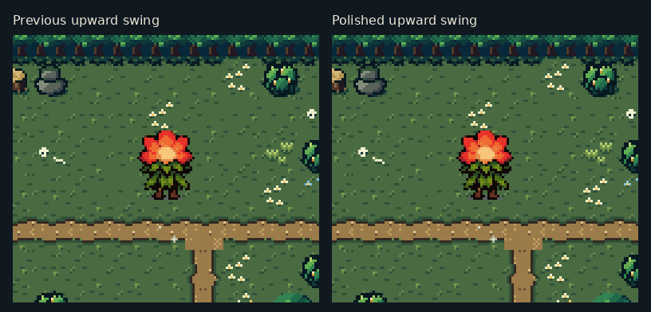
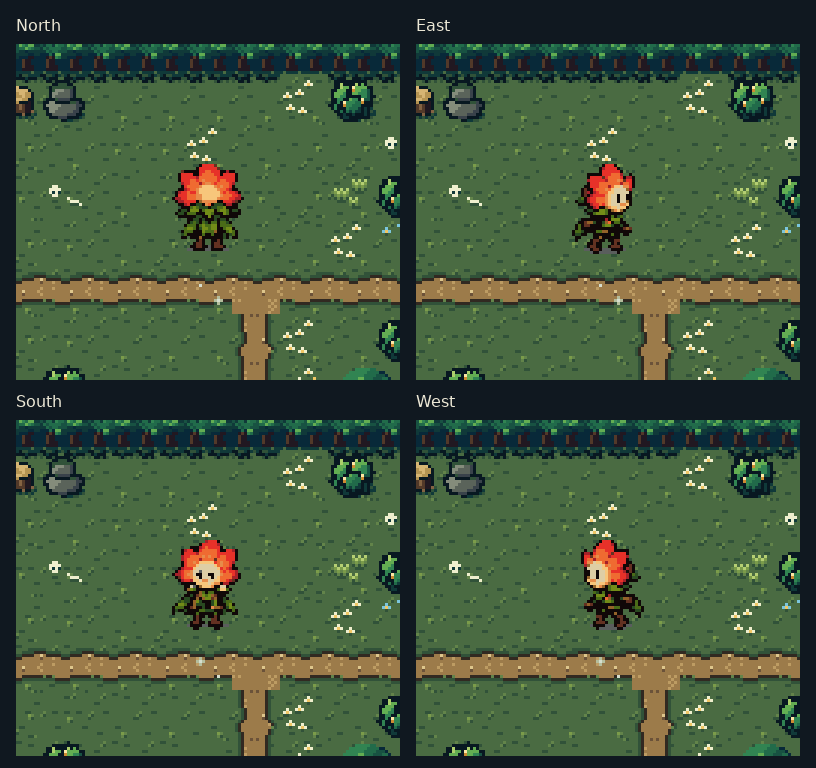
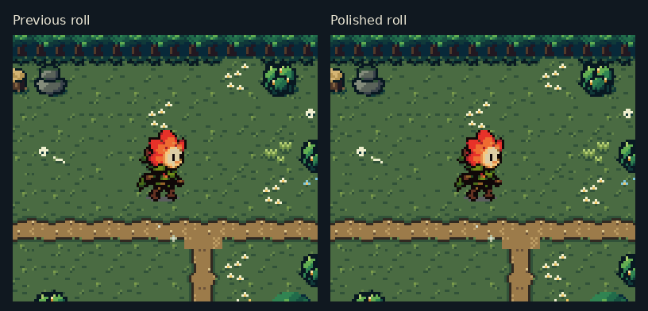
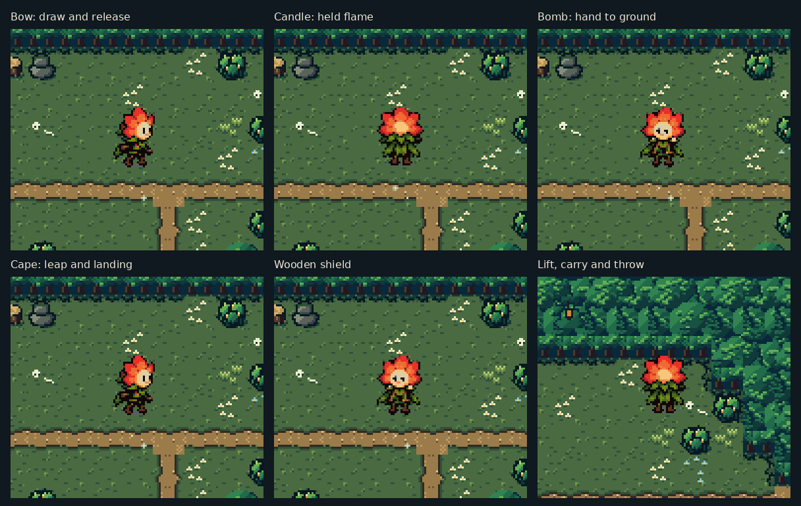
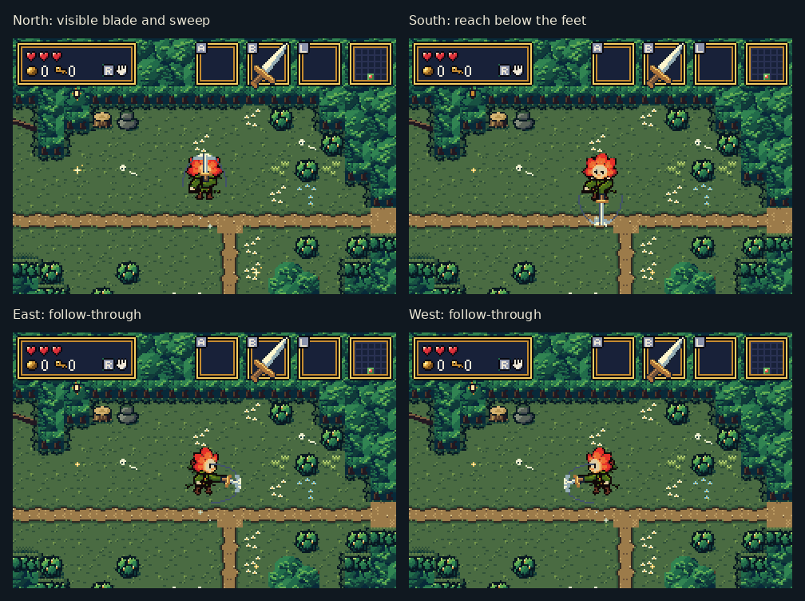

# Bloom animation polish — actual mGBA runs

Bloom keeps the original flower, clothing, idle and walking art. This pass
cleans up the roll and makes weapons and item actions easier to read.

The animations below are **crops of actual mGBA 0.10.5 frames**, enlarged 3×
without smoothing. Actions come from button presses on naturally generated
forest ground, with a full inventory, cleared actors and debug positioning.
No animation pose or frame is assigned. The comparison grids add a short
pause at the end of each loop; individual clips retain their captured timing.

## The upward sword swing

The sword has its own layer, drawn visibly over the back of the flower.
Its steel blade, grip and moving leading crescent are distinct. A quieter
outer sweep marks the actual reach bounds throughout the live part of the
attack. Wind-up and recovery carry no live sweep.

## Reach in every direction

The effect uses the same directional bounds as damage, brush cutting,
pickup collection and projectile deflection. Southward reach now appears
below Bloom's feet, where the former body-only sprite could not draw it.
Range and damage remain the same. The accidental invisible hit on the
input frame is removed; the attack now has a consistent wind-up, live
window and recovery.

## A compact roll

The detached leaves, cream speed strokes and gray ground marks are gone.
Each turn is one compact body, with a stable baseline and clear recovery.

## Other item actions

- Bow and candle use have visible tools and short body motions.
- The actual bomb passes from hand to ground, without a duplicate held bomb.
- Cape jumps have takeoff, tucked airborne and landing poses.
- Guarding shows the wooden shield.
- Lifting, carrying and throwing show the actual load, without a baked barrel.

## Uncropped native captures

The PNGs in the clip folders are unmodified **240×160 framebuffers**.

| Action | North | East | South | West |
| --- | --- | --- | --- | --- |
| Sword | [Clip](after/sword-n.gif) | [Clip](after/sword-e.gif) | [Clip](after/sword-s.gif) | [Clip](after/sword-w.gif) |
| Roll | [Clip](after/roll-n.gif) | [Clip](after/roll-e.gif) | [Clip](after/roll-s.gif) | [Clip](after/roll-w.gif) |
| Bow | [Clip](after/bow-n.gif) | [Clip](after/bow-e.gif) | [Clip](after/bow-s.gif) | [Clip](after/bow-w.gif) |
| Candle | [Clip](after/lamp-n.gif) | [Clip](after/lamp-e.gif) | [Clip](after/lamp-s.gif) | [Clip](after/lamp-w.gif) |
| Bomb | [Clip](after/bomb-n.gif) | [Clip](after/bomb-e.gif) | [Clip](after/bomb-s.gif) | [Clip](after/bomb-w.gif) |
| Cape | [Clip](after/cape-n.gif) | [Clip](after/cape-e.gif) | [Clip](after/cape-s.gif) | [Clip](after/cape-w.gif) |
| Shield | [Clip](after/guard-n.gif) | [Clip](after/guard-e.gif) | [Clip](after/guard-s.gif) | [Clip](after/guard-w.gif) |

[Lift/carry/throw clip](after/lift-throw.gif) · [All new native PNG folders](after/) ·
[Previous sword/roll captures](before/)

## Validation

The real ROM passes **274 animation, collision, OAM and VRAM checks**,
including all four directions' inclusive reach edges, misses just beyond
them, live-frame timing, interruptions, roll protection and queued attacks.
Gameplay checks cover frontal sword hits, reflected projectiles, lifting,
throwing, shield use, cape travel, menus, saving, all three progression
rewards and the Heart.

A sprite-memory sweep also checks menus and tool effects across three
forest seeds, mysteries and the Drain. Inventory/reward icons now use a
small streamed cache so opening the menu leaves room for action effects.
Repeated page changes check the cached icon pixels in actual OBJ VRAM.

[Validation and final ROM hash](validation.json) · [Animation checks](probe.json) ·
[Sprite-memory results](budget.json) · [Preserved character art](source-art.json) ·
[Implementation and reproduction guide](../../bartgame/docs/BLOOM_ANIMATION.md)
