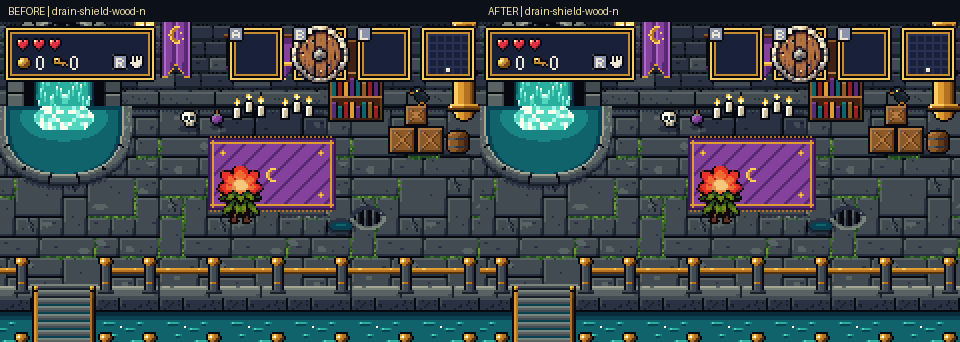
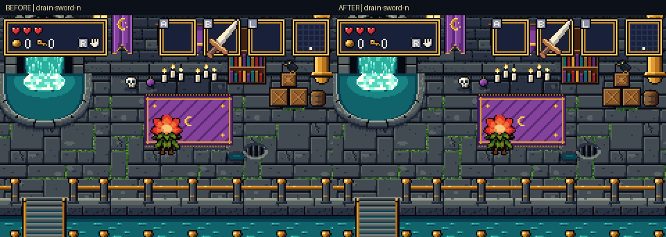
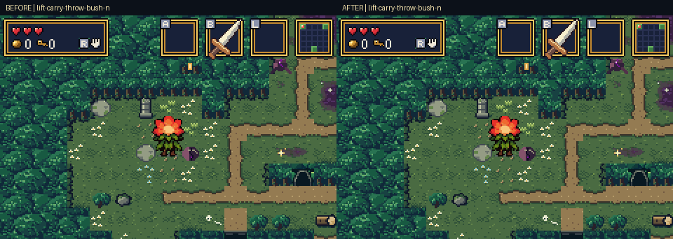
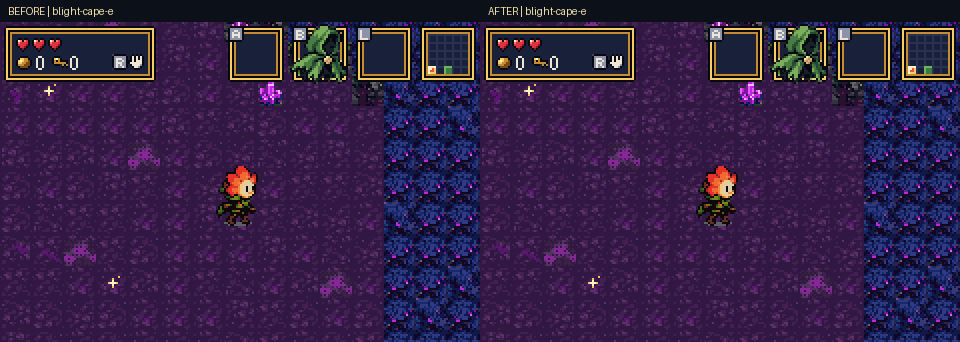
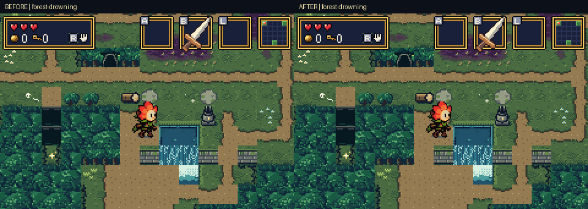
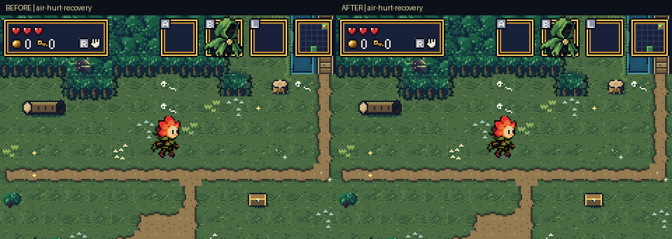

# Bloom: complete animation review in mGBA

Bloom's action animations now use direction-correct equipment depth, cleaner
poses and more continuous movement. This gallery contains **99 matched
before/after recordings from real runs in mGBA 0.10.5**, across the Drain,
healthy forest, blighted forest and caves, with extra foreground and recovery
cases. The previous forest, item and title artwork is included in the ROM.

- [Download the final GBA ROM](https://github.com/natertott/bartgame/raw/refs/heads/forest-art/downloads/bloom-suite-c518ba9/bartgame-bloom-suite-c518ba9.gba)
- [Download the ZIP](https://github.com/natertott/bartgame/raw/refs/heads/forest-art/downloads/bloom-suite-c518ba9/bartgame-bloom-suite-c518ba9.zip)
- [Watch or download the 57-second mGBA reel](https://github.com/natertott/bartgame/raw/refs/heads/forest-art/forest-review/bloom-suite/bloom-suite-reel.mp4)
- [Checksums](../../downloads/bloom-suite-c518ba9/SHA256SUMS.txt) · [Implementation and reproduction guide](../../bartgame/docs/BLOOM_SUITE.md)

## Equipment depth and readable sword motion

The left side is the previous ROM; the right side is this build. North-facing
shields, bow and lamp now sit ahead of Bloom. The shield rim remains visible
beside the flower instead of being painted onto its back. The sword blade
passes behind the petals while its leading arc still shows the complete
attack reach.





[Green shield](comparisons/north-shield-green.gif) ·
[Bow](comparisons/north-bow.gif) · [Lamp](comparisons/north-lamp.gif) ·
[Walking while guarding](comparisons/shield-walk.gif) · [Roll](comparisons/roll.gif)

## Lifting, throwing, jumping and hazards

Loads rise into the overhead grip and leave from the same position when
thrown. Bushes, stones, boulders and pots resemble the objects in the room.
Guard walking has a leg cycle; rolls have clearer directional bookends.
Jump poses progress through takeoff, flight and landing, with a shadow fixed
to the floor. Drowning no longer adds a solid blue pool over the scenery.







[Death](comparisons/death.gif) · [Pit fall](comparisons/pit-fall.gif) ·
[Cap return and drop-in](comparisons/cap-return-drop-in.gif)

## Two recovery bugs fixed

Taking a hit during a jump could leave Bloom hovering indefinitely. Rolling
into a wall could also stop gravity before Bloom reached the ground. The
right-hand recordings now finish the arc and land. These clips use actual
button inputs, a real enemy contact and existing generated walls.



[Watch the wall-bounce comparison](comparisons/roll-wall-bounce.gif).

## Check the same actions on different backgrounds

These links show complete emulator frames. Each background also includes
bomb use, east-facing sword and north-facing cape recordings in the full
index below.

| Background | Sword north | Shield north | Cape east | Bow north | Lamp north |
| --- | --- | --- | --- | --- | --- |
| Drain | [Watch](after/drain/drain-sword-n.gif) | [Watch](after/drain/drain-shield-wood-n.gif) | [Watch](after/drain/drain-cape-e.gif) | [Watch](after/drain/drain-bow-n.gif) | [Watch](after/drain/drain-lamp-n.gif) |
| Healthy forest | [Watch](after/worlds/forest-sword-n.gif) | [Watch](after/worlds/forest-shield-wood-n.gif) | [Watch](after/worlds/forest-cape-e.gif) | [Watch](after/worlds/forest-bow-n.gif) | [Watch](after/worlds/forest-lamp-n.gif) |
| Blighted forest | [Watch](after/worlds/blight-sword-n.gif) | [Watch](after/worlds/blight-shield-wood-n.gif) | [Watch](after/worlds/blight-cape-e.gif) | [Watch](after/worlds/blight-bow-n.gif) | [Watch](after/worlds/blight-lamp-n.gif) |
| Cave | [Watch](after/worlds/cave-sword-n.gif) | [Watch](after/worlds/cave-shield-wood-n.gif) | [Watch](after/worlds/cave-cape-e.gif) | [Watch](after/worlds/cave-bow-n.gif) | [Watch](after/worlds/cave-lamp-n.gif) |

## Capture method and limits

Inventory, starting position and facing, and clearing unrelated actors are
capture fixtures. The game then performs each action from real button
inputs on its generated terrain. No animation pose, source frame or terrain
is injected. Cave and pot-room captures enter the generated room mouths.
The interruption fixture places one real enemy to reproduce contact damage.

Native PNGs are untouched **240×160** emulator output. GIFs enlarge whole
frames 2× with nearest-neighbour sampling at approximately 30 fps. Filmstrips
follow Bloom through 16 chronological crops, with time, state, source pose
and height labels outside the image. The MP4 reel is a convenient compressed
view; the native PNGs preserve the original pixels.

The two transition GIFs exceed the GIF palette limit. Three paired comparison
GIFs also need palette reduction; the individual source GIFs and native PNGs
are retained. The [manifest](gallery-manifest.json) records palette precision,
ROM hashes and individual file checksums.

The recordings naturally cover **99 of 101 hero source poses**. The two
remaining legacy `jump_n` and `jump_e` images are not selected by reachable
gameplay; phased jumping is covered in every direction. Swimming and sprinting
are not implemented actions, and talk/frozen are unused enum values.

## Validation

The **97 ordinary clips preserve their recorded gameplay traces**. The two
recovery clips intentionally differ because they fix hovering. A separate
20-action comparison preserves all 940 recorded physical-input frames.
Sword timing, damage and range remain unchanged.

| Check | Result |
| --- | ---: |
| Full-suite motion, depth, hardware and recovery | 489/489 |
| Sword timing, range and input | 274/274 |
| Sprite allocation and menu restoration | 2,046/2,046, across 582 contexts |
| Unchanged environments, item art and physical contracts | 3,774/3,774 |
| Foreground and surface rendering | 2,538/2,538 |
| Mechanics, lifting, critical path/Heart, mysteries | 22/22, 14/14, 21/21, 28/28 |
| Capture activation checks | 166/166 |

The sprite allocation sweep peaks at **838/876 tiles**, leaving 38 free.
Five representative Drain, forest, blight, cave and Heart samples sustain
**180 game updates per 180 video frames** while using sword, shield and cape.
These samples clear unrelated actors and do not measure worst-case combat.
All environment artwork, unrelated sprites, item icons, title art and original
idle/walk frames remain exact against the previous ROM.

[Validation summary](validation.json) · [Reports and logs](validation/) ·
[After capture index](suite-index-after.json) · [Before capture index](suite-index-before.json)

Final ROM source: [`c518ba9`](https://github.com/natertott/bartgame/commit/c518ba9fbdc4efdee5b43330dcbd5105c329eaa6).
ROM SHA256:

```text
d5f9eda0647c0b197011656cd9fd758f2438df6c4e7e212dd100d31fc3f130ac
```

## Full animation index

Each row links the matched recordings, a chronological final filmstrip, and
unmodified native PNGs. The group `suite.json` files retain every video-frame
state trace and activation check.

### Directional actions in the Drain

[Full after trace](after/drain/suite.json) · [Full before trace](before/drain/suite.json)

| Action | Before | After | Filmstrip | Native frames |
| --- | --- | --- | --- | --- |
| drain idle n | [GIF](before/drain/drain-idle-n.gif) | [GIF](after/drain/drain-idle-n.gif) | [PNG](after/drain/drain-idle-n-frames.png) | [240×160](after/drain/drain-idle-n/) |
| drain idle e | [GIF](before/drain/drain-idle-e.gif) | [GIF](after/drain/drain-idle-e.gif) | [PNG](after/drain/drain-idle-e-frames.png) | [240×160](after/drain/drain-idle-e/) |
| drain idle s | [GIF](before/drain/drain-idle-s.gif) | [GIF](after/drain/drain-idle-s.gif) | [PNG](after/drain/drain-idle-s-frames.png) | [240×160](after/drain/drain-idle-s/) |
| drain idle w | [GIF](before/drain/drain-idle-w.gif) | [GIF](after/drain/drain-idle-w.gif) | [PNG](after/drain/drain-idle-w-frames.png) | [240×160](after/drain/drain-idle-w/) |
| drain walk n | [GIF](before/drain/drain-walk-n.gif) | [GIF](after/drain/drain-walk-n.gif) | [PNG](after/drain/drain-walk-n-frames.png) | [240×160](after/drain/drain-walk-n/) |
| drain walk e | [GIF](before/drain/drain-walk-e.gif) | [GIF](after/drain/drain-walk-e.gif) | [PNG](after/drain/drain-walk-e-frames.png) | [240×160](after/drain/drain-walk-e/) |
| drain walk s | [GIF](before/drain/drain-walk-s.gif) | [GIF](after/drain/drain-walk-s.gif) | [PNG](after/drain/drain-walk-s-frames.png) | [240×160](after/drain/drain-walk-s/) |
| drain walk w | [GIF](before/drain/drain-walk-w.gif) | [GIF](after/drain/drain-walk-w.gif) | [PNG](after/drain/drain-walk-w-frames.png) | [240×160](after/drain/drain-walk-w/) |
| drain roll n | [GIF](before/drain/drain-roll-n.gif) | [GIF](after/drain/drain-roll-n.gif) | [PNG](after/drain/drain-roll-n-frames.png) | [240×160](after/drain/drain-roll-n/) |
| drain roll e | [GIF](before/drain/drain-roll-e.gif) | [GIF](after/drain/drain-roll-e.gif) | [PNG](after/drain/drain-roll-e-frames.png) | [240×160](after/drain/drain-roll-e/) |
| drain roll s | [GIF](before/drain/drain-roll-s.gif) | [GIF](after/drain/drain-roll-s.gif) | [PNG](after/drain/drain-roll-s-frames.png) | [240×160](after/drain/drain-roll-s/) |
| drain roll w | [GIF](before/drain/drain-roll-w.gif) | [GIF](after/drain/drain-roll-w.gif) | [PNG](after/drain/drain-roll-w-frames.png) | [240×160](after/drain/drain-roll-w/) |
| drain sword n | [GIF](before/drain/drain-sword-n.gif) | [GIF](after/drain/drain-sword-n.gif) | [PNG](after/drain/drain-sword-n-frames.png) | [240×160](after/drain/drain-sword-n/) |
| drain sword e | [GIF](before/drain/drain-sword-e.gif) | [GIF](after/drain/drain-sword-e.gif) | [PNG](after/drain/drain-sword-e-frames.png) | [240×160](after/drain/drain-sword-e/) |
| drain sword s | [GIF](before/drain/drain-sword-s.gif) | [GIF](after/drain/drain-sword-s.gif) | [PNG](after/drain/drain-sword-s-frames.png) | [240×160](after/drain/drain-sword-s/) |
| drain sword w | [GIF](before/drain/drain-sword-w.gif) | [GIF](after/drain/drain-sword-w.gif) | [PNG](after/drain/drain-sword-w-frames.png) | [240×160](after/drain/drain-sword-w/) |
| drain shield wood n | [GIF](before/drain/drain-shield-wood-n.gif) | [GIF](after/drain/drain-shield-wood-n.gif) | [PNG](after/drain/drain-shield-wood-n-frames.png) | [240×160](after/drain/drain-shield-wood-n/) |
| drain shield wood e | [GIF](before/drain/drain-shield-wood-e.gif) | [GIF](after/drain/drain-shield-wood-e.gif) | [PNG](after/drain/drain-shield-wood-e-frames.png) | [240×160](after/drain/drain-shield-wood-e/) |
| drain shield wood s | [GIF](before/drain/drain-shield-wood-s.gif) | [GIF](after/drain/drain-shield-wood-s.gif) | [PNG](after/drain/drain-shield-wood-s-frames.png) | [240×160](after/drain/drain-shield-wood-s/) |
| drain shield wood w | [GIF](before/drain/drain-shield-wood-w.gif) | [GIF](after/drain/drain-shield-wood-w.gif) | [PNG](after/drain/drain-shield-wood-w-frames.png) | [240×160](after/drain/drain-shield-wood-w/) |
| drain shield green n | [GIF](before/drain/drain-shield-green-n.gif) | [GIF](after/drain/drain-shield-green-n.gif) | [PNG](after/drain/drain-shield-green-n-frames.png) | [240×160](after/drain/drain-shield-green-n/) |
| drain shield green e | [GIF](before/drain/drain-shield-green-e.gif) | [GIF](after/drain/drain-shield-green-e.gif) | [PNG](after/drain/drain-shield-green-e-frames.png) | [240×160](after/drain/drain-shield-green-e/) |
| drain shield green s | [GIF](before/drain/drain-shield-green-s.gif) | [GIF](after/drain/drain-shield-green-s.gif) | [PNG](after/drain/drain-shield-green-s-frames.png) | [240×160](after/drain/drain-shield-green-s/) |
| drain shield green w | [GIF](before/drain/drain-shield-green-w.gif) | [GIF](after/drain/drain-shield-green-w.gif) | [PNG](after/drain/drain-shield-green-w-frames.png) | [240×160](after/drain/drain-shield-green-w/) |
| drain shield walk n | [GIF](before/drain/drain-shield-walk-n.gif) | [GIF](after/drain/drain-shield-walk-n.gif) | [PNG](after/drain/drain-shield-walk-n-frames.png) | [240×160](after/drain/drain-shield-walk-n/) |
| drain shield walk e | [GIF](before/drain/drain-shield-walk-e.gif) | [GIF](after/drain/drain-shield-walk-e.gif) | [PNG](after/drain/drain-shield-walk-e-frames.png) | [240×160](after/drain/drain-shield-walk-e/) |
| drain shield walk s | [GIF](before/drain/drain-shield-walk-s.gif) | [GIF](after/drain/drain-shield-walk-s.gif) | [PNG](after/drain/drain-shield-walk-s-frames.png) | [240×160](after/drain/drain-shield-walk-s/) |
| drain shield walk w | [GIF](before/drain/drain-shield-walk-w.gif) | [GIF](after/drain/drain-shield-walk-w.gif) | [PNG](after/drain/drain-shield-walk-w-frames.png) | [240×160](after/drain/drain-shield-walk-w/) |
| drain bow n | [GIF](before/drain/drain-bow-n.gif) | [GIF](after/drain/drain-bow-n.gif) | [PNG](after/drain/drain-bow-n-frames.png) | [240×160](after/drain/drain-bow-n/) |
| drain bow e | [GIF](before/drain/drain-bow-e.gif) | [GIF](after/drain/drain-bow-e.gif) | [PNG](after/drain/drain-bow-e-frames.png) | [240×160](after/drain/drain-bow-e/) |
| drain bow s | [GIF](before/drain/drain-bow-s.gif) | [GIF](after/drain/drain-bow-s.gif) | [PNG](after/drain/drain-bow-s-frames.png) | [240×160](after/drain/drain-bow-s/) |
| drain bow w | [GIF](before/drain/drain-bow-w.gif) | [GIF](after/drain/drain-bow-w.gif) | [PNG](after/drain/drain-bow-w-frames.png) | [240×160](after/drain/drain-bow-w/) |
| drain lamp n | [GIF](before/drain/drain-lamp-n.gif) | [GIF](after/drain/drain-lamp-n.gif) | [PNG](after/drain/drain-lamp-n-frames.png) | [240×160](after/drain/drain-lamp-n/) |
| drain lamp e | [GIF](before/drain/drain-lamp-e.gif) | [GIF](after/drain/drain-lamp-e.gif) | [PNG](after/drain/drain-lamp-e-frames.png) | [240×160](after/drain/drain-lamp-e/) |
| drain lamp s | [GIF](before/drain/drain-lamp-s.gif) | [GIF](after/drain/drain-lamp-s.gif) | [PNG](after/drain/drain-lamp-s-frames.png) | [240×160](after/drain/drain-lamp-s/) |
| drain lamp w | [GIF](before/drain/drain-lamp-w.gif) | [GIF](after/drain/drain-lamp-w.gif) | [PNG](after/drain/drain-lamp-w-frames.png) | [240×160](after/drain/drain-lamp-w/) |
| drain bomb n | [GIF](before/drain/drain-bomb-n.gif) | [GIF](after/drain/drain-bomb-n.gif) | [PNG](after/drain/drain-bomb-n-frames.png) | [240×160](after/drain/drain-bomb-n/) |
| drain bomb e | [GIF](before/drain/drain-bomb-e.gif) | [GIF](after/drain/drain-bomb-e.gif) | [PNG](after/drain/drain-bomb-e-frames.png) | [240×160](after/drain/drain-bomb-e/) |
| drain bomb s | [GIF](before/drain/drain-bomb-s.gif) | [GIF](after/drain/drain-bomb-s.gif) | [PNG](after/drain/drain-bomb-s-frames.png) | [240×160](after/drain/drain-bomb-s/) |
| drain bomb w | [GIF](before/drain/drain-bomb-w.gif) | [GIF](after/drain/drain-bomb-w.gif) | [PNG](after/drain/drain-bomb-w-frames.png) | [240×160](after/drain/drain-bomb-w/) |
| drain cape n | [GIF](before/drain/drain-cape-n.gif) | [GIF](after/drain/drain-cape-n.gif) | [PNG](after/drain/drain-cape-n-frames.png) | [240×160](after/drain/drain-cape-n/) |
| drain cape e | [GIF](before/drain/drain-cape-e.gif) | [GIF](after/drain/drain-cape-e.gif) | [PNG](after/drain/drain-cape-e-frames.png) | [240×160](after/drain/drain-cape-e/) |
| drain cape s | [GIF](before/drain/drain-cape-s.gif) | [GIF](after/drain/drain-cape-s.gif) | [PNG](after/drain/drain-cape-s-frames.png) | [240×160](after/drain/drain-cape-s/) |
| drain cape w | [GIF](before/drain/drain-cape-w.gif) | [GIF](after/drain/drain-cape-w.gif) | [PNG](after/drain/drain-cape-w-frames.png) | [240×160](after/drain/drain-cape-w/) |

### Healthy forest, blight and caves

[Full after trace](after/worlds/suite.json) · [Full before trace](before/worlds/suite.json)

| Action | Before | After | Filmstrip | Native frames |
| --- | --- | --- | --- | --- |
| forest sword n | [GIF](before/worlds/forest-sword-n.gif) | [GIF](after/worlds/forest-sword-n.gif) | [PNG](after/worlds/forest-sword-n-frames.png) | [240×160](after/worlds/forest-sword-n/) |
| forest sword e | [GIF](before/worlds/forest-sword-e.gif) | [GIF](after/worlds/forest-sword-e.gif) | [PNG](after/worlds/forest-sword-e-frames.png) | [240×160](after/worlds/forest-sword-e/) |
| forest shield wood n | [GIF](before/worlds/forest-shield-wood-n.gif) | [GIF](after/worlds/forest-shield-wood-n.gif) | [PNG](after/worlds/forest-shield-wood-n-frames.png) | [240×160](after/worlds/forest-shield-wood-n/) |
| forest shield wood s | [GIF](before/worlds/forest-shield-wood-s.gif) | [GIF](after/worlds/forest-shield-wood-s.gif) | [PNG](after/worlds/forest-shield-wood-s-frames.png) | [240×160](after/worlds/forest-shield-wood-s/) |
| forest cape n | [GIF](before/worlds/forest-cape-n.gif) | [GIF](after/worlds/forest-cape-n.gif) | [PNG](after/worlds/forest-cape-n-frames.png) | [240×160](after/worlds/forest-cape-n/) |
| forest cape e | [GIF](before/worlds/forest-cape-e.gif) | [GIF](after/worlds/forest-cape-e.gif) | [PNG](after/worlds/forest-cape-e-frames.png) | [240×160](after/worlds/forest-cape-e/) |
| forest lamp n | [GIF](before/worlds/forest-lamp-n.gif) | [GIF](after/worlds/forest-lamp-n.gif) | [PNG](after/worlds/forest-lamp-n-frames.png) | [240×160](after/worlds/forest-lamp-n/) |
| forest bow n | [GIF](before/worlds/forest-bow-n.gif) | [GIF](after/worlds/forest-bow-n.gif) | [PNG](after/worlds/forest-bow-n-frames.png) | [240×160](after/worlds/forest-bow-n/) |
| forest bomb n | [GIF](before/worlds/forest-bomb-n.gif) | [GIF](after/worlds/forest-bomb-n.gif) | [PNG](after/worlds/forest-bomb-n-frames.png) | [240×160](after/worlds/forest-bomb-n/) |
| blight sword n | [GIF](before/worlds/blight-sword-n.gif) | [GIF](after/worlds/blight-sword-n.gif) | [PNG](after/worlds/blight-sword-n-frames.png) | [240×160](after/worlds/blight-sword-n/) |
| blight sword e | [GIF](before/worlds/blight-sword-e.gif) | [GIF](after/worlds/blight-sword-e.gif) | [PNG](after/worlds/blight-sword-e-frames.png) | [240×160](after/worlds/blight-sword-e/) |
| blight shield wood n | [GIF](before/worlds/blight-shield-wood-n.gif) | [GIF](after/worlds/blight-shield-wood-n.gif) | [PNG](after/worlds/blight-shield-wood-n-frames.png) | [240×160](after/worlds/blight-shield-wood-n/) |
| blight shield wood s | [GIF](before/worlds/blight-shield-wood-s.gif) | [GIF](after/worlds/blight-shield-wood-s.gif) | [PNG](after/worlds/blight-shield-wood-s-frames.png) | [240×160](after/worlds/blight-shield-wood-s/) |
| blight cape n | [GIF](before/worlds/blight-cape-n.gif) | [GIF](after/worlds/blight-cape-n.gif) | [PNG](after/worlds/blight-cape-n-frames.png) | [240×160](after/worlds/blight-cape-n/) |
| blight cape e | [GIF](before/worlds/blight-cape-e.gif) | [GIF](after/worlds/blight-cape-e.gif) | [PNG](after/worlds/blight-cape-e-frames.png) | [240×160](after/worlds/blight-cape-e/) |
| blight lamp n | [GIF](before/worlds/blight-lamp-n.gif) | [GIF](after/worlds/blight-lamp-n.gif) | [PNG](after/worlds/blight-lamp-n-frames.png) | [240×160](after/worlds/blight-lamp-n/) |
| blight bow n | [GIF](before/worlds/blight-bow-n.gif) | [GIF](after/worlds/blight-bow-n.gif) | [PNG](after/worlds/blight-bow-n-frames.png) | [240×160](after/worlds/blight-bow-n/) |
| blight bomb n | [GIF](before/worlds/blight-bomb-n.gif) | [GIF](after/worlds/blight-bomb-n.gif) | [PNG](after/worlds/blight-bomb-n-frames.png) | [240×160](after/worlds/blight-bomb-n/) |
| cave sword n | [GIF](before/worlds/cave-sword-n.gif) | [GIF](after/worlds/cave-sword-n.gif) | [PNG](after/worlds/cave-sword-n-frames.png) | [240×160](after/worlds/cave-sword-n/) |
| cave sword e | [GIF](before/worlds/cave-sword-e.gif) | [GIF](after/worlds/cave-sword-e.gif) | [PNG](after/worlds/cave-sword-e-frames.png) | [240×160](after/worlds/cave-sword-e/) |
| cave shield wood n | [GIF](before/worlds/cave-shield-wood-n.gif) | [GIF](after/worlds/cave-shield-wood-n.gif) | [PNG](after/worlds/cave-shield-wood-n-frames.png) | [240×160](after/worlds/cave-shield-wood-n/) |
| cave shield wood s | [GIF](before/worlds/cave-shield-wood-s.gif) | [GIF](after/worlds/cave-shield-wood-s.gif) | [PNG](after/worlds/cave-shield-wood-s-frames.png) | [240×160](after/worlds/cave-shield-wood-s/) |
| cave cape n | [GIF](before/worlds/cave-cape-n.gif) | [GIF](after/worlds/cave-cape-n.gif) | [PNG](after/worlds/cave-cape-n-frames.png) | [240×160](after/worlds/cave-cape-n/) |
| cave cape e | [GIF](before/worlds/cave-cape-e.gif) | [GIF](after/worlds/cave-cape-e.gif) | [PNG](after/worlds/cave-cape-e-frames.png) | [240×160](after/worlds/cave-cape-e/) |
| cave lamp n | [GIF](before/worlds/cave-lamp-n.gif) | [GIF](after/worlds/cave-lamp-n.gif) | [PNG](after/worlds/cave-lamp-n-frames.png) | [240×160](after/worlds/cave-lamp-n/) |
| cave bow n | [GIF](before/worlds/cave-bow-n.gif) | [GIF](after/worlds/cave-bow-n.gif) | [PNG](after/worlds/cave-bow-n-frames.png) | [240×160](after/worlds/cave-bow-n/) |
| cave bomb n | [GIF](before/worlds/cave-bomb-n.gif) | [GIF](after/worlds/cave-bomb-n.gif) | [PNG](after/worlds/cave-bomb-n-frames.png) | [240×160](after/worlds/cave-bomb-n/) |

### Lifting, hazards and transitions

[Full after trace](after/special-v2/suite.json) · [Full before trace](before/special-v2/suite.json)

| Action | Before | After | Filmstrip | Native frames |
| --- | --- | --- | --- | --- |
| lift carry throw bush | [GIF](before/special-v2/lift-carry-throw-bush.gif) | [GIF](after/special-v2/lift-carry-throw-bush.gif) | [PNG](after/special-v2/lift-carry-throw-bush-frames.png) | [240×160](after/special-v2/lift-carry-throw-bush/) |
| lift carry throw rock | [GIF](before/special-v2/lift-carry-throw-rock.gif) | [GIF](after/special-v2/lift-carry-throw-rock.gif) | [PNG](after/special-v2/lift-carry-throw-rock-frames.png) | [240×160](after/special-v2/lift-carry-throw-rock/) |
| lift carry throw boulder | [GIF](before/special-v2/lift-carry-throw-boulder.gif) | [GIF](after/special-v2/lift-carry-throw-boulder.gif) | [PNG](after/special-v2/lift-carry-throw-boulder-frames.png) | [240×160](after/special-v2/lift-carry-throw-boulder/) |
| lift carry throw pot | [GIF](before/special-v2/lift-carry-throw-pot.gif) | [GIF](after/special-v2/lift-carry-throw-pot.gif) | [PNG](after/special-v2/lift-carry-throw-pot-frames.png) | [240×160](after/special-v2/lift-carry-throw-pot/) |
| lift carry throw bush n | [GIF](before/special-v2/lift-carry-throw-bush-n.gif) | [GIF](after/special-v2/lift-carry-throw-bush-n.gif) | [PNG](after/special-v2/lift-carry-throw-bush-n-frames.png) | [240×160](after/special-v2/lift-carry-throw-bush-n/) |
| lift carry throw bush e | [GIF](before/special-v2/lift-carry-throw-bush-e.gif) | [GIF](after/special-v2/lift-carry-throw-bush-e.gif) | [PNG](after/special-v2/lift-carry-throw-bush-e-frames.png) | [240×160](after/special-v2/lift-carry-throw-bush-e/) |
| lift carry throw bush s | [GIF](before/special-v2/lift-carry-throw-bush-s.gif) | [GIF](after/special-v2/lift-carry-throw-bush-s.gif) | [PNG](after/special-v2/lift-carry-throw-bush-s-frames.png) | [240×160](after/special-v2/lift-carry-throw-bush-s/) |
| lift carry throw bush w | [GIF](before/special-v2/lift-carry-throw-bush-w.gif) | [GIF](after/special-v2/lift-carry-throw-bush-w.gif) | [PNG](after/special-v2/lift-carry-throw-bush-w-frames.png) | [240×160](after/special-v2/lift-carry-throw-bush-w/) |
| lift carry throw bush sword drop | [GIF](before/special-v2/lift-carry-throw-bush-sword-drop.gif) | [GIF](after/special-v2/lift-carry-throw-bush-sword-drop.gif) | [PNG](after/special-v2/lift-carry-throw-bush-sword-drop-frames.png) | [240×160](after/special-v2/lift-carry-throw-bush-sword-drop/) |
| forest drowning | [GIF](before/special-v2/forest-drowning.gif) | [GIF](after/special-v2/forest-drowning.gif) | [PNG](after/special-v2/forest-drowning-frames.png) | [240×160](after/special-v2/forest-drowning/) |
| forest pit fall | [GIF](before/special-v2/forest-pit-fall.gif) | [GIF](after/special-v2/forest-pit-fall.gif) | [PNG](after/special-v2/forest-pit-fall-frames.png) | [240×160](after/special-v2/forest-pit-fall/) |
| forest ledge jump | [GIF](before/special-v2/forest-ledge-jump.gif) | [GIF](after/special-v2/forest-ledge-jump.gif) | [PNG](after/special-v2/forest-ledge-jump-frames.png) | [240×160](after/special-v2/forest-ledge-jump/) |
| forest hurt n | [GIF](before/special-v2/forest-hurt-n.gif) | [GIF](after/special-v2/forest-hurt-n.gif) | [PNG](after/special-v2/forest-hurt-n-frames.png) | [240×160](after/special-v2/forest-hurt-n/) |
| forest hurt e | [GIF](before/special-v2/forest-hurt-e.gif) | [GIF](after/special-v2/forest-hurt-e.gif) | [PNG](after/special-v2/forest-hurt-e-frames.png) | [240×160](after/special-v2/forest-hurt-e/) |
| forest hurt s | [GIF](before/special-v2/forest-hurt-s.gif) | [GIF](after/special-v2/forest-hurt-s.gif) | [PNG](after/special-v2/forest-hurt-s-frames.png) | [240×160](after/special-v2/forest-hurt-s/) |
| forest hurt w | [GIF](before/special-v2/forest-hurt-w.gif) | [GIF](after/special-v2/forest-hurt-w.gif) | [PNG](after/special-v2/forest-hurt-w-frames.png) | [240×160](after/special-v2/forest-hurt-w/) |
| forest death | [GIF](before/special-v2/forest-death.gif) | [GIF](after/special-v2/forest-death.gif) | [PNG](after/special-v2/forest-death-frames.png) | [240×160](after/special-v2/forest-death/) |
| forest cap return drop in | [GIF](before/special-v2/forest-cap-return-drop-in.gif) | [GIF](after/special-v2/forest-cap-return-drop-in.gif) | [PNG](after/special-v2/forest-cap-return-drop-in-frames.png) | [240×160](after/special-v2/forest-cap-return-drop-in/) |
| forest item get bow | [GIF](before/special-v2/forest-item-get-bow.gif) | [GIF](after/special-v2/forest-item-get-bow.gif) | [PNG](after/special-v2/forest-item-get-bow-frames.png) | [240×160](after/special-v2/forest-item-get-bow/) |
| drain forest transition | [GIF](before/special-v2/drain-forest-transition.gif) | [GIF](after/special-v2/drain-forest-transition.gif) | [PNG](after/special-v2/drain-forest-transition-frames.png) | [240×160](after/special-v2/drain-forest-transition/) |

### Foreground occlusion

[Full after trace](after/fore/suite.json) · [Full before trace](before/fore/suite.json)

| Action | Before | After | Filmstrip | Native frames |
| --- | --- | --- | --- | --- |
| forest crown sword n | [GIF](before/fore/forest-crown-sword-n.gif) | [GIF](after/fore/forest-crown-sword-n.gif) | [PNG](after/fore/forest-crown-sword-n-frames.png) | [240×160](after/fore/forest-crown-sword-n/) |
| forest crown shield wood n | [GIF](before/fore/forest-crown-shield-wood-n.gif) | [GIF](after/fore/forest-crown-shield-wood-n.gif) | [PNG](after/fore/forest-crown-shield-wood-n-frames.png) | [240×160](after/fore/forest-crown-shield-wood-n/) |
| forest crown cape e | [GIF](before/fore/forest-crown-cape-e.gif) | [GIF](after/fore/forest-crown-cape-e.gif) | [PNG](after/fore/forest-crown-cape-e-frames.png) | [240×160](after/fore/forest-crown-cape-e/) |
| forest rock behind shield wood n | [GIF](before/fore/forest-rock-behind-shield-wood-n.gif) | [GIF](after/fore/forest-rock-behind-shield-wood-n.gif) | [PNG](after/fore/forest-rock-behind-shield-wood-n-frames.png) | [240×160](after/fore/forest-rock-behind-shield-wood-n/) |
| forest rock front shield wood n | [GIF](before/fore/forest-rock-front-shield-wood-n.gif) | [GIF](after/fore/forest-rock-front-shield-wood-n.gif) | [PNG](after/fore/forest-rock-front-shield-wood-n-frames.png) | [240×160](after/fore/forest-rock-front-shield-wood-n/) |
| drain counter shield wood n | [GIF](before/fore/drain-counter-shield-wood-n.gif) | [GIF](after/fore/drain-counter-shield-wood-n.gif) | [PNG](after/fore/drain-counter-shield-wood-n-frames.png) | [240×160](after/fore/drain-counter-shield-wood-n/) |

### Interrupted-flight and wall-bounce recovery

[Full after trace](after/interrupt/suite.json) · [Full before trace](before/interrupt/suite.json)

| Action | Before | After | Filmstrip | Native frames |
| --- | --- | --- | --- | --- |
| air hurt recovery | [GIF](before/interrupt/air-hurt-recovery.gif) | [GIF](after/interrupt/air-hurt-recovery.gif) | [PNG](after/interrupt/air-hurt-recovery-frames.png) | [240×160](after/interrupt/air-hurt-recovery/) |
| roll wall bounce | [GIF](before/interrupt/roll-wall-bounce.gif) | [GIF](after/interrupt/roll-wall-bounce.gif) | [PNG](after/interrupt/roll-wall-bounce-frames.png) | [240×160](after/interrupt/roll-wall-bounce/) |
