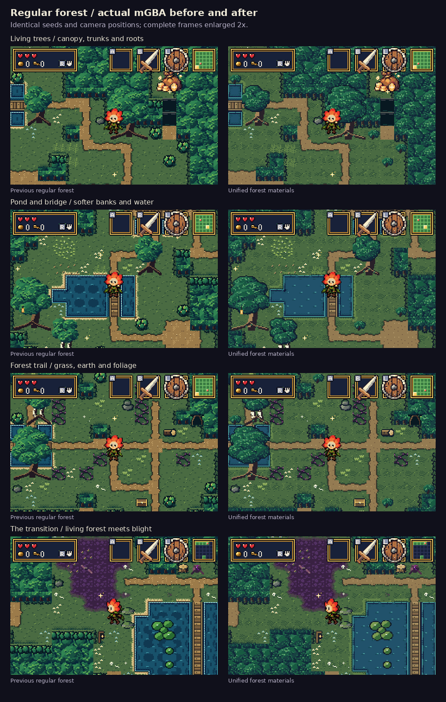
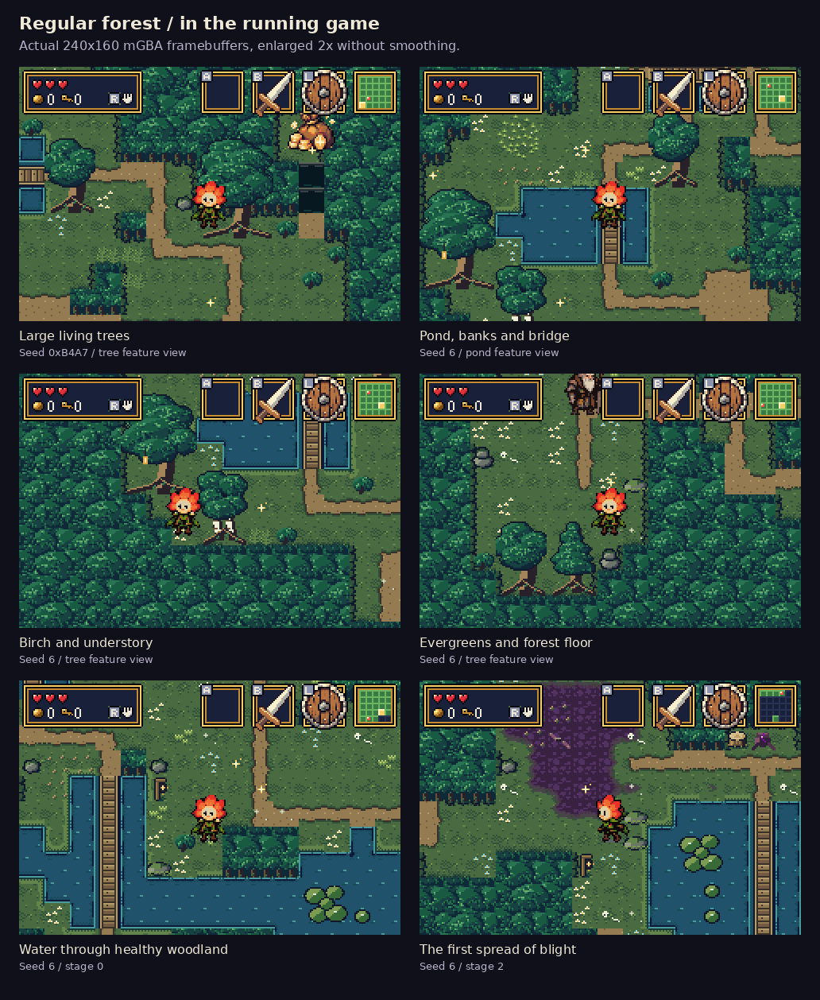
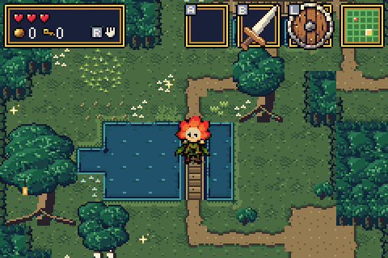
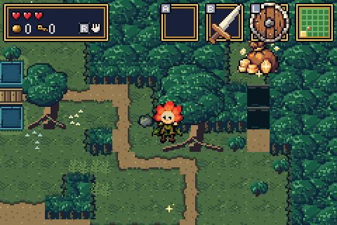
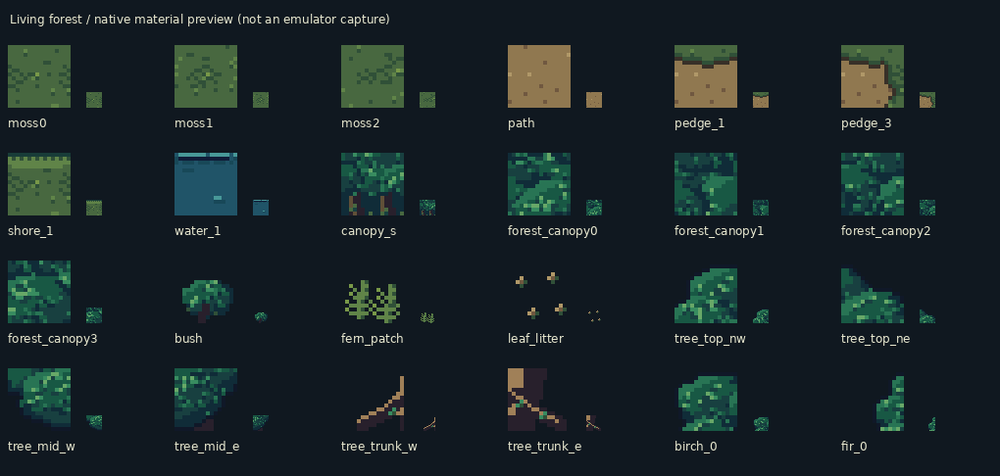

# Regular forest polish — actual mGBA runs

The regular forest now shares the blight pass's clustered foliage, cool
shadows and warm wood. Healthy areas keep green and teal leaves, living
turf and sunlit accents. Oak, birch and fir sprites have clearer shaded
crowns and warmer trunks; paths, mossy banks and water use quieter detail.

[Download the updated ROM](../../downloads/README.md) ·
[Validation](validation.json) · [Implementation notes](../../bartgame/docs/HEALTHY_FOREST.md)

## Before and after

These are actual mGBA 0.10.5 framebuffers at matching seeds, standing
positions and camera offsets. Each complete 240×160 frame is enlarged 2×
without smoothing; captions sit outside the game image.

## In the running forest

Tree silhouettes stand apart from the surrounding canopy. Sparse grass
flecks and small soil grains leave room for objects and enemies to read.
Water has short reflections, and wet moss replaces bright shoreline
stripes. The main grass colours still match the retained blight fringes.

Shared woodland materials also update rivers and bridges in deep rooms
and natural surfaces in forest interiors. Blight-specific canopy, earth,
masonry, trees, crystals, fissures, pools and pits retain their artwork.

## Actual animation

These clips sample 96 real video frames, every other frame, enlarged 2×
without smoothing. All six published GIFs preserve their captured colours
exactly within the GIF palette limit. The trees are static sprites; the
clips show the running scene and its normal terrain animation.

## Native captures and controls

- [New seed 0xB4A7: all 25 rooms and seven feature views](after/seed-b4a7/)
- [New seed 6: all 25 rooms and seven feature views](after/seed-6/)
- [Previous seed 0xB4A7](before/seed-b4a7/) · [Previous seed 6](before/seed-6/)
- [Capture and file-hash manifest](gallery.json)

Native PNGs are unmodified 240×160 framebuffers. The fixture navigates real
generated rooms, heals Bloom, clears enemies and ambient firefly actors,
settles the camera and synchronizes the animation clock. It does not
replace terrain or paint the screenshots.

Seven control frames match exactly, including both Drain and Heart views.
Three deep-room controls contain the intended shared woodland-material
changes. Their reports preserve `identical=false`, record the material
names and visible bounds, and verify every surrounding pixel is unchanged.

## Verification

- **3,762/3,762 scope checks:** 109 blight-specific materials and all 125
  animation frames remain exact, along with all Drain tiles, all 29
  sprite sheets, item palettes and the title bitmap.
- All 912 metatiles retain their IDs, types, collision masks and prop flags.
- **75/75 generated rooms:** physical layouts and spawn records unchanged.
- **2,538/2,538 surface checks:** substrates, prop layering, lifting and
  chest interactions pass.
- **21/21 critical-path checks:** the three required rewards, barriers,
  Heart and Grail remain completable. Optional mysteries pass **28/28**.
- Healthy, deep and Heart views each sustain **180 updates / 180 video frames**.
- Forest materials fit **992/1024 subtiles and 12/12 palettes**.

## Native asset preview

This final sheet is a **source-asset preview**, separate from the emulator
captures. The artwork is authored at native resolution, guided by the
[existing forest concept board](../../bartgame/art/ref/board_forest.jpg).
[Artwork and palette metadata](artwork.json) records the changed families.

Built from source [`fe25dc1`](https://github.com/natertott/bartgame/commit/fe25dc1f38dd2d6894f53c3130785235d2b4db70).
All new captures and reports identify ROM SHA256
`d346f72866060e452f8751efc51dc0b074d8cb240ceba159784b97939da78f59`.
