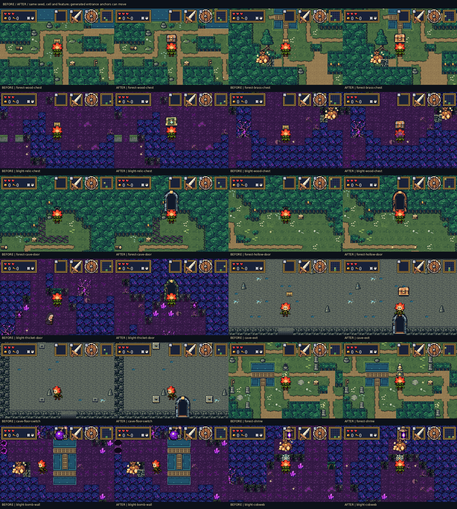
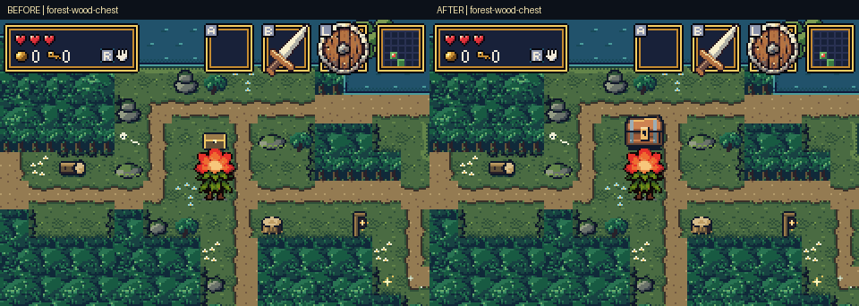
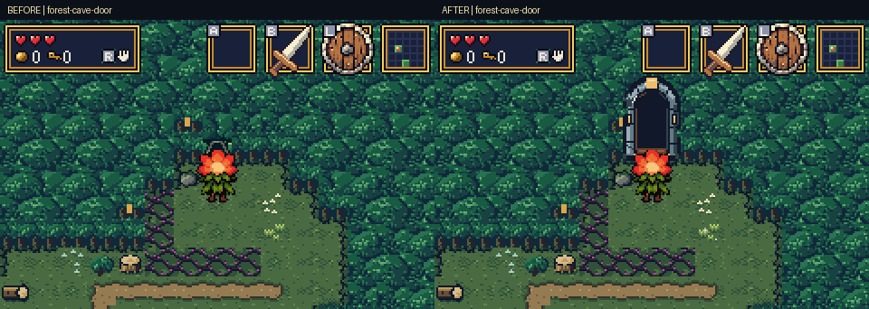
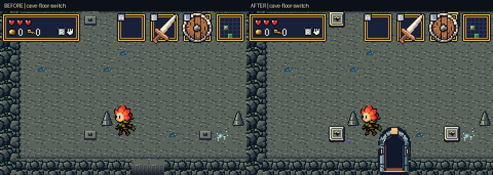
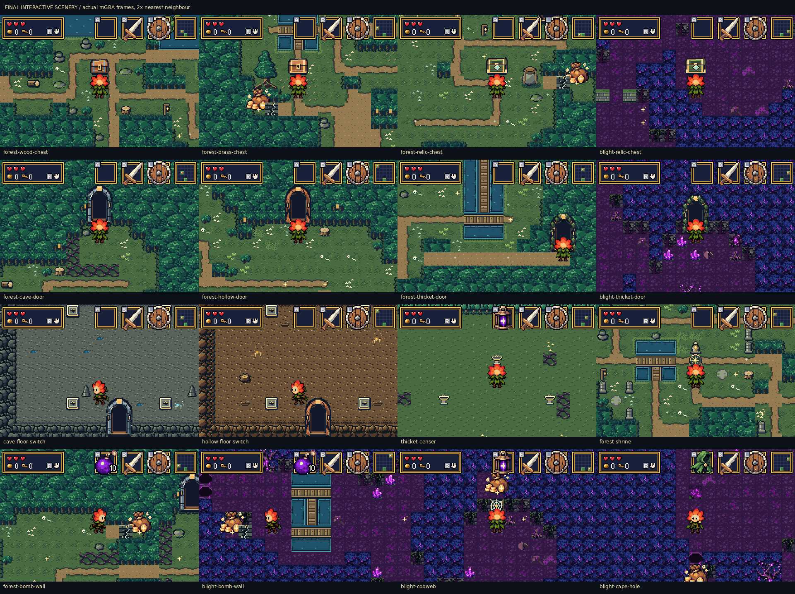

# Interactive scenery: larger, clearer objects in actual mGBA runs

Chests, switches, hazards, barriers and entrances now have stronger silhouettes
and clearer states against the healthy and blighted forest. This gallery shows
**40 cases from real ROM runs in mGBA 0.10.5**, including actual chest rewards,
room entry/exit, switch activation, bomb/candle/cape use and shrine healing.

- [Download the final GBA ROM](https://github.com/natertott/bartgame/raw/refs/heads/forest-art/downloads/interactive-scenery-3d3f8aa/bartgame-interactive-scenery-3d3f8aa.gba)
- [Download the ZIP](https://github.com/natertott/bartgame/raw/refs/heads/forest-art/downloads/interactive-scenery-3d3f8aa/bartgame-interactive-scenery-3d3f8aa.zip)
- [Watch/download the 49-second mGBA video](https://github.com/natertott/bartgame/raw/refs/heads/forest-art/forest-review/interactive-scenery/interactive-scenery-reel.mp4)
- [Checksums](../../downloads/interactive-scenery-3d3f8aa/SHA256SUMS.txt) · [Implementation and reproduction guide](../../bartgame/docs/INTERACTIVE_SCENERY.md)

## Before and after

The left column in each pair is the previous ROM; the right is this build.
Entrances reserve more headroom, so some objects move within the same seed
and room. Those comparisons demonstrate the generated result rather than
claiming identical local placement.



## Corrections

| Interaction | Correction |
| --- | --- |
| Wooden chest | 15×11 becomes 22×20 visible pixels, with a clear latch and raised lid. Existing gilt/supply and small mystery rewards. |
| Brass chest | 24×21, brighter bands and corners. Existing map/heart-piece and medium mystery rewards. |
| Relic chest | 26×22, green panels, gold frame and bold seal. Existing keys, major equipment and large/progression prizes. |
| Pressure plates | Full 16×16 footprint; recessed inactive face and conspicuous warm pressed state. |
| Cave/hollow/thicket entrances | 16×16 mouths become 32×47 visible arches, taller than Bloom, with distinct stone, bark/root and leafy frames. |
| Interior exits | Matching large entrances, with bars/planks/woven roots for closed trial exits. |
| Holes | Dark recessed cavities, chipped rims and visible near walls; blighted variants keep restrained violet fractures. |
| Bombable walls | Broad broken slabs and pale fracture edges, replacing the thin decorative-looking crack. |
| Cobwebs | Connected ivory spokes and rings, clearly visible over the local floor. |
| Locked gates | Larger gold keyhole and readable bands, with a distinct open state. |
| Censers and pots | Wider bowls/rims and stronger body shapes; lit/unlit states are clear and the carried pot matches the ground pot. |
| Healing shrine/spring | A votive statue and dedicated standing medallion replace ordinary flowers as the shrine cue; the spring is a clearer basin. |

Existing loot values and required progression remain intact. Chest tiers reflect
the reward already assigned to the room. Previous item icons, title artwork,
forest materials and Bloom animation polish are included.

## Watch the interactions



[Brass chest](comparisons/forest-brass-chest.gif) ·
[Relic chest in deep blight](comparisons/blight-relic-chest.gif) ·
[Wooden chest in deep blight](comparisons/blight-wood-chest.gif)



[Hollow entry](comparisons/forest-hollow-door.gif) ·
[Blighted thicket entry](comparisons/blight-thicket-door.gif) ·
[Interior exit](comparisons/cave-exit.gif)



[Light a censer](comparisons/thicket-censer.gif) ·
[Heal at the shrine](comparisons/forest-shrine.gif) ·
[Bomb the cracked wall](comparisons/blight-bomb-wall.gif) ·
[Burn the web](comparisons/blight-cobweb.gif) ·
[Jump the holes](comparisons/blight-cape-hole.gif)

Large pocket hoards now stay behind intact barriers, so the bag cannot hide
the crack or web explaining how to reach it. Opening and collecting still use
the real items and existing save bits. The audit also found an existing censer
placement bug in seed `22`, cell `9`: a censer could be shifted away from an
NPC onto a spot with a stump blocking its approach. Placement now protects
all four censer approaches and the NPC's speech space.

## Final rooms



Existing liftable bushes, rocks, thorn vines, relic pickups and the Drain's
keeper/shop and tall ladder exit were also inspected. They retain their
established artwork; the complete index below includes those audit views.

## Capture method

Fixtures choose real seeds/rooms, inventory, position and facing and clear
unrelated actors. The game performs the actions from button inputs. No terrain,
chest contents, mystery descriptors, animation poses or source frames are
injected. Cave, hollow and thicket rooms are entered through generated mouths.
The shrine clip starts with an injured player and shows actual healing.

Each side has 40 cases and **32/32 successful interaction checks**. All use the
same seed/cell pairs; **31 also retain the same target and camera**, while nine
reflect local placement changes. [Before metadata](before/capture.json) and
[after metadata](after/capture.json) record targets, inputs, states and checks.

Native PNGs are untouched **240×160** framebuffers. GIFs enlarge whole frames
2× with nearest-neighbour sampling at approximately 30 fps. Nine transition
GIFs per side and some paired GIFs exceed the 256-colour palette limit; exact
native frames are retained. The MP4 is a compressed convenience view.
[The manifest](gallery-manifest.json) records palette precision, ROM hashes
and individual evidence-file checksums. Filmstrips use chronological complete
emulator frames with captions outside them.

## Validation

| Check | Final result |
| --- | ---: |
| Interactive scale, depth, actual actions and persistence | 549/549 |
| Generated room traversal, bridges and item pockets | 625/625 rooms across 25 seeds |
| Foreground and floor composition | 2,538/2,538 |
| Packed art scope and unchanged physical contracts | 4,038/4,038 |
| Sprite memory and menu restoration | 2,046/2,046 across 582 contexts |
| Bloom motion/depth and sword timing/range | 469/469 and 274/274 |
| Required trials / critical path and Heart | 54/54 and 21/21 |
| Mechanics / lift / mysteries / pockets / quests / saves | 22/22, 14/14, 28/28, 18/18, 12/12, 6/6 |

All original **912 metatile IDs and physical contracts** remain intact; the
new shrine marker is appended. All **101 Bloom frames and effects**, unrelated
sprite sheets, three other carried-object frames, item icons, palettes and
title art remain exact. The carried pot changes to match its new ground image.
The 5×5 maze and save format are retained; local entrance/censer placement
intentionally changes.

Background budgets are **997/1024** subtiles for forest, **999/1024** for the
Drain and **199/1024** for mysteries. The allocation sweep peaks at
**854/876 OBJ tiles**, leaving 22 free, with exact seven-icon menu pages and
palette restoration verified.

[Validation summary](validation.json) · [Final reports and logs](validation/)

Game source: [`3d3f8aa`](https://github.com/natertott/bartgame/commit/3d3f8aa970a163959655463dc52efd75c15597e1).
Final ROM SHA256:

```text
bbd08678b1e10fb110e562a6374b0242cb8e73affbdd747f033fd0ce99619eee
```

## Full audit index

Each row links the matched before/after GIFs, an unmodified native screenshot,
a chronological final filmstrip and additional native frames.

| Case | Seed / cell | Before | After | Native | Filmstrip | Frames |
| --- | --- | --- | --- | --- | --- | --- |
| forest wood chest | `0x6` / 16 | [GIF](before/forest-wood-chest.gif) | [GIF](after/forest-wood-chest.gif) | [PNG](after/forest-wood-chest.png) | [PNG](after/forest-wood-chest-frames.png) | [240×160](after/forest-wood-chest/) |
| blight wood chest | `0x9` / 15 | [GIF](before/blight-wood-chest.gif) | [GIF](after/blight-wood-chest.gif) | [PNG](after/blight-wood-chest.png) | [PNG](after/blight-wood-chest-frames.png) | [240×160](after/blight-wood-chest/) |
| forest brass chest | `0x7` / 10 | [GIF](before/forest-brass-chest.gif) | [GIF](after/forest-brass-chest.gif) | [PNG](after/forest-brass-chest.png) | [PNG](after/forest-brass-chest-frames.png) | [240×160](after/forest-brass-chest/) |
| blight brass chest | `0x7` / 18 | [GIF](before/blight-brass-chest.gif) | [GIF](after/blight-brass-chest.gif) | [PNG](after/blight-brass-chest.png) | [PNG](after/blight-brass-chest-frames.png) | [240×160](after/blight-brass-chest/) |
| forest relic chest | `0xb4a7` / 21 | [GIF](before/forest-relic-chest.gif) | [GIF](after/forest-relic-chest.gif) | [PNG](after/forest-relic-chest.png) | [PNG](after/forest-relic-chest-frames.png) | [240×160](after/forest-relic-chest/) |
| blight relic chest | `0x6` / 19 | [GIF](before/blight-relic-chest.gif) | [GIF](after/blight-relic-chest.gif) | [PNG](after/blight-relic-chest.png) | [PNG](after/blight-relic-chest-frames.png) | [240×160](after/blight-relic-chest/) |
| forest cave door | `0xb4a7` / 11 | [GIF](before/forest-cave-door.gif) | [GIF](after/forest-cave-door.gif) | [PNG](after/forest-cave-door.png) | [PNG](after/forest-cave-door-frames.png) | [240×160](after/forest-cave-door/) |
| mixed cave door | `0xb4a7` / 0 | [GIF](before/mixed-cave-door.gif) | [GIF](after/mixed-cave-door.gif) | [PNG](after/mixed-cave-door.png) | [PNG](after/mixed-cave-door-frames.png) | [240×160](after/mixed-cave-door/) |
| forest hollow door | `0x6` / 0 | [GIF](before/forest-hollow-door.gif) | [GIF](after/forest-hollow-door.gif) | [PNG](after/forest-hollow-door.png) | [PNG](after/forest-hollow-door-frames.png) | [240×160](after/forest-hollow-door/) |
| blight hollow door | `0x6` / 24 | [GIF](before/blight-hollow-door.gif) | [GIF](after/blight-hollow-door.gif) | [PNG](after/blight-hollow-door.png) | [PNG](after/blight-hollow-door-frames.png) | [240×160](after/blight-hollow-door/) |
| forest thicket door | `0xb4a7` / 7 | [GIF](before/forest-thicket-door.gif) | [GIF](after/forest-thicket-door.gif) | [PNG](after/forest-thicket-door.png) | [PNG](after/forest-thicket-door-frames.png) | [240×160](after/forest-thicket-door/) |
| blight thicket door | `0x7` / 14 | [GIF](before/blight-thicket-door.gif) | [GIF](after/blight-thicket-door.gif) | [PNG](after/blight-thicket-door.png) | [PNG](after/blight-thicket-door-frames.png) | [240×160](after/blight-thicket-door/) |
| small hollow chest | `0x6` / 3 | [GIF](before/small-hollow-chest.gif) | [GIF](after/small-hollow-chest.gif) | [PNG](after/small-hollow-chest.png) | [PNG](after/small-hollow-chest-frames.png) | [240×160](after/small-hollow-chest/) |
| medium cave chest | `0xb` / 17 | [GIF](before/medium-cave-chest.gif) | [GIF](after/medium-cave-chest.gif) | [PNG](after/medium-cave-chest.png) | [PNG](after/medium-cave-chest-frames.png) | [240×160](after/medium-cave-chest/) |
| large thicket chest | `0x6` / 17 | [GIF](before/large-thicket-chest.gif) | [GIF](after/large-thicket-chest.gif) | [PNG](after/large-thicket-chest.png) | [PNG](after/large-thicket-chest-frames.png) | [240×160](after/large-thicket-chest/) |
| cave floor switch | `0xb4a7` / 11 | [GIF](before/cave-floor-switch.gif) | [GIF](after/cave-floor-switch.gif) | [PNG](after/cave-floor-switch.png) | [PNG](after/cave-floor-switch-frames.png) | [240×160](after/cave-floor-switch/) |
| hollow floor switch | `0x6` / 0 | [GIF](before/hollow-floor-switch.gif) | [GIF](after/hollow-floor-switch.gif) | [PNG](after/hollow-floor-switch.png) | [PNG](after/hollow-floor-switch-frames.png) | [240×160](after/hollow-floor-switch/) |
| thicket floor switch | `0x6` / 12 | [GIF](before/thicket-floor-switch.gif) | [GIF](after/thicket-floor-switch.gif) | [PNG](after/thicket-floor-switch.png) | [PNG](after/thicket-floor-switch-frames.png) | [240×160](after/thicket-floor-switch/) |
| thicket censer | `0xb4a7` / 13 | [GIF](before/thicket-censer.gif) | [GIF](after/thicket-censer.gif) | [PNG](after/thicket-censer.png) | [PNG](after/thicket-censer-frames.png) | [240×160](after/thicket-censer/) |
| cave pot | `0xb4a7` / 12 | [GIF](before/cave-pot.gif) | [GIF](after/cave-pot.gif) | [PNG](after/cave-pot.png) | [PNG](after/cave-pot-frames.png) | [240×160](after/cave-pot/) |
| cave spring | `0xb4a7` / 3 | [GIF](before/cave-spring.gif) | [GIF](after/cave-spring.gif) | [PNG](after/cave-spring.png) | [PNG](after/cave-spring-frames.png) | [240×160](after/cave-spring/) |
| cave exit | `0xb` / 17 | [GIF](before/cave-exit.gif) | [GIF](after/cave-exit.gif) | [PNG](after/cave-exit.png) | [PNG](after/cave-exit-frames.png) | [240×160](after/cave-exit/) |
| hollow exit | `0x6` / 3 | [GIF](before/hollow-exit.gif) | [GIF](after/hollow-exit.gif) | [PNG](after/hollow-exit.png) | [PNG](after/hollow-exit-frames.png) | [240×160](after/hollow-exit/) |
| thicket exit | `0x6` / 17 | [GIF](before/thicket-exit.gif) | [GIF](after/thicket-exit.gif) | [PNG](after/thicket-exit.png) | [PNG](after/thicket-exit-frames.png) | [240×160](after/thicket-exit/) |
| forest locked door | `0xb4a7` / 24 | [GIF](before/forest-locked-door.gif) | [GIF](after/forest-locked-door.gif) | [PNG](after/forest-locked-door.png) | [PNG](after/forest-locked-door-frames.png) | [240×160](after/forest-locked-door/) |
| blight locked door | `0x7` / 14 | [GIF](before/blight-locked-door.gif) | [GIF](after/blight-locked-door.gif) | [PNG](after/blight-locked-door.png) | [PNG](after/blight-locked-door-frames.png) | [240×160](after/blight-locked-door/) |
| forest shrine | `0xdeadbeef` / 5 | [GIF](before/forest-shrine.gif) | [GIF](after/forest-shrine.gif) | [PNG](after/forest-shrine.png) | [PNG](after/forest-shrine-frames.png) | [240×160](after/forest-shrine/) |
| forest relic pedestal | `0xb4a7` / 23 | [GIF](before/forest-relic-pedestal.gif) | [GIF](after/forest-relic-pedestal.gif) | [PNG](after/forest-relic-pedestal.png) | [PNG](after/forest-relic-pedestal-frames.png) | [240×160](after/forest-relic-pedestal/) |
| forest bush | `0xb4a7` / 16 | [GIF](before/forest-bush.gif) | [GIF](after/forest-bush.gif) | [PNG](after/forest-bush.png) | [PNG](after/forest-bush-frames.png) | [240×160](after/forest-bush/) |
| forest rock_small | `0xb4a7` / 16 | [GIF](before/forest-rock_small.gif) | [GIF](after/forest-rock_small.gif) | [PNG](after/forest-rock_small.png) | [PNG](after/forest-rock_small-frames.png) | [240×160](after/forest-rock_small/) |
| forest thorn | `0xb4a7` / 11 | [GIF](before/forest-thorn.gif) | [GIF](after/forest-thorn.gif) | [PNG](after/forest-thorn.png) | [PNG](after/forest-thorn-frames.png) | [240×160](after/forest-thorn/) |
| thicket boulder | `0x7` / 17 | [GIF](before/thicket-boulder.gif) | [GIF](after/thicket-boulder.gif) | [PNG](after/thicket-boulder.png) | [PNG](after/thicket-boulder-frames.png) | [240×160](after/thicket-boulder/) |
| drain control | `0xb4a7` / Drain | [GIF](before/drain-control.gif) | [GIF](after/drain-control.gif) | [PNG](after/drain-control.png) | [PNG](after/drain-control-frames.png) | [240×160](after/drain-control/) |
| drain exit | `0xb4a7` / Drain | [GIF](before/drain-exit.gif) | [GIF](after/drain-exit.gif) | [PNG](after/drain-exit.png) | [PNG](after/drain-exit-frames.png) | [240×160](after/drain-exit/) |
| forest bomb wall | `0xdeadbeef` / 15 | [GIF](before/forest-bomb-wall.gif) | [GIF](after/forest-bomb-wall.gif) | [PNG](after/forest-bomb-wall.png) | [PNG](after/forest-bomb-wall-frames.png) | [240×160](after/forest-bomb-wall/) |
| blight bomb wall | `0x6` / 4 | [GIF](before/blight-bomb-wall.gif) | [GIF](after/blight-bomb-wall.gif) | [PNG](after/blight-bomb-wall.png) | [PNG](after/blight-bomb-wall-frames.png) | [240×160](after/blight-bomb-wall/) |
| forest cobweb | `0x6` / 0 | [GIF](before/forest-cobweb.gif) | [GIF](after/forest-cobweb.gif) | [PNG](after/forest-cobweb.png) | [PNG](after/forest-cobweb-frames.png) | [240×160](after/forest-cobweb/) |
| blight cobweb | `0x6` / 24 | [GIF](before/blight-cobweb.gif) | [GIF](after/blight-cobweb.gif) | [PNG](after/blight-cobweb.png) | [PNG](after/blight-cobweb-frames.png) | [240×160](after/blight-cobweb/) |
| forest cape hole | `0xb4a7` / 16 | [GIF](before/forest-cape-hole.gif) | [GIF](after/forest-cape-hole.gif) | [PNG](after/forest-cape-hole.png) | [PNG](after/forest-cape-hole-frames.png) | [240×160](after/forest-cape-hole/) |
| blight cape hole | `0x6` / 9 | [GIF](before/blight-cape-hole.gif) | [GIF](after/blight-cape-hole.gif) | [PNG](after/blight-cape-hole.png) | [PNG](after/blight-cape-hole-frames.png) | [240×160](after/blight-cape-hole/) |
