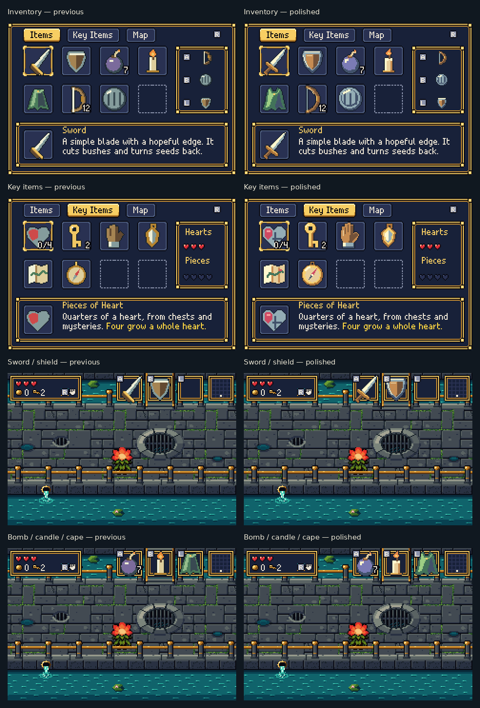
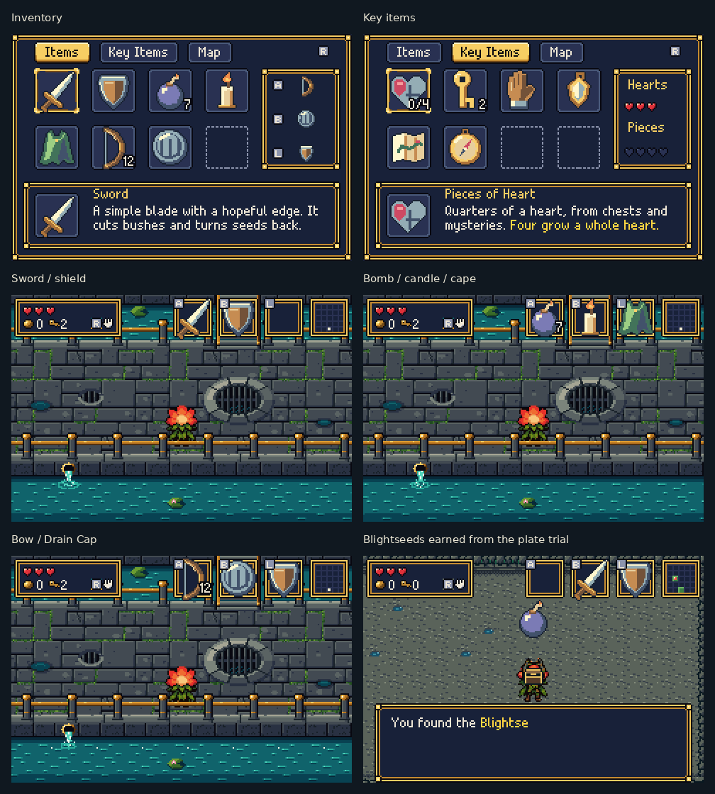
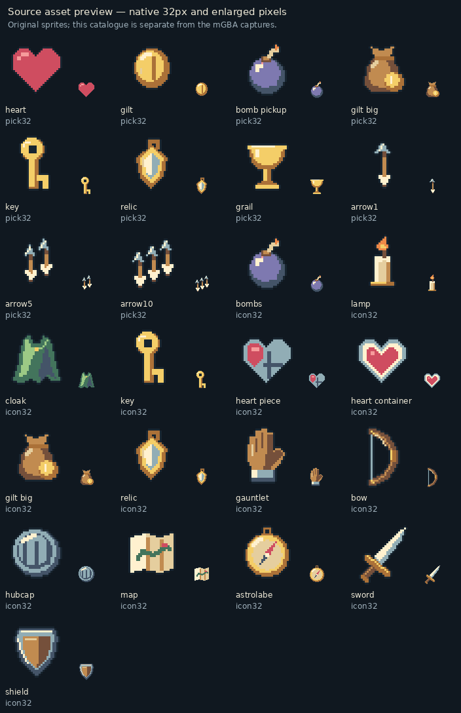
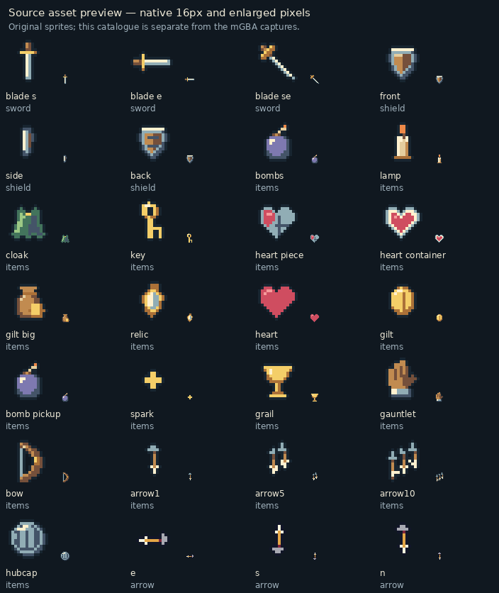

# Handheld item polish

This pass takes cues from the clear silhouettes, compact highlights and
warm colour ramps of classic handheld Zelda and Pokémon art. The drawings
remain simple: a plain sword and wooden shield, readable tools, and distinct
collectibles. Larger tools have their own pixel drawings; small sprites keep
the details that matter at 16 pixels.

The sword has a visible grip below its guard, the cape has a neckline and
shoulders, and the gauntlet has stepped fingers and a thumb. Heart containers
have a pale rim, heart pieces show their quarters, and arrow bundles have
staggered tips and fletching. Materials share upper-left lighting.

## Before and after in mGBA

## The polished items in the running game

These are actual **240×160 mGBA 0.10.5 framebuffers**, enlarged 2× without
smoothing. Captions sit outside the game image. The menu and HUD views use
a full-inventory render fixture. The Blightseeds view comes from completing
the generated plate trial and opening its earned chest, in seed `0xB4A7`.

[Native new screenshots](after/) · [Native previous screenshots](before/)

## Complete sprite catalogues

These two sheets are **source-asset previews**, separate from the emulator
screenshots above. Each shows the native sprite beside a nearest-neighbour
enlargement.

## Validation

The ROM builds within the existing asset allocations. All 55 active frames
retain their names, order, dimensions and palette slots. The generated asset
header is identical to the previous pass: 28 sprite sheets, 4069 sprite tiles
and 16 OBJ palettes. The material palette changes affect item sheets only;
projectile arrows retain the shared effects palette.

The actual ROM passed **21/21 menu/equipment/save checks** and **22/22 item
mechanics checks**. All six new native captures record the final ROM SHA256.

[Validation and ROM hash](validation.json) · [Menu checks](menu.log) ·
[Mechanics checks](mechanics.log) ·
[Art source](../../bartgame/art/clean_items.py) ·
[Capture instructions](../../bartgame/docs/SURFACES_AND_ITEMS.md)
