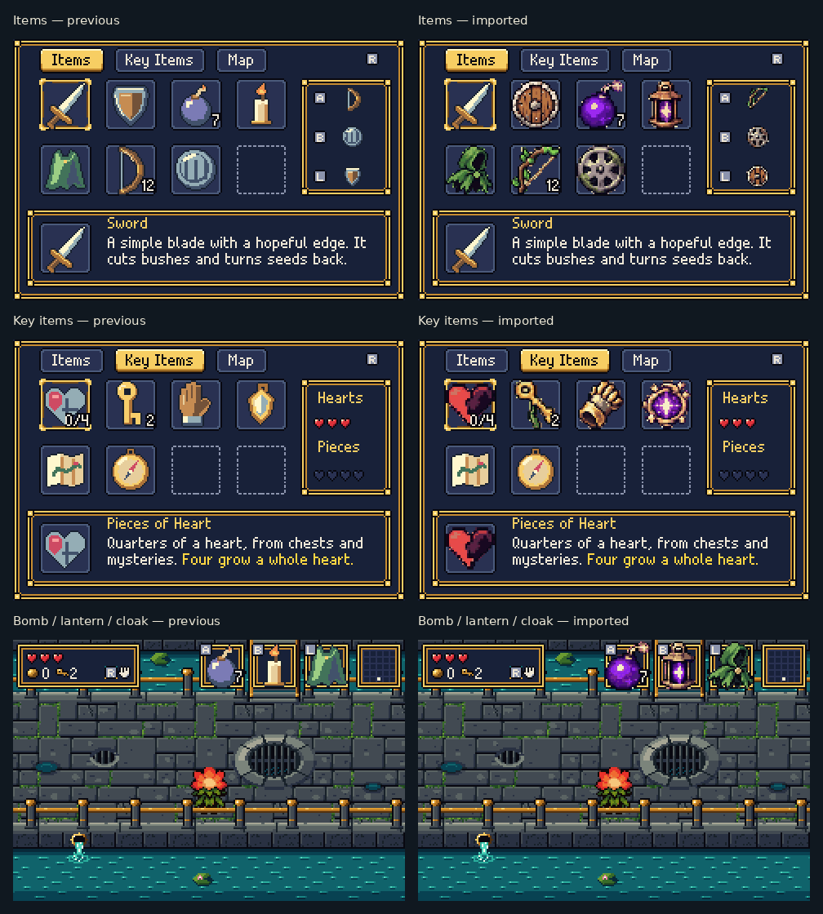
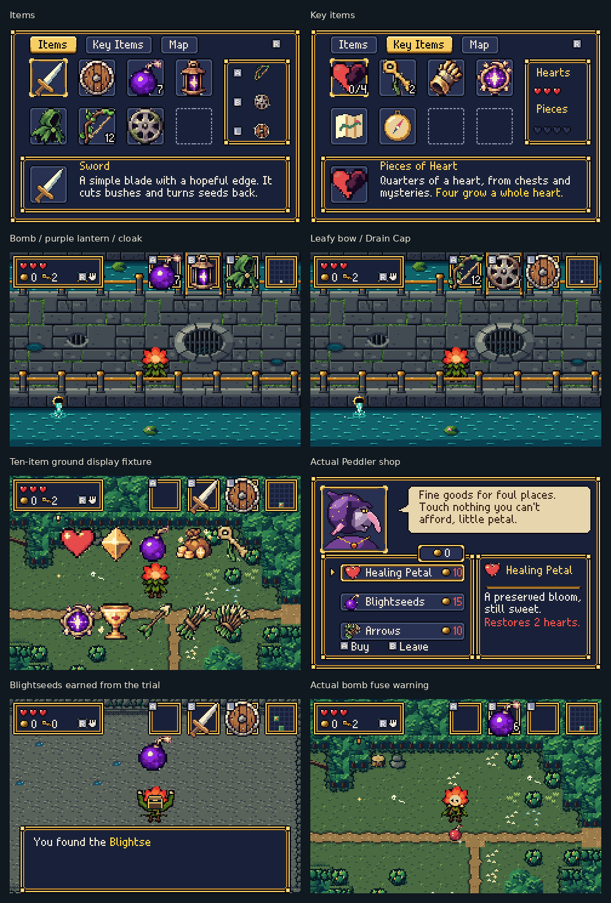
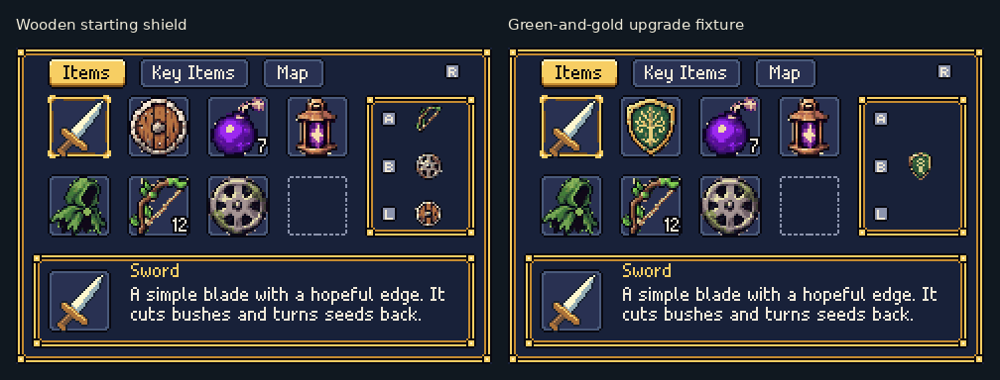
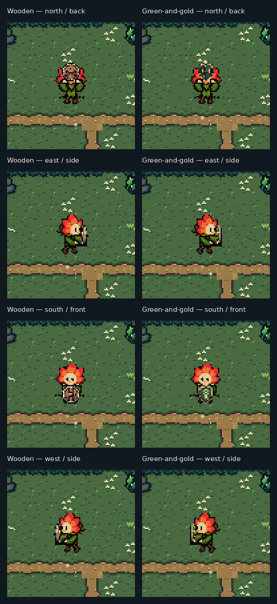
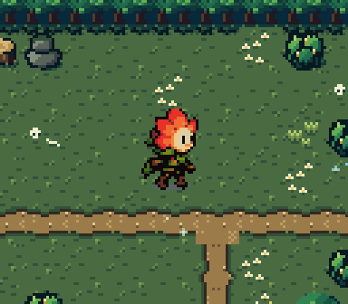
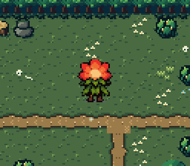
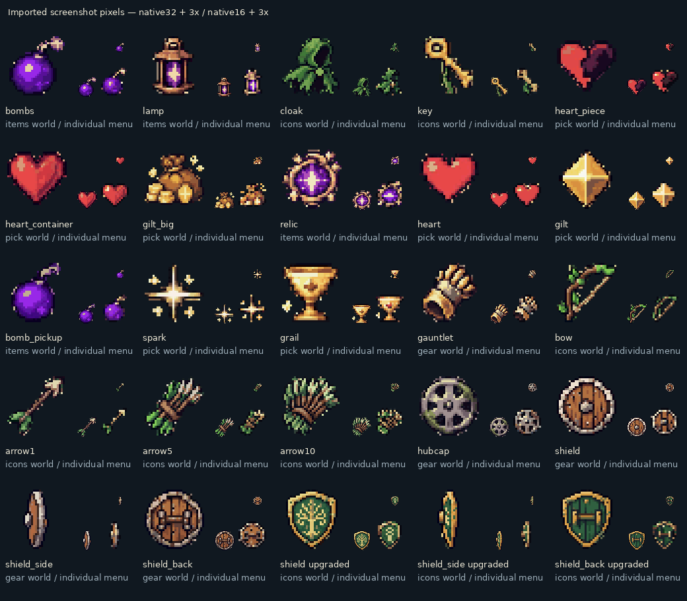

# Supplied item artwork — actual mGBA review

The item and shield designs are imported from the two supplied screenshots.
The checkerboard is removed, and their pixel shapes, shading and glints are
retained at the GBA's native sprite sizes.

## Before and after

These are actual mGBA 0.10.5 framebuffers, enlarged 2× without smoothing.

## In the running game

Inventory and ground-item displays are rendering fixtures. The Blightseeds
reward is earned by completing the actual generated plate trial. Native
240×160 screenshots are in the folders below.

## Both shield designs

The wooden shield is the starting design. The green-and-gold shield is
wired as an upgrade variant; its review fixture sets ownership explicitly.
It has not been assigned to a new chest or quest in this artwork update.

## Held items

These clips show genuine item-button actions in mGBA. They crop the actual
framebuffers and enlarge them 3× with nearest-neighbour scaling; frame
timing is retained at a 30fps sample rate.

## Complete source-art catalogue

This last image is a **source-asset preview**, separate from emulator
captures. Large inventory icons use individual palettes to retain shading;
world sprites share four material palettes. The smaller 16×16 forms lose
some fine detail, as expected at that size.

[Native new frames](after/) · [Native previous frames](before/) ·
[Item source screenshot](../../bartgame/art/ref/items-reference.jpg) ·
[Shield source screenshot](../../bartgame/art/ref/shields-reference.jpg) ·
[Updated ROM download](../../downloads/README.md) ·
[Validation](validation.json) · [Import metadata](import.json) ·
[Implementation and capture instructions](../../bartgame/docs/REFERENCE_ITEMS.md)
