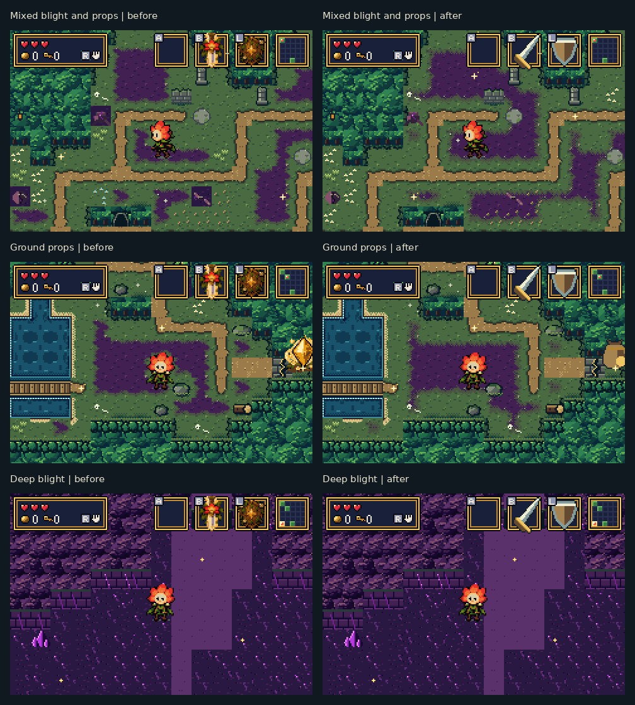
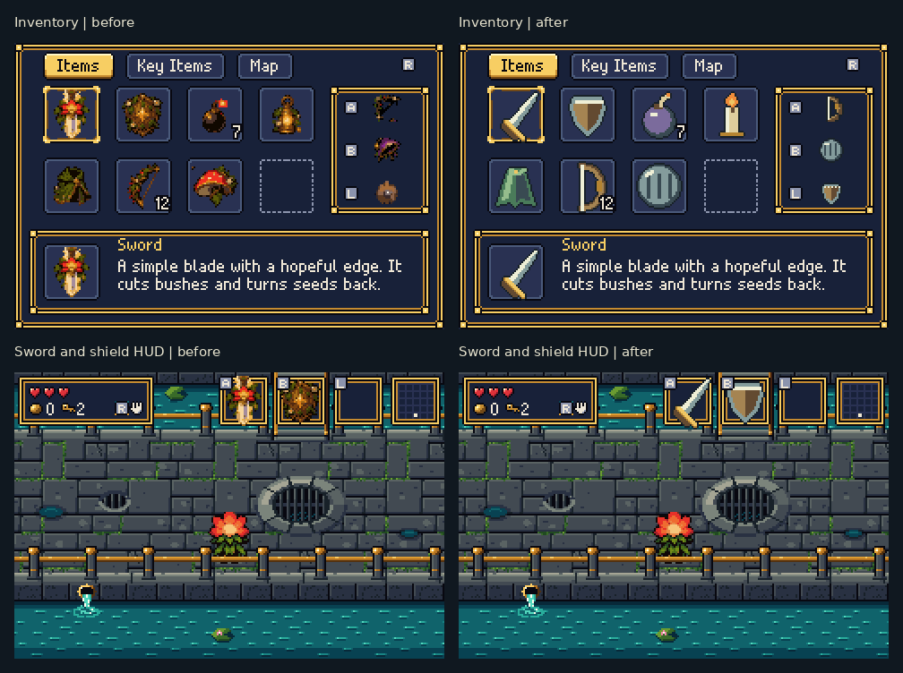
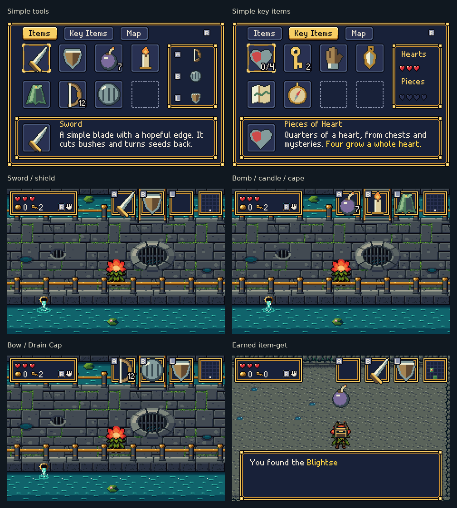
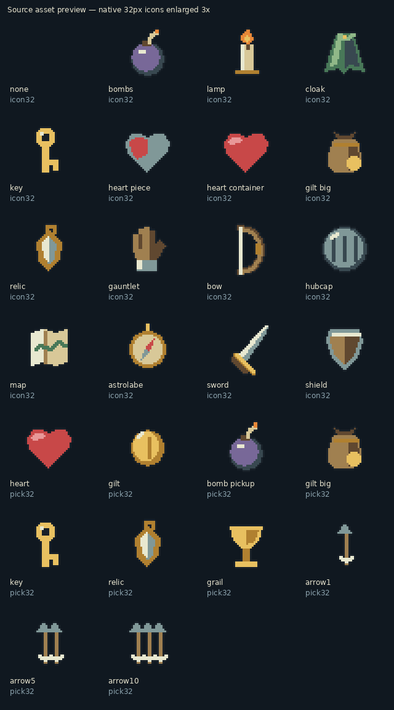

# Surface blending and simpler items

These before/after views were captured from the actual ROM in mGBA 0.10.5.
Terrain comparisons use the same seed (`0xB4A7`), room and standing point;
enemies are cleared to inspect the surfaces. Captions are outside the game
frames, which are enlarged 2× without smoothing.

## Floors and props

Props no longer contain rectangular grass or rot backgrounds. They use the
floor they stand on, including mixed blight and trail edges. Blight blending
also accounts for diagonal neighbours. Lifting objects exposes the same
floor; opened chests retain it.

## Item icons before and after

## In the running game

The full-inventory menu and HUD views are render fixtures. The item-get view
comes from completing the actual plate trial and claiming its Blightseeds.

## All large item and pickup icons

This last sheet is explicitly a **source-asset preview** at 3×. The plain
sword, wooden shield, round bomb, candle, cloak, keys, tools and pickups use
shared material colours without miniature decorative frames or halos.

[Native terrain comparisons](surfaces/) · [Native UI frames](items-after/) ·
[25 generated forest views](forest-after/) · [Validation](validation.json) ·
[Implementation and capture instructions](../../bartgame/docs/SURFACES_AND_ITEMS.md)

Validation covers the actual terrain VRAM, prop clearing/chest interaction,
unchanged physical layouts and spawn records, room traversal and menu/item
behaviour. Terrain physics, progression and save formats are retained.

Final checks: **2,526/2,526 surface and sprite-order checks**, **75/75 rooms'
physical layouts/spawns unchanged** across three seeds, and **21/21 menu
checks**. The wider room scan passed 125/125; item mechanics and mystery
checks passed 22/22 and 28/28. The forest remains within its native budgets:
869/1024 subtiles, 11/12 material palettes.
