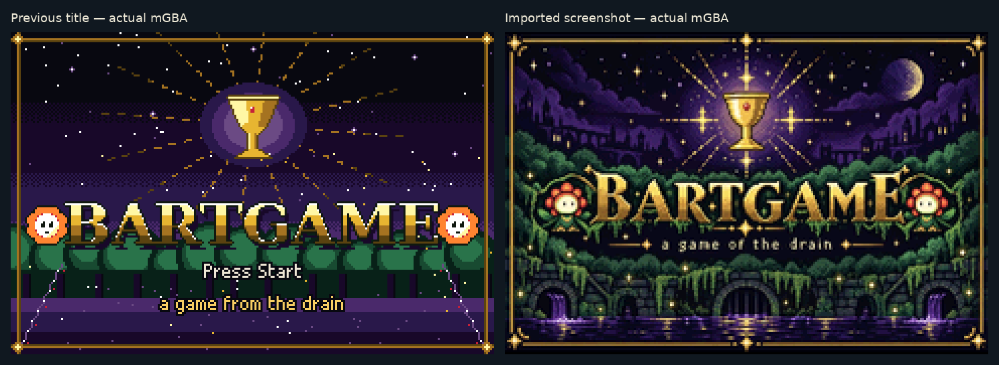
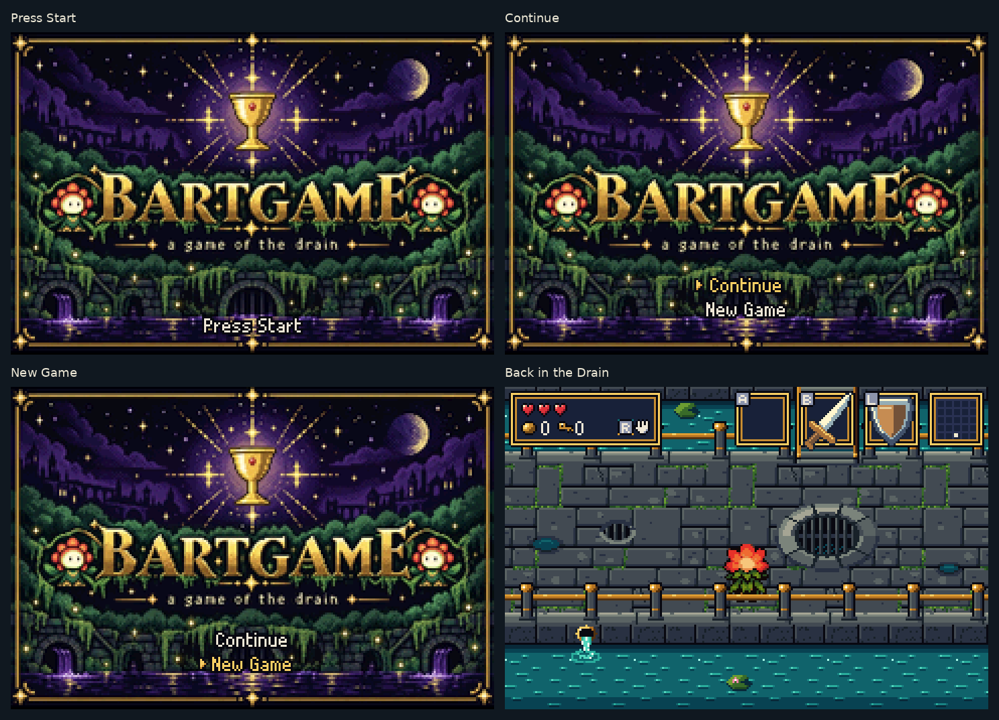

# Opening screen — supplied artwork in the real ROM

The title now imports the actual screenshot, retaining the complete image
and its built-in lettering. It uses 2,070 colours in the GBA's native
240×160 direct-colour display, replacing the earlier 16-colour painting.

## Before and after

These are actual mGBA 0.10.5 framebuffers, enlarged 3× without smoothing.
The imported title is captured during the prompt's normal off blink.

## Title controls

The small prompt and choices use the lower part of the picture. The main
lettering and subtitle remain visible. New Game, Continue, saving, map use
and returning to the title after winning are checked in the real emulator.

[Native screenshots](native/) · [Download the updated ROM](../../downloads/README.md) ·
[Source screenshot](../../bartgame/art/ref/title-reference.jpg) ·
[Conversion metadata](conversion.json) · [Validation](validation.json) ·
[Implementation and capture instructions](../../bartgame/docs/TITLE_REFERENCE.md)
