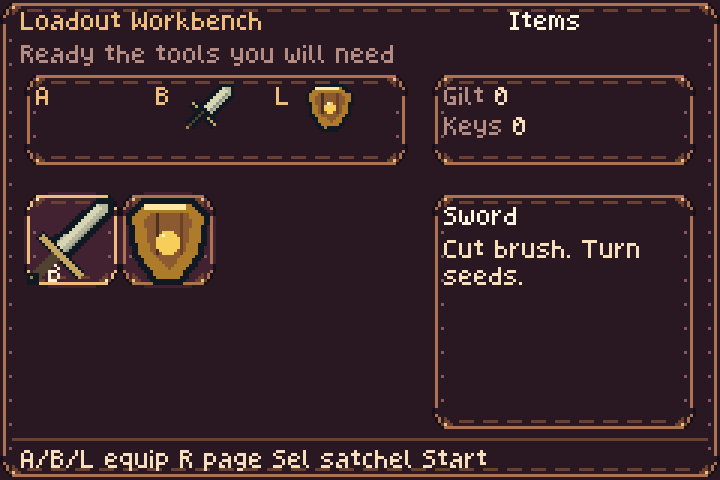
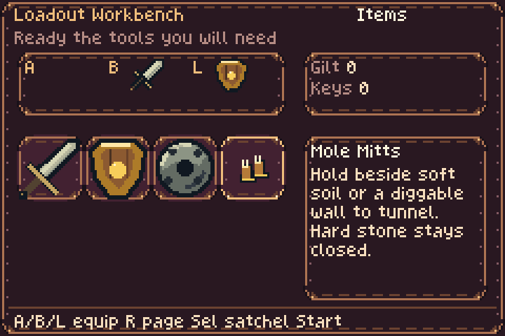
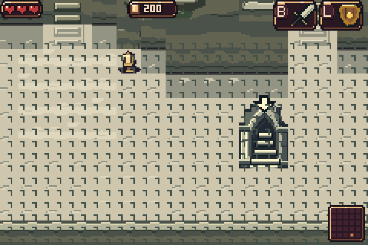
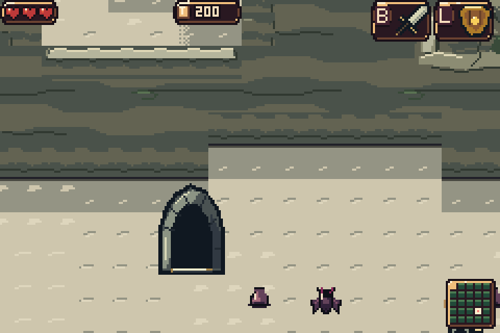

# Pause display fixes and complete item catalogue

Newly received tools now appear on the first pause screen. The initial Workbench reads the full owned inventory, including legacy tools, passive items, gold fusion halves and Kinstone counters. It keeps seven slots per page and selects a newly received tool. Newly received passive items appear on Keys. A/B/L equip tools directly.

The persistent artifacts came from the Cream map overwriting shared HUD/menu graphics. Leaving it now restores those graphics, the borrowed sprite pixels and palettes, and drains pending uploads. Paused item icons also reuse a backed-up graphics bank rather than growing the combat sprite heap. Existing sprite art, item effects, terrain and combat mechanics are unchanged.

[Download ROM](../downloads/pause-repair-9080b7e1/bartgame-pause-fixed.gba?raw=true) · [Download ZIP](../downloads/pause-repair-9080b7e1/bartgame-pause-fixed.zip?raw=true) · [Checksums and build settings](../downloads/pause-repair-9080b7e1/README.md)

## Actual mGBA captures

These are real 240×160 emulator frames, enlarged exactly 3× with nearest-neighbour sampling. No artwork was reconstructed. The first-pause pair uses the same seed and real opening-draft choices: Mole Mitts, Heart Container and Peril Beam. The world examples exercise the same menu round trip in different Cream rooms: baseline cell 0 and the fixed run's surveyed most-loaded cell 18.

| Before | Fixed |
| --- | --- |
| First pause omits the newly awarded Mitts. | First pause includes and selects the Mitts. |
|  |  |
| Map → Satchel → world leaves repeated gold debris. | Shared graphics restore cleanly after that round trip. |
|  |  |

Also inspect [earned passive items](fixed/inventory/new-passives-3x.png), [the old Satchel workaround](before/inventory/later-satchel-workaround-3x.png), [fixed map → Satchel](fixed/graphics/satchel-after-atlas-3x.png), and [Forest after return](fixed/graphics/forest/after-3x.png).

## Every item

[Complete item report](../bartgame/docs/items/PLAYER_ITEM_CATALOG.md) · [CSV](../bartgame/docs/items/PLAYER_ITEM_CATALOG.csv) · [JSON](../bartgame/docs/items/PLAYER_ITEM_CATALOG.json)

There are **139 visible arcade catalogue entries**, including overlapping original/legacy representations, consumables, upgrades and bottle states. **129** have a current acquisition or bottle-state path; **10** are defined without a current award route. The report lists every entry, its effect, equipment status, acquisition route and source references. Hidden helper slots and the additional Fleet blessing are documented separately. This is a source audit, not a claim that 139 items were collected in one run.

## Verification and provenance

The fixed ROM passes **30/30 focused native mGBA checks** and **40/40 actual-C host inventory checks**. Both reported bugs reproduce in the previous ROM. The native tests earn items through the ordinary opening draft, verify exact rendered glyphs and palettes, equip with A/B/L, cycle pages and reopen pause. They also check exact restoration of resident HUD/UI tiles, all 5,504 borrowed icon/HUD OBJ bytes, all 512 OBJ palette bytes, and static ground graphics across Cream, Sewer and Forest returns.

The native survey covers all 25 Cream rooms of seed 1 and exercises the largest ordinary sprite allocation encountered: 438 of 876 tiles. Pausing adds no allocation or failure. Larger-than-seven-item ownership and catalogue-wide pagination use explicit host-only fixtures; native gameplay ownership was not fabricated. Ordinary room-load and hero-navigation fixtures are disclosed in the input traces. See [detailed QA and reproduction](QA.md), [native fixed assertions](fixed/report.json), [baseline reproduction](before/report.json), and [host assertions](validation/host-inventory.json).

| Build | Source commit | ROM SHA-256 |
| --- | --- | --- |
| Before | `48a39a9a1c0dc3fe1a0eb4fa563219eab0d104f6` | `98d1dce7d1fa78d64a537688d44872b78e9a012585584081820a23edb2f9842e` |
| Fixed | `9080b7e1d32e1b344722fcd6f89acefe1e621160` | `9b3c24cf17088a335c7efeaf2d49aacb627abb43569987a050decf910f6a5f5f` |

The normal build retains Cream profile 12, the approved Contour Folio map with Exploded Shelves markers, and all previous production art selections. Generated asset data is byte-for-byte unchanged. [Build settings](validation/build-options.json), [build log](validation/build.log), [asset fingerprint](validation/assets-header-sha256.txt), and [gallery manifest](manifest.json) pin this evidence. The complete historical terrain/generation test suite was not rerun for this UI repair.
