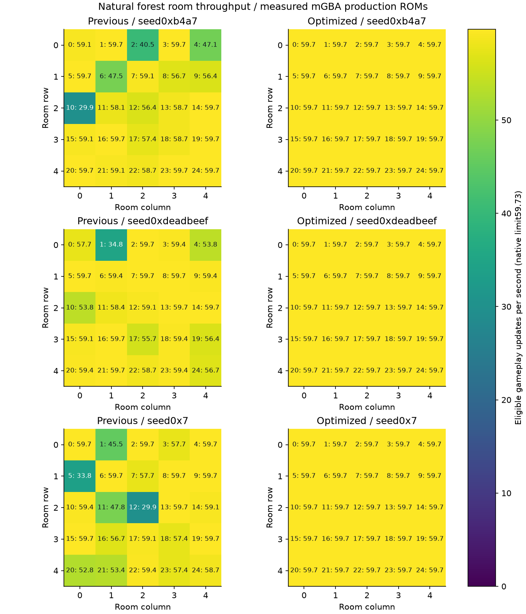
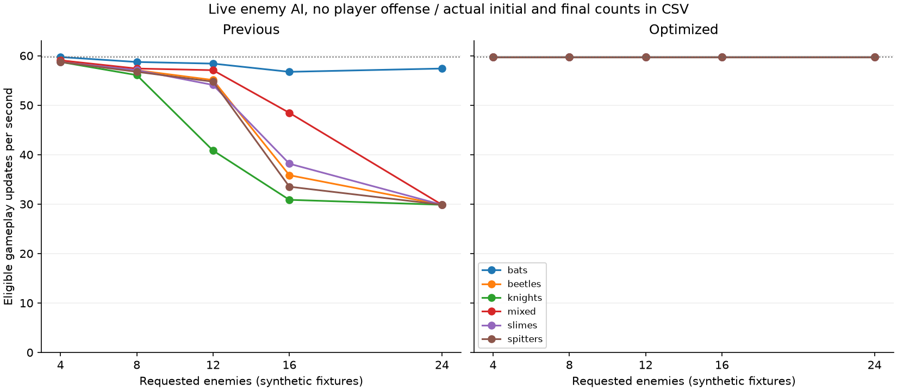
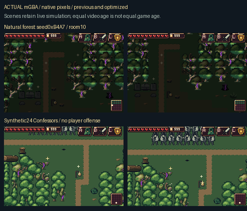
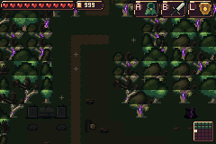
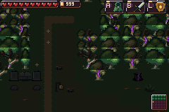
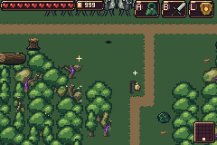
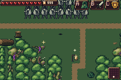
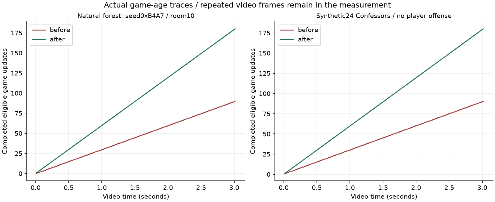
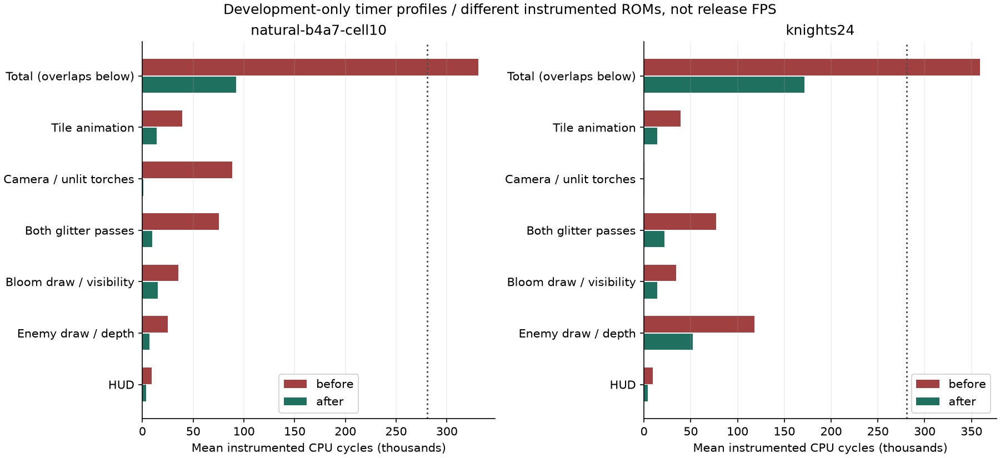

# Measured performance improvements

The optimized build removes repeated renderer/terrain work while retaining the selected native artwork, glitter, enemy AI/populations and action rules. The production ROM is measured in actual mGBA runs; separate development-only timer profiles explain CPU cost.

[Download the production ROM/ZIP](../downloads/performance-c09e290/README.md) · [Complete measurements](measurements/README.md) · [Regression evidence](validation/README.md)

## Actual production throughput

“Updates/s” means completed eligible game updates per video frame multiplied by the native GBA refresh rate 59.7275 Hz. It is not the emulator host machine’s speed. Paused menus, named dialogue, shops and room transitions are excluded from gameplay throughput and recorded separately.

| Matched workload | Cases | Previous updates/s | Optimized updates/s | Missed updates, previous → optimized |
| --- | ---: | ---: | ---: | ---: |
| Natural forest rooms, three seeds | 75 | 56.29 | 59.73 | 777 → 0 |
| Drain | 3 | 59.29 | 59.40 | 4 → 3 |
| Generated mystery interiors | 24 | 59.73 | 59.73 | 0 → 0 |
| Real item/action contexts | 12 | 58.34 | 59.48 | 50 → 9 |
| Synthetic enemies, combat inputs | 30 | 48.05 | 59.72 | 1056 → 1 |
| Synthetic enemies, no player offense | 30 | 48.92 | 59.73 | 977 → 0 |
| Room 10 after 120 ordinary warmup frames | 1 | 29.86 | 59.73 | 90 → 0 |

These are weighted rates from the sampled eligible frames. Each ordinary workload lasts 180 video frames; the finite corpus does not establish a universal 60 FPS bound for every future room, enemy/effect combination or area. Faster runs advance more actual simulation in the same video time. Planned player floor positions match the reference; camera and live enemy states are not forced to manufacture an identical screenshot. Per-case initial/final rosters and match flags are retained.

The broad survey still records 13 repeated gameplay frames among 25,920 eligible video frames: 12 at the initial sampling boundary (video index 1), and one at video index 178 in the 16-enemy mixed-combat fixture. These observations remain included in the rates above.

## Native recordings

**Natural forest: seed 0xB4A7 / room 10:** 29.86 → 59.73 updates/s; missed 90 → 0. Actual enemies start/end: previous 6/6, optimized 6/5.

| Previous | Optimized |
| --- | --- |
|  |  |

**Synthetic 24 Confessors / no player offense:** 29.86 → 59.73 updates/s; missed 90 → 0. Actual enemies start/end: previous 24/24, optimized 24/24.

| Previous | Optimized |
| --- | --- |
|  |  |

Each GIF samples every sixth raw native frame with 100 ms viewing holds, approximately real native playback. Repeated video frames remain repeated. All 180 original frames per selected run and their video/game ages are available in the [native manifest](actual/manifest.json). No pixels, AI timers, enemy HP or simulation clocks are replaced for these recordings. Health restoration, full inventory, developer navigation and explicitly replaced stress rosters are disclosed fixtures.

## What consumed the frame budget

Room-dependent work included repeated full-room unlit-torch searches, software division in tile animation scheduling, repeated tree-depth/visibility queries, room-wide glitter scans and object overlap tests on unrelated actor slots. Equivalent cached/indexed queries, packed native-row tests and earlier exact viewport/kind rejection remove that repeated work. No animation frame, glitter site, enemy update or monster is removed to achieve the measured result.

These timer measurements use separate instrumented development ROMs and include profiling overhead. The total overlaps the displayed child phases; do not add the bars. Timer-ROM samples support diagnosis, while the production reports above establish experienced throughput. Only the uninstrumented production ROM is downloadable.

## Preserved behavior and visual output

The independent frozen-source regression passes **900/900** and retains **24 matched actual RGB views**. Separate host differential reports compare actual C routines for actor/object painting, native visibility, glitter/HUD, torch invalidation and animation/DMA scheduling. Their fixture counts have different units and are not added to the regression count.

The [supplemental native and workload checks](validation/SUPPLEMENTAL.md) also show all 45 menu RGB views and their page/cursor/map/zoom/state records matching exactly, across all nine menu style and palette combinations. Both sets of native images and the additional Heart-pressure measurements are retained there.

The original authored art and resolved native payloads are unchanged. Fixed-logic native comparisons separately establish visual equivalence; the throughput recordings deliberately do not claim identical game state at equal video age. See [all raw reports and limits](validation/README.md).

Production source `c09e29092e0d2ba6107659f975ed0c3ec41c3936`; ROM SHA256 `59f1e54cbbbac7e8f31b4e0c4623db72fe1f2a2190c7ceee5cc6fd559c6be898`.
