# Regional handoff: Forest, Cream and the Drain

[Download the ROM](https://raw.githubusercontent.com/natertott/bartgame/handoff-restoration-curdled-cream/downloads/regional-handoff-51880a55/bartgame-51880a55.gba) · [Download ZIP](https://raw.githubusercontent.com/natertott/bartgame/handoff-restoration-curdled-cream/downloads/regional-handoff-51880a55/bartgame-51880a55.zip) · [Checksums and frozen evidence](../downloads/regional-handoff-51880a55/README.md)

The restored handoff content now lives in the generated Blighted Forest and
Curdled Cream, with physical services in the Drain. The invented Challenge
Annex selection hub is removed from ordinary exploration. Its internal scene
IDs remain for compatible saves and the generated regional interiors.

The Cream entrance is a **second wall ladder**, copied from the selected
Forest ladder with its clear upward arrow. The market, wizard, cabinet,
bridge, storage and original Forest ladder keep their positions.

Source: `51880a55e6ecf86728f3a0923e5547e7bdeed5a0`. Normal production build; no development enemy lab.
ROM SHA256: `0dd8554384b53e618140f8c61590fc7e6a7ff0888f296ece034a95f357b34fdd`.

## What is integrated

- Three real opening gift rounds, expanded wares, three priced bed offers,
  their physical reward chest, Trophy preferences, fusion directions and hints.
- Events and themed interiors distributed across both regions: caches,
  fights, waves, survival, pots, healing, memory pairs, switches, certified
  block boards, torches, cleanup, portals, gold seals and mechanisms.
- Seven rotating quest forms: pots, hunting, scavenging, stealth, carrying,
  delivery and blocks. Six can originate in either region; the large block
  task uses a verified Forest clearing. Couriers travel between the regions.
  Existing Forest quests remain.
- Escalating field waves on the actual reachable component, once-only first
  rewards, colored fusions with physical consequences, coherent mechanism
  interiors and useful carts, bridges, underpasses and parachute crossings.
- Four objectives selected against live capabilities and world facts. The
  final seal requires three actual regional trials and a genuine guardian;
  collecting its physical Earth Element wins. The original Heart and summit
  victories remain available.
- Exact discovered feature positions on overview/zoom maps, useful objective
  directions and compatible checkpoints. A victory retires its completed run.

Optional families vary across seeds. One run need not contain every optional
mechanism or visit every room. Seven future regions remain unspecified; they
are not presented as completed areas. The [494-row source audit](../docs/handoff-restoration/AUDIT.md)
distinguishes implemented features, adaptations, retired material and references.

## Playing this build

Choose the opening gifts, then use the north-wall ladders: Forest on the left,
Cream beside the wizard. Face a service or regional feature and press **A**.
The Drain's guide explains the current seal with A and gives a route hint with
**R**. The stone broker locates fusers; match halves at the actual regional
NPCs or gold seal chamber.

**Start** opens the original pause screen; **Select** opens the expanded
Satchel. Assign equipment with **A/B/L**. **R** from the Satchel opens the
current region's map, including when inside its generated chamber. Press
**A** to inspect the selected room. Legends identify quests, waves, fusions,
mechanisms and the current goal; markers use the feature's actual placed tile.

Bombs retain charge-and-throw impact behavior: tap to drop, half a second for
1½ tiles, one second for the two-tile maximum. The approved Step-and-cut,
character art, selected HUD, original soundtrack and existing item behavior
remain. Owning a trial tool alone still does not bypass the Forest's required
trial completion.

To continue a previous run in mGBA, put a **copy** of its `.sav` beside the
new ROM and give it the same filename stem. Published extension-v2 saves are
read at their original length; the new extension stores actual discovered
positions and a stable quest-region choice. Legacy Annex-only errands are
retired without a stake penalty, and old optional objectives are reassigned to
real regional sites. Earned inventory and profile records remain.

## Actual mGBA views

All gallery PNGs are untouched240×160 framebuffers from the ROM identified
above. GIFs replay captured emulator frames; they are not source-art mockups.
The linked reports disclose each seed, input trace and fixture. Natural
approach tests use ordinary walking; isolated mechanic tests may position the
hero or supply a stated loadout. Those are mechanic proofs, not claims of an
unassisted playthrough. Quest/chain tests earn their rewards and enemy damage
through real input, without writing outcomes, terrain or video memory.

| Second Cream ladder, ordinary walking | Generated Forest entrance |
| --- | --- |
| [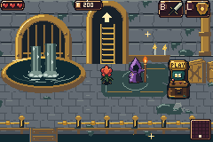](images/cream-ladder-walk.gif) | [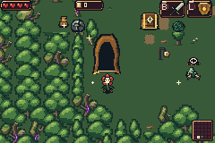](images/forest-door.png) |

| Forest overview with actual features | Cream room zoom with exact markers |
| --- | --- |
| [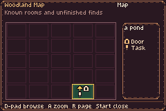](images/forest-map.png) | [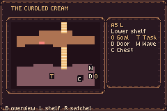](images/cream-map-zoom.png) |

| Cream hunting quest, genuinely completed | Memory Recall, genuinely completed |
| --- | --- |
| [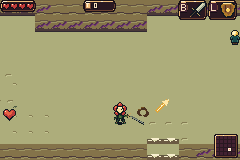](images/cream-hunt.png) | [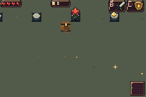](images/memory-recall.png) |

| Blue fusion changes actual access | Three-wave portal's paired pocket |
| --- | --- |
| [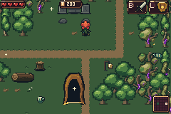](images/blue-fusion.png) | [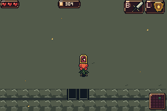](images/paired-pocket.png) |

The following isolated mechanism recordings use the disclosed equipment and
protection fixtures; their input traces require a living player throughout.

| Upper bridge, lower underpass and separate rewards | Cart crossing water and stopping on dry ground |
| --- | --- |
| [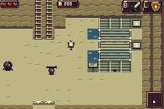](images/bridge-underpass.gif) | [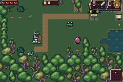](images/cart-water-crossing.gif) |

[Actual Cream parachute descent](images/cream-parachute.gif).

Opening gifts and additional ending verification

[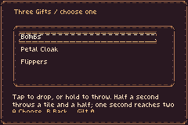](images/starting-gift.png)
[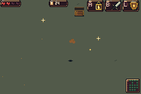](images/earth-pickup.png)

[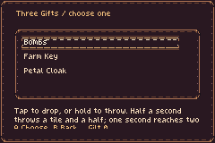](images/fresh-run.png)

[Gallery file provenance](gallery-provenance.json) records the unchanged source
captures, dimensions, hashes and ROM identity. Large review reports have readable summaries with adjacent `.json.gz` files
that decode to the exact recorded originals. The full archive includes original
input traces, additional native clips and explicitly labelled camera mosaics.

## Qualification and implementation

[Exact final verification and limits](../bartgame/docs/regional-integration/VERIFICATION.md)
separates actual native interactions from source, asset and host checks.
[Acceptance criteria](../bartgame/docs/regional-integration/ACCEPTANCE.md),
[events](../bartgame/docs/handoff-restoration/EVENTS.md),
[placement](../bartgame/docs/handoff-restoration/REGIONAL_CONTENT.md),
[mechanisms](../bartgame/docs/handoff-restoration/REGIONAL_MECHANISMS.md) and
[map/save migration](../bartgame/docs/regional-integration/MAP_SAVE.md) describe
the implementation and the preserved behavior.

The physical placement sweep executes production C across1,024 seeds and
102,400 room states, including33,324 actual field stamps. Independent reach
checks compare393,216 capability-state masks and614,400 individual site queries.
Those are host proofs, not native playthroughs.

Actual mGBA tests cover all13 eligible quest/origin pairs, the complete earned
four-seal route, the original Heart and Cream boss wins, published-save
migration, map preservation, physical fusions and paired events. The ordinary
loadout arrival survey checks32 generated interior classes without Flippers.
The quest/chain input proofs never grant inventory, health or completion.
Isolated mechanism and stress suites disclose their equipment/protection
fixtures separately. Specialized Scavenger cover/dig and every watcher-failure
combination are outside the regional native quest table; their implementation
and host/source coverage are not presented as individual native playthroughs.

The performance survey retains the generated rosters and tests296 scenarios,
including75 Forest rooms and150 Cream shelf workloads across three seeds.
It records52,642 updates in52,647 eligible frames: five isolated single-frame
holds, no consecutive missed updates. All150 Cream samples retain27,000/27,000
updates. This matches the preceding integrated candidate's timing totals;
these measurements establish sampled behavior rather than every possible seed.

All126 original sheets retain their IDs, geometry, palettes and every original frame.
Two service frames append. Seventeen previously empty Forest mobility mappings
become resident; every original visible mapping and its referenced pixels stay
protected. The Cream ladder is copied from the existing Forest composition.
