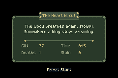
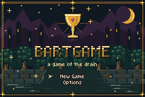
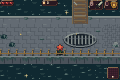

# A fresh run after victory

Winning now retires the active run. Returning to the title or restarting the
ROM offers **New Game** and **Options**, rather than Continue into a finished
forest. Starting again generates a fresh maze with the normal starting gear.
The cabinet's discovery journal and appearance preferences remain intact.

**[Download updated main ROM](../downloads/victory-reset-bcb7a0e/bartgame-bcb7a0e.gba)** ·
**[Download ZIP](../downloads/victory-reset-bcb7a0e/bartgame-bcb7a0e.zip)** ·
[Checksums](../downloads/victory-reset-bcb7a0e/SHA256SUMS.txt)

Completed v1/v2 saves from older builds are also rejected. Unfinished saves
remain compatible, including ordinary cleared non-goal rooms. A post-Heart
save attempt cannot recreate a completed checkpoint. Victory statistics stay
on the ending screen; only the run-save header is invalidated.

The three new enemies, original music and sewer memory cabinet from the
[previous release](../arcade-journal-review/README.md) are included.

| Actual victory summary | Title after victory | Starting a fresh run |
| --- | --- | --- |
|  |  |  |

These are untouched native240×160 mGBA screenshots from the delivered ROM.
The test defeats the actual40-HP Heart with real sword inputs and collects
its real Grail. Navigation, player positioning/healing/inventory and profile
fixtures are disclosed; enemy HP, AI state and the victory state are not
assigned to fabricate that result. Separate serialized fixtures test old
completed and unfinished record admission.

Game source:
[`bcb7a0e0`](https://github.com/natertott/bartgame/commit/bcb7a0e0f0fdb8421c295cbab82f50edb6d88429).
The9,538,772-byte normal ROM has SHA256
`40c4b7f3738459c7b4fe3866687086fb6441196f4e871ec2f839663cc619e559`.

- [53/53 actual lifecycle checks](validation/victory.json): victory, same-session/cold restart, fresh generation, completed-save recovery, journal/preferences and unfinished saves.
- [6/6 existing save compatibility checks](validation/unfinished-save-compatibility.txt): migration, Continue, progression rewards and corrupt checksums.
- [43/43 decoded sprite/terrain checks](validation/native-assets.json): all existing native graphics retained.
- [Frozen build inputs](validation/build.json) and [complete evidence](../downloads/victory-reset-bcb7a0e/victory-evidence.zip): matching ROM/ELF/map/header, exact test tool, five native screenshots and original report.

[Run lifecycle policy](../bartgame/docs/RUN_LIFECYCLE.md) records the behavior
and old dead-Heart save recovery. No save format/version or profile layout
changes are required.
